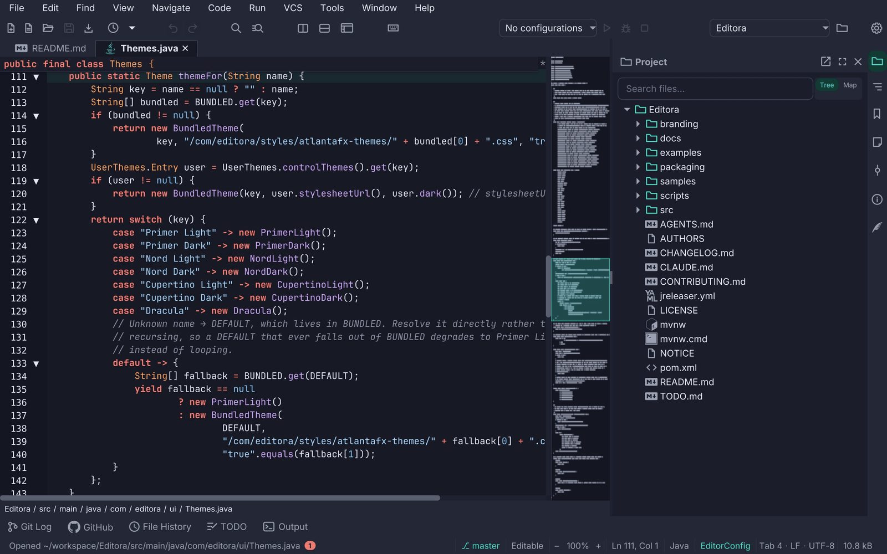
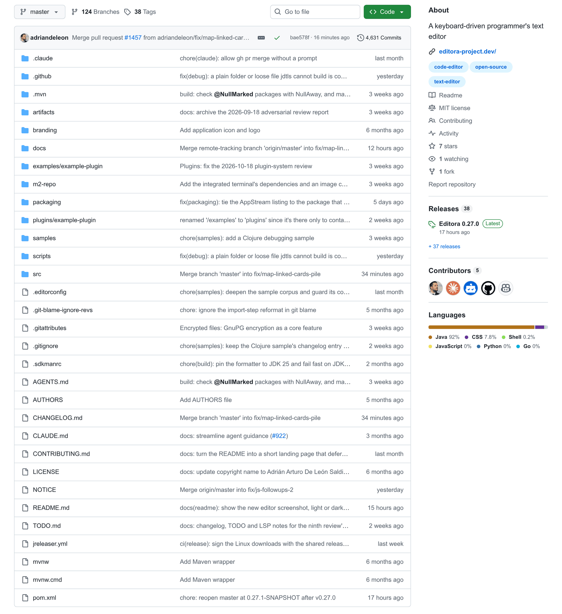
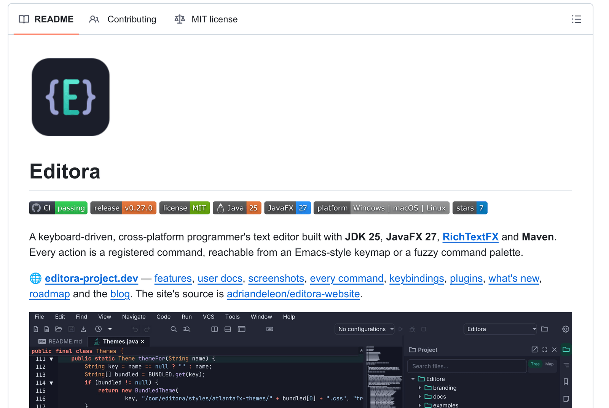
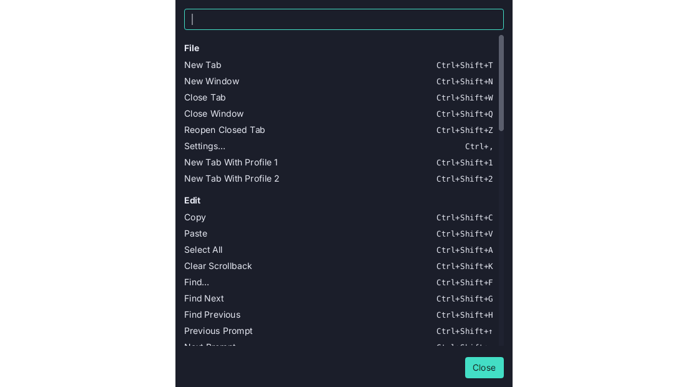
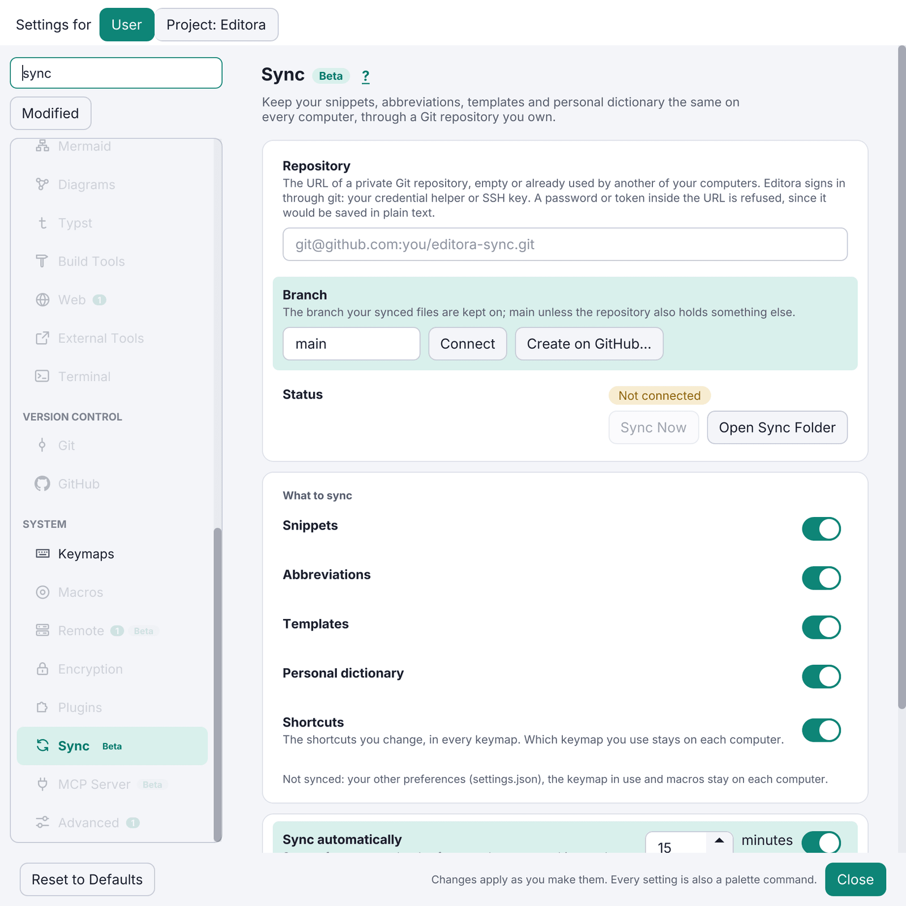
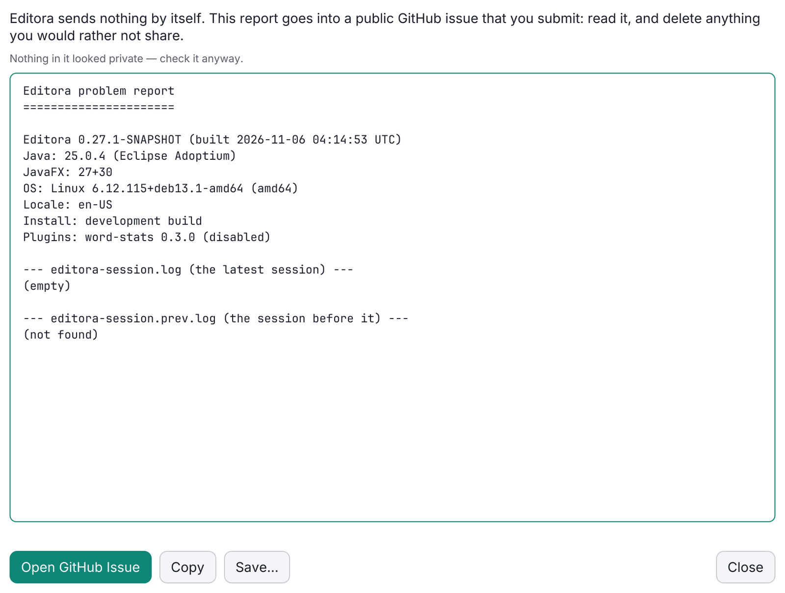
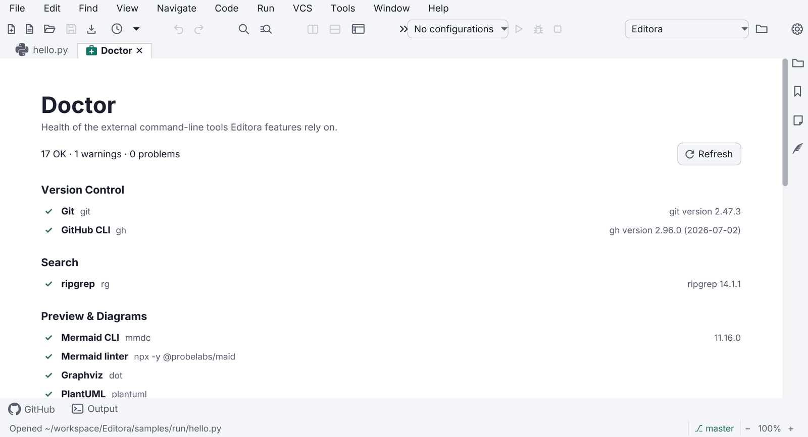
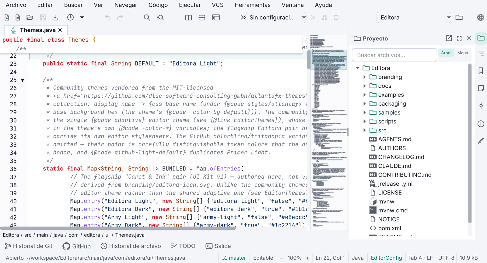
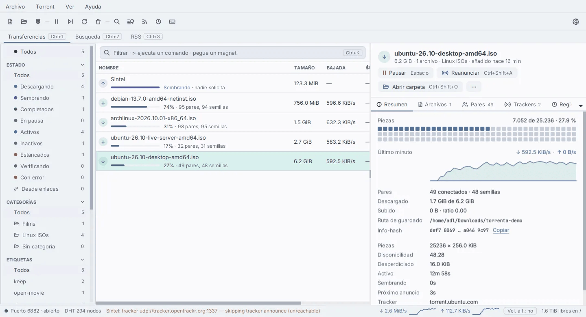

# adl Desktop Apps Guidelines

UI, UX and platform rules for adl's JavaFX desktop apps: **Editora**, **Torrenta**, **Termina**, **Modula**,
**Mirada** and **nux**. Editora is the reference implementation.

**MUST** is a release blocker for a new app. **SHOULD** is expected unless the app has a stated reason.
**MAY** is a pattern worth copying when the app grows into it.

**Version 1.0.0 · 2026-11-06** · Web version: <https://pauta-project.dev/1.0.0/>

## Principles



1. **Keyboard first.** Every action works without a mouse. The mouse is a shortcut to commands, not the
   other way round.
2. **Every feature is a command.** One registry of commands with ids. Menus, toolbar buttons, the command
   palette and key bindings all run commands by id. Nothing is wired straight to logic.
3. **Changes apply as they are made.** Settings have no Save button. A change reaches every open window.
4. **Nothing fails silently.** Every failure reaches the status bar, the Message Log or the Debug Log, and
   the user can turn any of it into a GitHub issue.
5. **Local first, nothing sent without asking.** No telemetry. The only automatic network call is a
   once-a-day release check the user can turn off. Problem reports are built locally and submitted by the
   user.
6. **Same app on every OS.** Windows, macOS and Linux get the same features and the same installer
   quality. Platform differences live behind one class, never scattered `if (isMac)` checks.
7. **Users' data outlives versions.** Config files carry a schema version and migrate forward. An older
   build never overwrites a newer config.

## New app checklist

Each group links to the page with the rules and the Editora code to copy. Everything here is a MUST unless it says
SHOULD.

### Platform

[Platform baseline](../platform/)

- [ ] JDK 25 or newer (`release` 25 is the floor) and JavaFX 27 or newer
- [ ] One JPMS module, `com.<app>`
- [ ] Maven Wrapper committed (`mvnw`, `mvnw.cmd`, `.mvn/wrapper/`)
- [ ] AtlantaFX light and dark themes, following the system by default
- [ ] Inter bundled and attached to every scene and dialog (SHOULD)

### Code quality

[Code quality gates](../quality/)

- [ ] Every package `@NullMarked`; NullAway on Error Prone fails the build
- [ ] Spotless with Palantir Java Format
- [ ] JUnit 5 and headless FX tests (`-Dglass.platform=Headless`), FX tests tagged `fx`
- [ ] JaCoCo check at 0.90 lines and 0.90 methods

### Keyboard and commands

[Keyboard first](../keyboard/)

- [ ] One `CommandRegistry`: every action is a command with an id
- [ ] Command Palette as an in-scene overlay, not a `Popup`
- [ ] Emacs and CUA keymaps at least, with user overrides on top

### Settings

[Settings](../settings/)

- [ ] Settings window with a page sidebar, search and live apply
- [ ] A palette command for every setting
- [ ] Versioned config in `~/.<app>`, with migrations and downgrade backups
- [ ] Export and import of the config folder
- [ ] Settings sync through a Git/GitHub repository (SHOULD)

### Diagnostics

[Diagnostics and support](../diagnostics/)

- [ ] Status-bar echo and Message Log
- [ ] Debug Log with a session file, and an uncaught exception handler
- [ ] Daily update check with an off switch; About shows versions and update status
- [ ] Report a Problem (redacted, prefilled GitHub issue) and `--report`

### Command line and languages

[Command line](../command-line/) · [Internationalization](../i18n/)

- [ ] `--help`, `--version`, `--config-dir`, `--dev`
- [ ] Single instance per config folder
- [ ] At least six message catalogs, with a parity test

### Repository

[Repository documents](../repository/)

- [ ] `README.md` with the badge row and a light/dark hero screenshot
- [ ] `CHANGELOG.md` in Keep a Changelog format
- [ ] MIT `LICENSE`, and `NOTICE` with every third-party licence
- [ ] `AGENTS.md`, with a one-line `CLAUDE.md` pointing to it
- [ ] `CONTRIBUTING.md`, `docs/` and `branding/`
- [ ] `.github/ISSUE_TEMPLATE/bug_report.yml`

### Packaging and signing

[Packaging, signing and release](../release/)

- [ ] jpackage installers through JReleaser: Linux x64 and arm64, macOS arm64 and x64, Windows x64
- [ ] macOS `.dmg` signed with Developer ID, notarized and stapled
- [ ] Linux downloads with `.asc` signatures from the shared release key
- [ ] Build provenance attestations for every download
- [ ] Windows `.msi` Authenticode, once the certificate is chosen (SHOULD)
- [ ] Homebrew cask in `adriandeleon/homebrew-tap` and a winget package `AdrianDeLeon.<App>` (SHOULD)

### CI/CD (GitHub Actions)

[CI/CD](../release/#cicd-github-actions)

- [ ] `ci.yml` on every push and pull request: Format and Build & Test, both required checks for `master`
- [ ] `full-tests.yml` on Linux, macOS and Windows: daily, on a `full-ci` label, before every release (SHOULD)
- [ ] `release.yml` on a `v*` tag that matches the pom, with a `workflow_dispatch` dry run
- [ ] Every third-party action pinned to a commit SHA
- [ ] Dependabot for `github-actions` and `maven`
- [ ] `permissions: contents: read` by default; write only in publishing jobs
- [ ] `timeout-minutes` on every job; superseded pull-request runs cancelled
- [ ] Test and coverage reports uploaded; coverage totals in the job summary
- [ ] Signing skipped without secrets, but a tag without them fails
- [ ] A smoke launch of the packaged app on each OS before release

## Platform baseline

| Area | Rule | Level | Editora reference |
|---|---|---|---|
| JDK | **JDK 25 or newer.** `maven.compiler.release` 25 is the floor, not the ceiling: build and bundle a current JDK (the enforcer range is `[25,)`, open-ended). The bundled runtime is jlinked; users never install Java | MUST | `pom.xml` |
| JavaFX | **JavaFX 27 or newer** (`javafx.version` 27 is the floor) | MUST | `pom.xml` |
| Modules | One named JPMS module (`com.<app>`); `module-info.java` opens only what reflection, FXML and Jackson need | SHOULD | `src/main/java/module-info.java` |
| Theme toolkit | **AtlantaFX 3.x** (`atlantafx-base`) for controls; light and dark themes; app CSS uses AtlantaFX `-color-*` tokens, never hex literals | MUST | `ui/Themes.java`, `app.css` |
| UI font | Bundle **Inter** (Regular, Bold, Italic, BoldItalic + `OFL.txt`); register with `Font.loadFont` before any stylesheet; attach `ui-font.css` to every scene and dialog pane. Gives the family one look on every OS | SHOULD | `ui/Fonts.java` |
| Build | **Maven** with the **Maven Wrapper** (`mvnw`, `mvnw.cmd`) committed, so `./mvnw` works on a clean machine | MUST | `mvnw`, `.mvn/wrapper/` |
| Null safety | **JSpecify** annotations, checked by **NullAway** on **Error Prone** at compile time. Every package is `@NullMarked` in its own `package-info.java` | MUST | `docs/conventions.md#null-annotations-jspecify-checked-by-nullaway` |
| Formatting | **Spotless** with Palantir Java Format; CI fails an unformatted change | MUST | `pom.xml` (spotless plugin) |
| Tests | **JUnit 5** + **TestFX** over JavaFX's built-in **Headless** glass platform (`-Dglass.platform=Headless`), so FX tests need no display, no xvfb and no Monocle | MUST | `docs/testing.md`, `FxTestSupport` |
| Coverage | **JaCoCo** `check` at `mvn verify`: **≥ 0.90 lines, ≥ 0.90 methods**, ≥ 0.79 branches, plus per-package floors | MUST | `pom.xml` `jacoco-check` |
| Logging | `java.util.logging`, captured in-app by the Debug Log | SHOULD | `ui/DebugLog.java` |
| JSON config | Jackson POJOs with a `SCHEMA_VERSION` each | SHOULD | `config/Settings`, `config/migration/ConfigSchema.java` |


### Everyday commands (identical in every repo)

```bash
./mvnw javafx:run                 # run the app
./mvnw test                       # unit + headless FX tests, writes the JaCoCo report
./mvnw spotless:apply             # format
./mvnw verify                     # full gate: tests, coverage check, NullAway
./mvnw -Pfatjar package           # runnable fat jar for this OS
./mvnw clean -Pdist package       # native installer for this OS (clean is mandatory)
```

The `clean` in every `-Pdist` build is mandatory: incremental compilation can leave synthetic enum-switch
classes out of `target/classes`, and jlink then ships an app whose keyboard fails on the first keypress.

## Repository documents

| File | What it holds | Level |
|---|---|---|
| `README.md` | A landing page, about 200 lines: logo, badges, one-paragraph pitch, hero screenshot, highlights, install, build, command line, config folder, licence. Detail lives on the website. | MUST |
| `CHANGELOG.md` | [Keep a Changelog 1.1](https://keepachangelog.com/en/1.1.0/) + SemVer. An `## [Unreleased]` section with Added / Changed / Fixed / Removed; each entry opens with a bold one-line summary written for users. | MUST |
| `LICENSE` | MIT, "Copyright (c) 2026 Adrián Arturo De León Saldivar". | MUST |
| `NOTICE` | App name, copyright, "licensed under the MIT License", then every bundled third-party component with its licence (Inter is OFL, AtlantaFX is MIT, OpenJFX is GPLv2+CPE…). Ship it inside the installers too. | MUST |
| `AGENTS.md` (+ a one-line `CLAUDE.md` pointing to it) | Operational rules for coding agents: essential commands, worktree-per-task, change checklist. Not a changelog. | MUST |
| `CONTRIBUTING.md` | How to build, test, format, and open a PR. | MUST |
| `docs/` | `architecture.md`, `conventions.md`, `testing.md`, `gotchas.md`, `release.md`, `building-and-packaging.md`, `decisions/` (ADRs). | MUST |
| `TODO.md` | The open list, kept in the same PR as the change. | MAY |
| `.github/ISSUE_TEMPLATE/bug_report.yml` | Issue form whose field ids (`environment`, `report`) the in-app Report a Problem fills. | MUST |
| `branding/` | Source SVG of the icon; generated PNG/ICNS/ICO live in `packaging/`. | MUST |



### README badges (in this order)

```markdown
[](…/actions/workflows/ci.yml)
[](…/releases/latest)
[](LICENSE)


[](…/stargazers)
```



The hero screenshot is a `<picture>` with a dark `srcset` under `prefers-color-scheme: dark`, so GitHub
shows the screenshot that matches the reader's theme. Screenshots are taken at 2× by a headless harness so
they can be retaken after any UI change. The README states that the app is built with the help of AI
coding tools.

## Code quality gates

- **NullAway is an error, not a warning.** Put `@Nullable` on what may be null and fix the report; do not
  suppress it. A new package starts with its own `package-info.java` carrying `@NullMarked`.
- **Coverage floors are a regression net, not a target.** The build-wide floor is 0.90 lines and methods.
  Each package of 300+ lines gets its own floor about three points below its measured level; when a
  package's coverage rises, ratchet its floor up. A test (`BuildHygieneTest`) fails when the documented
  floor table and the pom disagree.
- **Prefer a pure decision helper plus unit tests.** Use the headless FX harness only when controller or
  toolkit behaviour is the point.
- **Tag FX tests `@Tag("fx")`**, so the pure suite runs alone with `-DexcludedGroups=fx`.
- **Guard tests that pay for themselves across the family:**
  - *Command sweep* runs every registered command in a real headless window (`CommandSweepFxTest`).
  - *Message parity*: every locale has every key; every `command.<id>` has a `.desc` (`MessagesTest`).
  - *Settings round trip*: every switch, number and choice survives a restart (`SettingsRoundTripFxTest`).
  - *Contrast*: text tokens keep their ratios in every theme (`StyleContrastTest`).
  - *Release supply chain*: signing and attestation steps stay where they are (`ReleaseSupplyChainTest`).
- **No sleeps in tests.** Own workers and FX callbacks with a scope (`AsyncTestScope`) and use latches.
- **A test window writes only inside its temp folders**, never in the real home directory.

## Keyboard first

### Commands

- Every user-facing action is a `Command` (id, title, runnable) registered in one `CommandRegistry`.
- Command ids are dotted and grouped by area: `file.open`, `view.toggleStatusBar`, `help.reportProblem`.
- Titles come from `command.<id>` and palette descriptions from `command.<id>.desc` in the message
  catalogs, so a registered command is localized and discoverable without extra work.
- A command that cannot run in the current context is shown greyed with a tooltip that says why, not
  hidden.

### Command Palette

- **MUST.** Opened by `M-x` in Emacs keymaps and `Ctrl/Cmd+Shift+P` in the others.
- Fuzzy matching over title, id and description; recently used commands first; each row shows the active
  key binding.
- It is an **in-scene overlay** in the window's root `StackPane`, not a `javafx.stage.Popup`. On Windows a
  Popup does not reliably take OS keyboard focus and the whole app can stop receiving keystrokes.
- The same picker (`QuickOpen`) serves every other list choice: recent files, themes, keymaps, settings
  values.


### Keymaps

- Ship presets as JSON resources: Emacs, CUA, IntelliJ, VS Code and Sublime, with `.mac.json` variants
  where Cmd replaces Ctrl.
- Layer order: base keymap → user overrides → plugin keymaps → the user's own bindings again, so the user
  always has the last word (`KeymapLayers`).
- A keymap editor in Settings lists every command with its chord, searchable, with conflict warnings.
- Never bake a chord into translated text. Derive the label from the active keymap.
- Multi-key prefixes (`C-x …`) show a which-key style hint listing the possible next keys.




### Focus and accessibility

- Every interactive control is reachable with Tab and operable with Space/Enter.
- Keyboard focus is drawn by one `:focus-visible` block at the end of `app.css`.
- Icon-only buttons are built by a helper (`Icons.button`) that sets both the tooltip and the accessible
  text.
- On/off rows use a keyboard-operable switch (`SettingSwitch`, `TOGGLE_BUTTON` role). A bare AtlantaFX
  `ToggleSwitch` is mouse-only.
- Readable text uses `-color-fg-muted` or stronger; `-color-fg-subtle` (about 3:1) is for disabled or
  decorative text only.
- Rows wrap instead of truncating to "…". Check German at 1024 px wide.

## Window shell


- **Status bar**, always present (toggleable). Its left side is the *echo area*: one line of feedback for
  the last action. Errors are red, warnings amber. Clicking it opens the Message Log.
- **Themes**: light and dark AtlantaFX themes plus a "follow the system" choice, switchable at run time
  without a restart. Semantic colours: amber = not durable yet (unsaved, read-only), red = broken,
  green = verified or added.
- **Title bar**: SHOULD use JavaFX 27's `HeaderBar` with `StageStyle.EXTENDED` to put the menu or tabs in
  the title bar, with a decorated-window fallback, and `useSystemMenuBar` on macOS.
- **Native dialogs** go through one helper (`Dialogs.styled`) because a dialog is its own scene and does
  not inherit the app stylesheet or the UI font.
- **Welcome page** when there is nothing to restore: Start actions (which run commands), Recent items, a
  Customize block (keymap and theme), Help links.
- **About** shows version, build, runtime (Java and JavaFX versions), licence, links, and the result of the
  last update check.
- **Window state**: size, position, maximized state and open items are restored on the next launch; a
  `--no-session` flag skips the restore.
- **Zoom**: UI and content zoom from the keyboard (`Ctrl/Cmd +`, `-`, `0`), persisted.
- **Modes** (MAY): Zen (no chrome), Simple (fewer menus for new users), Expert.


## Settings

### The Settings window

- **MUST.** Opened by `Ctrl/Cmd+,` and a palette command. A sidebar of pages with icons on the left, the
  page on the right, and a **search field on top**.
- **Search** finds a row by its title, description, visible text, its card or section heading, its page
  name and English keywords. Title hits rank above description hits; whole words above word starts. The
  page with the best match opens, and every non-matching row, heading and card is hidden
  (`SettingsSearch`).
- **Live apply.** No Save button. Text fields commit on Enter or focus loss; invalid numbers are marked and
  never committed.
- A change made in one window reaches every other open window.



### Adding a setting touches five places

1. **Model** field, default and accessors, with a schema bump and migration.
2. **Control**, built once, writing the field and applying it.
3. **Row** on its page with search keywords.
4. **Load** line that sets the control from the model, safe to run at any time.
5. **Palette command** that flips or prompts the same field, plus strings in every catalog.

### Config folder and schema

- Config lives in `~/.<app>` (`~/.<app>-dev` for `--dev`, any folder via `--config-dir` or
  `<APP>_CONFIG_DIR`).
- `settings.json` for preferences, `workspace-state.json` for session state, other stores in their own
  JSON files.
- Every versioned file has a `SCHEMA_VERSION` and a `v → v+1` migration step. A purely additive field uses
  an identity step.
- A file newer than the running build is backed up to `<name>.v<n>.bak` and defaults load: an older build
  never clobbers a newer config.
- **Export configuration** writes a timestamped `.zip` of the config folder (`ConfigExporter`). Import
  restores from one.

### Settings Sync (Git / GitHub)

- **SHOULD.** Optional sync of settings, keybindings and user data through a Git repository the user owns.
- Setup by pasting a repo URL, or **Create on GitHub** through the `gh` CLI. The account that can read the
  repo is pinned per clone, so machines with two GitHub accounts work.
- Automatic (on change and at start) and manual triggers. Machine-local keys (window size, paths) never
  sync.
- Conflict rule: on a same-entry conflict *this machine wins*. A backup is taken before any sync that
  replaces local files.
- Status shows as a pill in Settings and as echo messages; failures go to the Message Log.
- Reference: `sync/SyncEngine`, `sync/SyncMerge`, `sync/SyncAccount`, `ui/SettingsSync`,
  `docs/subsystems/settings-sync.md`.


## Diagnostics and support

| Feature | Behaviour | Level | Editora reference |
|---|---|---|---|
| **Message Log** | Session-only history of every echo-area message with `HH:mm:ss` times, newest first, bounded. Opened by clicking the status message; Esc closes; Clear empties it. | MUST | `ui/MessageLog`, `ui/MessageLogPopup` |
| **Debug Log** | Captures all `java.util.logging` records and uncaught exceptions in memory (bounded) **and** mirrors them to `<app>-session.log` in the config folder, keeping the previous one as `<app>-session.prev.log` so a crash is still visible next launch. A modeless window with Refresh, Copy, Clear, Export and Report a Problem. The only way to see logs in a packaged build. | MUST | `ui/DebugLog`, `ui/DebugLogWindow` |
| **Uncaught exception handler** | Installed first thing in `main`; routes to the Debug Log and an echo message. Never a stack trace dialog. | MUST | `DebugLog.install()` |
| **Update notification** | Reads GitHub `/releases/latest`. Once per app session (not per window), at most once a day, a few seconds after the first frame. A newer version shows a status-bar notice and a line in About; "Check for Updates" runs it by hand. Off switch in Settings. Never downloads or installs by itself. | MUST | `update/UpdateCheck`, `ui/UpdateCheckScheduler`, `ui/UpdateCoordinator` |
| **Report a Problem** | Help → Report a Problem builds a report (version, OS, runtime, settings summary, recent Debug Log), **redacts** it (home paths, user names, tokens, hosts), shows it editable, copies it to the clipboard and opens a prefilled GitHub issue from `bug_report.yml`. Over about 7,500 characters the link falls back to "paste from the clipboard". `<app> --report` does the same from the command line for when the app cannot start. Nothing is uploaded. | MUST | `report/ProblemReport`, `report/Redactor`, `report/ReportCommand`, `ui/ReportProblemWindow` |
| **Doctor** | A page that checks the environment (external tools, versions, permissions, paths) with a status per row and a fix or link for each failure. | SHOULD | `doctor/*`, `ui/DoctorPane` |
| **Crash recovery** | Unsaved user work is snapshotted off the FX thread and offered back after a crash. | SHOULD (apps with user documents) | `recovery/RecoveryService` |







## Command line and launch

Every app accepts at least:

| Flag | Meaning |
|---|---|
| `--help`, `--version` | Printed before the GUI starts; plain English, not translated. |
| `--config-dir <dir>`, `--dev` | Use another config folder (`~/.<app>-dev` for `--dev`). |
| `--new-instance` | Start a second process instead of handing off to the running one. |
| `--no-session` | Do not restore the last session. |
| `--report` | Write a redacted problem report and open the GitHub issue. |
| `[files…]` | Open these items. |

- **Single instance per config folder.** A second launch hands its arguments to the running app over a
  local endpoint and exits (`ipc/SingleInstance`). On macOS, `openFiles` Apple Events reach the running
  app (`MacOpenFiles`). An advisory lock tells two processes on one folder about each other
  (`config/InstanceLock`).
- The headless-AWT guard is the first statement of `main`.
- A `.app` launched from Finder inherits a stripped `PATH`: resolve external tools through the login shell's
  `PATH`.

## Internationalization

### Languages

Every app ships **at least these six**. They are a floor, not the set: an app SHOULD add languages as people ask
for them, and a new app can start with more.

| Language | Catalog |
|---|---|
| English (base) | `messages.properties` |
| Spanish | `messages_es.properties` |
| Portuguese | `messages_pt.properties` |
| French | `messages_fr.properties` |
| Italian | `messages_it.properties` |
| German | `messages_de.properties` |

Adding a language:

- Add `messages_<code>.properties` with every key, and the language to the Settings language picker. The parity
  test then holds it to the same keys as the others.
- Translate for real; do not ship English values in another language's catalog.
- Check the layout in the new language at 1024 px wide. German is today's longest; rows must wrap, never cut.
- Scripts beyond Latin need more than strings. Chinese, Japanese and Korean need a font fallback, because Inter
  has no CJK glyphs. Arabic and Hebrew need `NodeOrientation.RIGHT_TO_LEFT` on every scene.

### Rules

- Never pass a raw English literal to a control: `tr("some.key")` from one `Messages` class.
- Every language has a real translation of every key. A test fails the build when a key is missing in any
  catalog.
- `MessageFormat` rules: in a value with a placeholder, double literal apostrophes; identifiers such as line
  numbers and ports use `{0,number,#}` so they are not digit-grouped.
- Untranslated on purpose: technical identifiers, `--help` and `--version` text.




## Packaging, signing and release

### Targets

Each target builds on its own GitHub-hosted runner. jpackage and JavaFX natives are host-specific, so there
is no cross-building.

| Target | Runner | Downloads |
|---|---|---|
| Linux x64 | `ubuntu-latest` | `.deb`, `.rpm`, `.AppImage`, `.tar.gz`, fat jar |
| Linux arm64 | `ubuntu-24.04-arm` | `.tar.gz` (and `.deb` where the app's tooling allows), fat jar |
| macOS arm64 | `macos-15` | `.dmg` |
| macOS x64 | `macos-15-intel` | `.dmg` (the last Intel image, good to about Aug 2027) |
| Windows x64 | `windows-latest` | `.msi`, fat jar |
| Windows arm64 | — | **Not possible yet**: OpenJFX publishes no `win-aarch64` natives (JDK-8314064). ARM users run the x64 MSI under emulation. |

- Downloads are named `<App>-<version>-<target>.<ext>`.
- jpackage builds the installers through the Maven `dist` profile. **JReleaser** (`jreleaser.yml`) only
  creates the GitHub release: it attaches the files, `checksums_sha256.txt` and the changelog section.
- The maven version is the single source of truth: `-SNAPSHOT` on `master`, a tag `vX.Y.Z` releases, a
  post-release job bumps to the next snapshot.
- GitHub releases are immutable, so a **release-asset check** fails the run before publishing when an
  expected file is missing.
- **Linux desktop integration**: a `.desktop` file whose `StartupWMClass` is the JavaFX app class, plus
  AppStream metainfo `io.github.adriandeleon.<App>`.
- **AOT cache** (JDK 25 Leyden): a training run during packaging cuts start-up time; Linux legs run it under
  `xvfb`.

### Install methods

| Channel | Platform | What the user runs | How it is published | Level |
|---|---|---|---|---|
| GitHub release | All | Download the `.dmg`, `.msi`, `.deb`, `.rpm`, `.AppImage` or `.tar.gz` | JReleaser attaches every file, with checksums | MUST |
| Homebrew cask | macOS (Apple Silicon) | `brew install --cask adriandeleon/tap/<app>` | JReleaser's `brew` packager writes the cask to [`adriandeleon/homebrew-tap`](https://github.com/adriandeleon/homebrew-tap) | SHOULD |
| winget | Windows x64 | `winget install AdrianDeLeon.<App>` | JReleaser's `winget` packager opens a pull request on [`microsoft/winget-pkgs`](https://github.com/microsoft/winget-pkgs) from the `adriandeleon` fork | SHOULD |

- **One tap for the family.** The official homebrew-cask repository has notability rules a new project does not
  meet, so the casks live in a personal tap. A cask takes exactly one artifact: it serves Apple Silicon, and
  Intel Macs use the `macos-x64` DMG.
- **winget is reviewed by Microsoft.** The first submission for a new publisher is checked by a person, not
  merged automatically. The package identifier is `AdrianDeLeon.<App>`, the moniker the app's lower-case name.
- **Both need a `PACKAGES_TOKEN` secret**, a classic personal access token with `repo` scope: the workflow's own
  token cannot write to the tap or open a pull request on the fork. Without it JReleaser skips both packagers and
  the GitHub release still publishes.
- `jreleaser package --basedir .` writes the cask and the winget manifests locally, to check them without
  releasing.
- **Status on 2026-11-06:** the tap exists and holds no casks yet. Torrenta and Termina have both packagers
  configured, waiting for the token. Mirada's first winget submission
  ([microsoft/winget-pkgs#471599](https://github.com/microsoft/winget-pkgs/pull/471599)) is open.

### Signing

| Platform | How | Status in the family |
|---|---|---|
| macOS `.dmg` | Developer ID Application certificate (team 8JKSF797L8), hardened runtime with per-app entitlements, `notarytool` submission, stapled ticket, `spctl` check, then a smoke launch of the notarized app. Secrets per repo: `MACOS_CERT_P12`, `MACOS_CERT_PASSWORD`, `APPLE_API_KEY_P8`, `APPLE_API_KEY_ID`, `APPLE_API_ISSUER`. A tag without the secrets fails. | **Done** in all six |
| Linux `.deb` `.rpm` `.AppImage` `.tar.gz` | One shared OpenPGP release key ("Adrian De Leon (release signing)"). A separate `sign-linux` job: `rpmsign` for `.rpm`, a debsigs origin signature for `.deb`, and an armoured `.asc` beside every file. Public key committed as `packaging/linux/signing-key.asc` and attached to each release. Secrets `LINUX_GPG_KEY`, `LINUX_GPG_PASSPHRASE`. Shared scripts `sign-linux-packages.sh` and `check-linux-signatures.sh`. | Editora, Torrenta, Termina, Modula; Mirada partly; nux not yet |
| Windows `.msi` | Authenticode. **Open decision**: SignPath Foundation (free for OSS), Certum Open Source cert, or Azure Trusted Signing. Until then MSIs are unsigned and SmartScreen warns. | **Not done** in any app |
| All | GitHub **build provenance attestations** (`actions/attest-build-provenance`) for every download; `gh attestation verify` checks them. | Editora, Termina |

- Signing steps skip cleanly when the secrets are absent, so a fork or a dry run still builds.
- The certificate renews before 2027-11-30; the Apple membership before 2027-10-31.

### CI/CD (GitHub Actions)

| Workflow | When | What | Level |
|---|---|---|---|
| `ci.yml` | Every push to `master` and every pull request | **Format** (`spotless:check`) and **Build & Test** (`./mvnw verify`, coverage gate included) on JDK 25. Both are required status checks for `master`. | MUST |
| `full-tests.yml` | Daily (cron), on a pull request labelled `full-ci`, and before every release | The full suite on Linux, macOS and Windows; flaky tests listed in the job summary. | SHOULD |
| `release.yml` | A `v*` tag that matches the pom version; `workflow_dispatch` as a dry run | The five-target matrix, signing jobs, attestations, the release-asset check, JReleaser, then the bump to the next snapshot. A dry run builds and signs and publishes nothing. | MUST |

Every workflow:

- Pins each third-party action to a commit SHA, with its version in a comment
  (`actions/setup-java@b843ebf… # v6.1.0`). Dependabot updates `github-actions` and `maven` weekly.
- Starts from `permissions: contents: read`; only a job that publishes asks for write access, in its own block.
- Sets up Temurin JDK 25 with `actions/setup-java` and `cache: maven`.
- Puts `timeout-minutes` on every job, and uses `concurrency` to cancel a superseded pull-request run, never a run
  on `master`.
- Uploads the surefire reports when tests fail and the JaCoCo report always; writes the coverage totals to the
  job summary.
- Skips signing cleanly when the secrets are absent (forks, dry runs); a tag without them fails.
- Launches the packaged app once on each OS before a release (a smoke test).

## Feature matrix

Surveyed on 2026-11-05 from each repository's default branch. ● has it, ◐ partly or differently,
— not found.

**What the apps are.**

| App | What it is | Homepage | Source |
|---|---|---|---|
| Editora | Programmer's text editor (the reference) | [editora-project.dev](https://editora-project.dev/) | [adriandeleon/Editora](https://github.com/adriandeleon/Editora) |
| Torrenta | BitTorrent client | [torrenta-project.dev](https://torrenta-project.dev/) | [adriandeleon/torrenta](https://github.com/adriandeleon/torrenta) |
| Termina | Terminal emulator | [termina-project.dev](https://termina-project.dev/) | [adriandeleon/Termina](https://github.com/adriandeleon/Termina) |
| Modula | Software-defined-radio receiver | — | [adriandeleon/Modula](https://github.com/adriandeleon/Modula) |
| Mirada | Fast image viewer (GraalVM native image) | — | [adriandeleon/Mirada](https://github.com/adriandeleon/Mirada) |
| nux | UPS monitor for Network UPS Tools, in the tray | — | [adriandeleon/nux](https://github.com/adriandeleon/nux) |

### Platform and repository


| | Editora | Torrenta | Termina | Modula | Mirada | nux |
|---|:-:|:-:|:-:|:-:|:-:|:-:|
| JDK 25+ and JavaFX 27+, JPMS module, `mvnw` | ● | ● | ● | ● | ● | ● |
| AtlantaFX 3 | ● | ● | ◐ vendored CSS | ● Primer | ● Cupertino | ● Primer |
| Inter UI font (SHOULD) | ● | ● | ● | — Plex Mono | — | — |
| NullAway + every package `@NullMarked` | ● | ● | ● | ● | ● | — |
| Spotless (Palantir) | ● | ● | ● | ● | ● | — |
| JaCoCo gate | ● 0.90 L/M | ● 0.90 L | ◐ per-package | — | — | — |
| Headless FX tests | ● | ● | ● | — | ● | ● |
| Six or more message catalogs | ● | ● | ● | — | — | ● |
| README badges + screenshot | ● | ● | ● | ● | ◐ no shot | ● |
| Keep a Changelog format | ● | ◐ | ◐ | ● | ◐ | ● |
| MIT `LICENSE` + `NOTICE` | ● | ● | ● | ● | ● | ● |
| `AGENTS.md` canonical, `CLAUDE.md` a pointer | ● | ◐ `CLAUDE.md` only | ● | ◐ `CLAUDE.md` only | ● | ◐ copy |
| `CONTRIBUTING.md` | ● | — | — | — | — | — |
| `docs/` and `branding/` | ● | ● | ● | ● | ● | ● |
| `bug_report.yml` issue form | ● | ● | — | — | — | — |
| Dependabot | ● | ● | — | ● | — | ● |


### Release and signing


| | Editora | Torrenta | Termina | Modula | Mirada | nux |
|---|:-:|:-:|:-:|:-:|:-:|:-:|
| JReleaser | ● | ● | ● | — | — | — |
| Five-target matrix (Linux x64/arm64, macOS arm64/x64, Windows x64) | ● | ◐ | ● | ◐ no Linux arm64 | ● | ● |
| macOS signed + notarized `.dmg` | ● | ● | ● | ● | ● | ● |
| Linux OpenPGP `.asc` signatures | ● | ● | ● | ● | ◐ rpm + checksums | — |
| Windows `.msi` Authenticode | — | — | — | — | — | — |
| Build provenance attestations | ● | — | ● | — | — | — |
| Homebrew cask / winget manifests | — | ● | ● | — | ◐ winget | — |
| `.desktop` file + AppStream metainfo | ● | ● | ● | ● | ◐ no metainfo | ◐ no metainfo |
| AOT start-up training | ● | — | ● | — | ● | — |


### User-facing features


| | Editora | Torrenta | Termina | Modula | Mirada | nux |
|---|:-:|:-:|:-:|:-:|:-:|:-:|
| Command registry + Command Palette (in-scene overlay) | ● | ● | ● | ● | ● | ● |
| Keymap presets | ● 9 | — | — | — | — | — |
| Keybinding editor / shortcuts reference | ● | ● | ● | — | ◐ | — |
| Settings window | ● | ● | ● | ● | ● | ● |
| Settings search | ● | ● | ● | — | — | — |
| Settings sync (Git / GitHub via `gh`) | ● | ● | ● | — | — | — |
| Message Log (status-bar history) | ● | ● | — | — | — | — |
| Debug Log + uncaught exception handler | ● | ● | ● | — | — | — |
| Update notification (GitHub releases) | ● | ● | ● | ● | — | ● |
| Report a Problem → GitHub issue (+ `--report`) | ● | ● | — | — | — | — |
| About window with runtime versions | ● | ● | ● | ● | ● | ● |
| Welcome page | ● | ● | — | — | — | — |
| Doctor / diagnosis | ● | ◐ per torrent | — | ◐ native libs | — | — |
| Single instance (hand off to running app) | ● | ● | — | — | — | ● |
| `--config-dir` and other CLI flags | ● | ● | ● | — | — | ◐ |
| Light / dark / follow system, live switch | ● | ● | ● | ● | ● | ● |
| Extended title bar (`HeaderBar`, `StageStyle.EXTENDED`) | ● | ◐ opt-in | ● | — | ● | — |
| Desktop notifications | ● | ● | ● | ● | — | ● |
| Tray icon (SNI over D-Bus, AWT fallback) | — | ● | — | ● | — | ● |
| Window geometry restore | ● | ● | ● | — | ● | — |
| Config export / import | ● | — | — | — | — | — |
| Plugins | ● | — | — | — | — | — |

## Shared features

Beyond the list this guide started from, these already exist in two or more apps and belong in the
guideline:

1. **`AppInfo` + `build-info.properties`.** Version, build time and commit come from a Maven-filtered
   resource, read by About, `--version`, the update check and problem reports. *(all six)*
2. **Shared `update/` package** (`UpdateCheck` pure parser, `UpdateService`, `ReleaseInfo`). *(5 apps)*
3. **Pure palette core shared verbatim**: `FuzzyMatch`, `MatchText`, `KeyChord`, `PaletteKeys`,
   `TextInputKeys`. Emacs-style caret keys work inside the palette's query field. *(Editora → Termina →
   Mirada, Torrenta)*
4. **Shortcuts reference window**: a searchable list of every key, opened from Help. *(Termina, Mirada)*
5. **Extended title bar** with JavaFX 27 `HeaderBar` and `StageStyle.EXTENDED`, falling back to a
   decorated window; the macOS system menu bar via `useSystemMenuBar`. *(Editora, Termina, Mirada,
   Torrenta opt-in)*
6. **macOS app-menu integration**: About and Settings in the application menu, `openFiles` Apple Events
   reaching the running app (`MacOpenFiles` / `MacHandlers`). *(Editora, Mirada, Torrenta)*
7. **Tray package** (`AwtTray`, `SniTray`, `StatusNotifierItem` over dbus-java) plus **autostart** (XDG
   autostart, LaunchAgent, `HKCU\…\Run`) and `--minimized`. *(Torrenta, Modula, nux)*
8. **Desktop notifications** through one `Notifier`: `notify-send`/`gdbus` on Linux, `osascript` on macOS,
   a PowerShell toast on Windows, the tray as fallback. *(Torrenta, Termina, Modula, nux, Editora)*
9. **Window geometry that stays on screen**: `WindowGeometry` / `WindowPlacement` restore size and
   position but move a window back when its monitor is gone. *(Editora, Torrenta, Termina, Mirada)*
10. **Linux desktop integration**: a `.desktop` file whose `StartupWMClass` matches the JavaFX app class
    (`com.<app>.App`), AppStream metainfo `io.github.adriandeleon.<App>`, multi-size PNG icons.
11. **Package-manager channels**: Homebrew cask and winget manifests generated by JReleaser.
    *(Torrenta, Termina, Mirada)*
12. **Atomic config writes** with a file lock, and values clamped to a valid range when read.
    *(Termina, nux, Mirada)*
13. **Dev capture / screenshot mode** (`DevCapture`, nux `--screenshot=`): renders the real UI headless at
    2× for README, website and bug-report images. *(Torrenta, Termina, nux; Editora uses an external headless harness)*
14. **Smoke launch in CI**: the packaged app is started and checked (still running after 20 s, or
    `--version`) on every OS before release. *(all six)*
15. **Release dry run**: `workflow_dispatch` builds and signs with throwaway credentials and publishes
    nothing. *(Editora, Modula, Mirada, nux, Termina)*
16. **`SECURITY.md`** with how to report a vulnerability privately. *(Modula; worth adding everywhere)*
17. **Simple mode / density**: fewer menus and a compact layout for new users. *(Editora, Torrenta)*
18. **Zoom levels** stored per window kind, `Ctrl/Cmd +/-/0`. *(Editora, Termina)*
19. **Undo for destructive list actions** (remove a torrent, close a tab) and **reopen closed tab**.
    *(Torrenta `UndoStack`, Termina and Editora `ClosedTabs`)*

## Gaps per app

| App | Missing MUSTs |
|---|---|
| **Editora** | Windows MSI signing. |
| **Torrenta** | Keep-a-Changelog format; `AGENTS.md` (only `CLAUDE.md` is committed); `CONTRIBUTING.md`; Windows signing; attestations. |
| **Termina** | Message Log; Report a Problem; single instance; `bug_report.yml`; `CONTRIBUTING.md`; full coverage gate; Windows signing. |
| **Modula** | JaCoCo; headless FX tests; i18n; Settings search and sync; Message/Debug Log; Report a Problem; `AGENTS.md`; `CONTRIBUTING.md`; `bug_report.yml`; JReleaser; Linux arm64. |
| **Mirada** | JaCoCo; i18n; Settings search and sync; Message/Debug Log; uncaught handler; update check; Report a Problem; `CONTRIBUTING.md`; `bug_report.yml`; JReleaser. |
| **nux** | NullAway; Spotless; JaCoCo; Settings search and sync; Message/Debug Log; Report a Problem; `CONTRIBUTING.md`; `bug_report.yml`; Linux signatures; JReleaser. |

