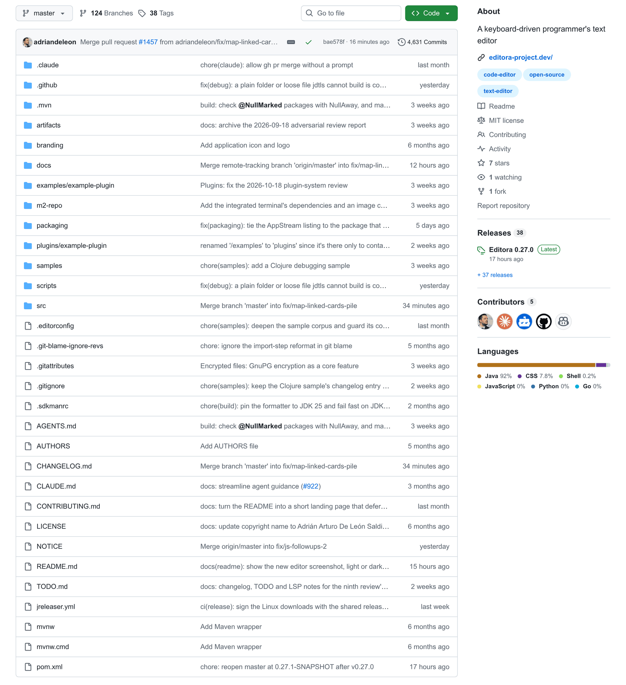
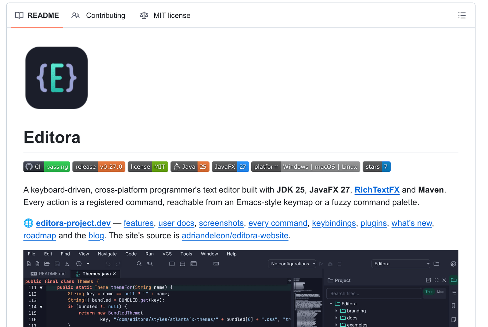
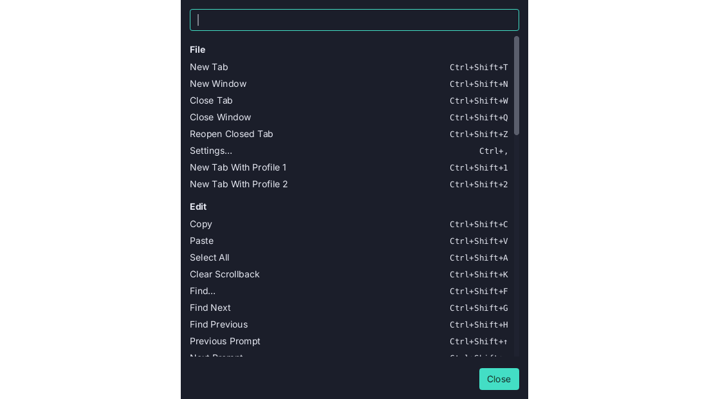
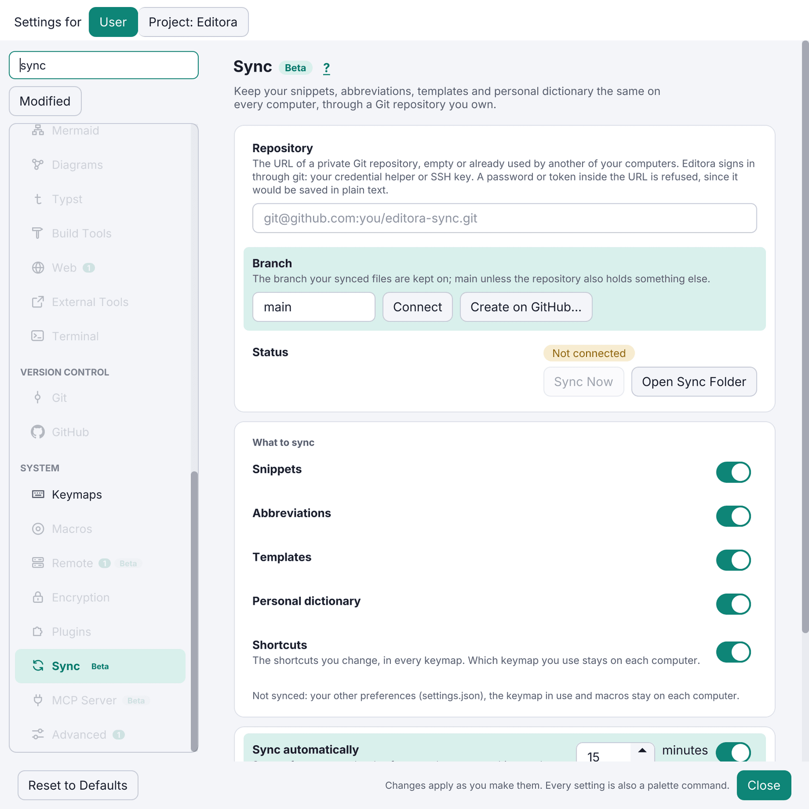
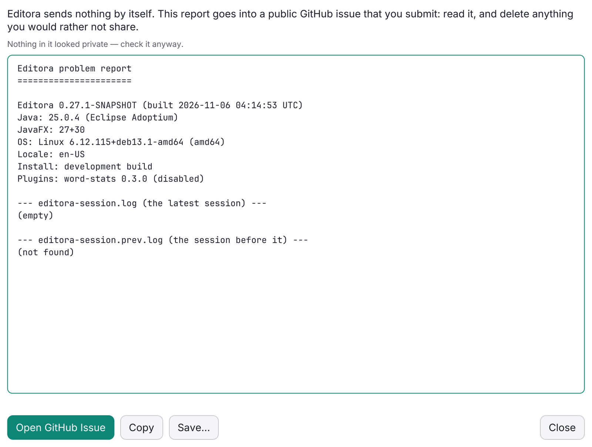
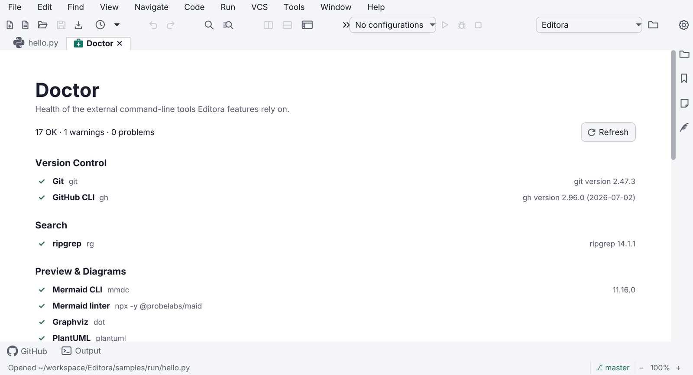
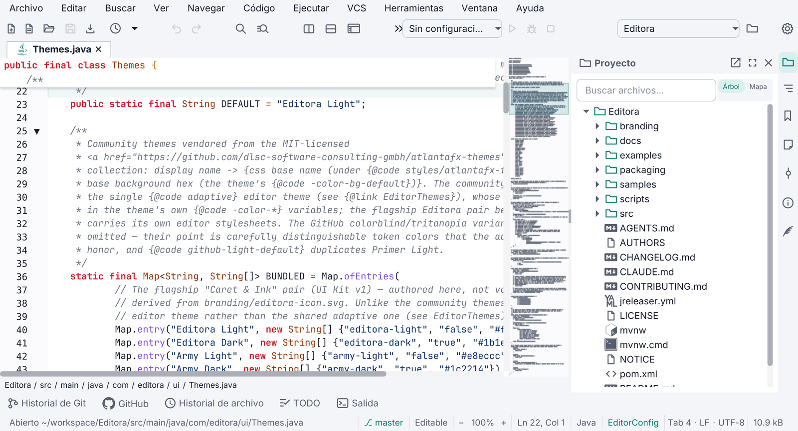
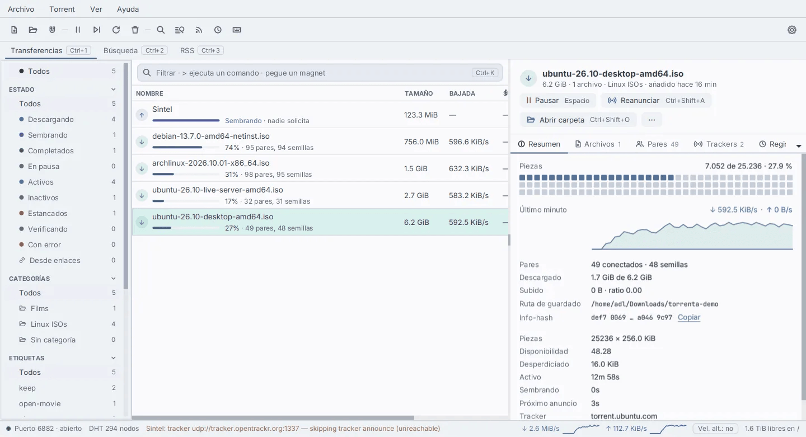
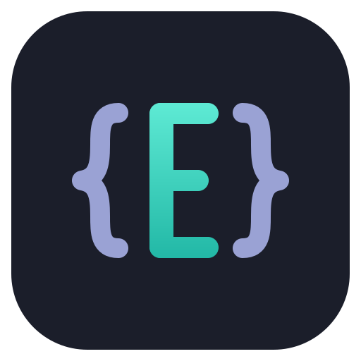

# Pauta: the adl desktop apps guidelines

UI, UX and platform rules for adl's JavaFX desktop apps: **Editora**, **Torrenta**, **Termina**, **Modula**,
**Mirada** and **nux**. Editora is the reference implementation.

**MUST** is a release blocker for a new app. **SHOULD** is expected unless the app has a stated reason.
**MAY** is a pattern worth copying when the app grows into it.

**Version 1.2.0 · 2026-11-06** · Web version: <https://pauta-project.dev/1.2.0/>

## Principles


These come from what the six apps already do. Editora is the reference; each principle names where else it is
written down.

### For the people using the apps

1. **Keyboard first.** Every action works without a mouse. The mouse is a shortcut to commands, not the
   other way round.
2. **Every feature is a command.** One registry of commands with ids. Menus, toolbar buttons, the command
   palette and key bindings all run commands by id. Nothing is wired straight to logic.
3. **Speed comes first.** Start-up and the app's core action (typing in Editora, stepping to the next image in
   Mirada, a keystroke reaching the shell in Termina) are the product. When a feature pulls against them, the
   feature loses or waits until it can be made cheap. *(Mirada's "Priorities"; "fast first" in Termina and
   Mirada.)*
4. **The UI never waits.** The JavaFX application thread only touches the scene graph. Disk, network,
   processes, parsing and searching run on other threads and hand their result back; a keystroke, a scroll or a
   window opening never waits for them. See [Performance](../performance/).
5. **Changes apply as they are made.** Settings have no Save button. A change reaches every open window.
6. **Nothing fails silently.** Every failure reaches the status bar, the Message Log or the Debug Log, and
   the user can turn any of it into a GitHub issue.
7. **Never claim what is not true.** No link that looks like a link and does nothing, no "up to date" before
   an update check has answered, no setting that seems to apply when it cannot: a setting that waits for a
   restart says so on its own row. *(Modula's About, Editora's update status, Termina's settings rows.)*
8. **Local first, nothing sent without asking.** No telemetry. The only automatic network call is a
   once-a-day release check the user can turn off. Problem reports are built locally and submitted by the
   user.
9. **Same app on every OS.** Windows, macOS and Linux get the same features and the same installer
   quality. Platform differences live behind one class, never scattered `if (isMac)` checks.
10. **Users' data outlives versions.** Config files carry a schema version and migrate forward. An older
    build never overwrites a newer config.

### For the people building them

11. **One source of truth for each fact.** The version lives in `pom.xml` and reaches About, `--version`, the
    update check and problem reports through a filtered `build-info.properties`. A key binding is declared once,
    so the menu and the accelerator cannot disagree. A list that repeats a fact (About's dependencies, the
    coverage table in the docs) has a test that fails when the two drift, in both directions.
    *(Modula's `DependenciesTest`, nux and Torrenta's `AppInfo`, Editora's `BuildHygieneTest`.)*
12. **Separate the decision from the UI, then test it.** Anything with a rule in it (which key does what, sort
    order, when a bar shows, whether a colour is legible) is a small pure method or class with its own unit
    tests. UI classes stay thin and only wire decisions to controls. *(Termina, Torrenta, Mirada and nux
    "Conventions"; Editora's pure decision helpers.)* See [Code quality gates](../quality/).
13. **Verify by driving the real app.** UI bugs are visual and none of them throw. Before calling a UI change
    done, run the real window, press the real keys and look at the result, through a capture hook or a
    headless screenshot; reasoning about event order is not evidence. *(Termina and Torrenta's `DevCapture`,
    nux's `--screenshot`, the headless harness behind Editora's website screenshots.)*

## New app checklist

Each group links to the page with the rules and the Editora code to copy. Everything here is a MUST unless it says
SHOULD.

**Start from the template.** [adl-desktop-app-template](https://github.com/adriandeleon/adl-desktop-app-template) is a GitHub template repository that already
ticks every MUST on this list: a small runnable app with its tests, CI and release workflows and every repository
document. Click **Use this template**, then run `scripts/rename.sh <AppName> <package>`.

### Platform

[Platform baseline](../platform/)

- [ ] JDK 25 or newer (`release` 25 is the floor) and JavaFX 27 or newer
- [ ] One JPMS module, `com.<app>`
- [ ] Maven Wrapper committed (`mvnw`, `mvnw.cmd`, `.mvn/wrapper/`)
- [ ] AtlantaFX light and dark themes, following the system by default
- [ ] Inter bundled and attached to every scene and dialog (SHOULD)

### Code quality

[Code quality gates](../quality/)

- [ ] The version comes only from `pom.xml` (filtered `build-info.properties`); lists that repeat a fact have a drift test
- [ ] Rules live in pure, unit-tested helpers; UI classes stay thin
- [ ] A capture hook or headless screenshot drives the real window for UI checks
- [ ] Every package `@NullMarked`; NullAway on Error Prone fails the build
- [ ] Spotless with Palantir Java Format
- [ ] JUnit 5 and headless FX tests (`-Dglass.platform=Headless`), FX tests tagged `fx`
- [ ] JaCoCo check at 0.90 lines and 0.90 methods

### Performance

[Performance](../performance/)

- [ ] No I/O, process, parsing or waiting on the JavaFX application thread; results return through `Platform.runLater`
- [ ] Background results applied under a generation guard; named daemon threads
- [ ] Redraws coalesced to one per pulse; streams delivered in batches
- [ ] Logs, histories and caches bounded; large inputs guarded
- [ ] Only the first frame built before it paints; update check and extras deferred

### Keyboard and commands

[Keyboard first](../keyboard/)

- [ ] One `CommandRegistry`: every action is a command with an id
- [ ] Command Palette as an in-scene overlay, not a `Popup`
- [ ] Emacs and CUA keymaps at least, with user overrides on top

### Menus

[Menus](../menus/)

- [ ] Menu rows are commands: icon, title and chord from the registry and the active keymap, no `KeyCombination` accelerators
- [ ] Right-click menus close on a press anywhere outside them and never stack (`ContextMenuDismissal` installed at startup)
- [ ] Right-click menus open from the Menu key and Shift+F10 at the selected row (`RowContextMenu`)

### Settings

[Settings](../settings/)

- [ ] Settings window with a page sidebar, search and live apply
- [ ] A palette command for every setting
- [ ] Versioned config in `~/.<app>`, with migrations and downgrade backups
- [ ] Export and import of the config folder
- [ ] Settings sync through a Git/GitHub repository (SHOULD)

### Diagnostics

[Diagnostics and support](../diagnostics/)

- [ ] Status-bar echo and Message Log
- [ ] Debug Log with a session file, and an uncaught exception handler
- [ ] Daily update check with an off switch; About shows versions and update status
- [ ] Report a Problem (redacted, prefilled GitHub issue) and `--report`

### Command line and languages

[Command line](../command-line/) · [Internationalization](../i18n/)

- [ ] `--help`, `--version`, `--config-dir`, `--dev`
- [ ] Single instance per config folder
- [ ] At least six message catalogs, with a parity test

### Repository

[Repository documents](../repository/)

- [ ] `README.md` with the badge row and a light/dark hero screenshot
- [ ] `CHANGELOG.md` in Keep a Changelog format
- [ ] MIT `LICENSE`, and `NOTICE` with every third-party licence
- [ ] `AGENTS.md`, with a one-line `CLAUDE.md` pointing to it
- [ ] `CONTRIBUTING.md`, `docs/` and `branding/`
- [ ] `.github/ISSUE_TEMPLATE/bug_report.yml`

### Packaging and signing

[Packaging, signing and release](../release/)

- [ ] jpackage installers through JReleaser: Linux x64 and arm64, macOS arm64 and x64, Windows x64
- [ ] macOS `.dmg` signed with Developer ID, notarized and stapled
- [ ] Linux downloads with `.asc` signatures from the shared release key
- [ ] Build provenance attestations for every download
- [ ] Windows `.msi` Authenticode, once the certificate is chosen (SHOULD)
- [ ] Homebrew cask in `adriandeleon/homebrew-tap` and a winget package `AdrianDeLeon.<App>` (SHOULD)

### CI/CD (GitHub Actions)

[CI/CD](../release/#cicd-github-actions)

- [ ] `ci.yml` on every push and pull request: Format and Build & Test, both required checks for `master`
- [ ] `full-tests.yml` on Linux, macOS and Windows: daily, on a `full-ci` label, before every release (SHOULD)
- [ ] `release.yml` on a `v*` tag that matches the pom, with a `workflow_dispatch` dry run
- [ ] Every third-party action pinned to a commit SHA
- [ ] Dependabot for `github-actions` and `maven`
- [ ] `permissions: contents: read` by default; write only in publishing jobs
- [ ] `timeout-minutes` on every job; superseded pull-request runs cancelled
- [ ] Test and coverage reports uploaded; coverage totals in the job summary
- [ ] Signing skipped without secrets, but a tag without them fails
- [ ] A smoke launch of the packaged app on each OS before release

## Platform baseline

| Area | Rule | Level | Editora reference |
|---|---|---|---|
| JDK | **JDK 25 or newer.** `maven.compiler.release` 25 is the floor, not the ceiling: build and bundle a current JDK (the enforcer range is `[25,)`, open-ended). The bundled runtime is jlinked; users never install Java | MUST | `pom.xml` |
| JavaFX | **JavaFX 27 or newer** (`javafx.version` 27 is the floor) | MUST | `pom.xml` |
| Modules | One named JPMS module (`com.<app>`); `module-info.java` opens only what reflection, FXML and Jackson need | SHOULD | `src/main/java/module-info.java` |
| Theme toolkit | **AtlantaFX 3.x** (`atlantafx-base`) for controls; light and dark themes; app CSS uses AtlantaFX `-color-*` tokens, never hex literals | MUST | `ui/Themes.java`, `app.css` |
| UI font | Bundle **Inter** (Regular, Bold, Italic, BoldItalic + `OFL.txt`); register with `Font.loadFont` before any stylesheet; attach `ui-font.css` to every scene and dialog pane. Gives the family one look on every OS | SHOULD | `ui/Fonts.java` |
| Build | **Maven** with the **Maven Wrapper** (`mvnw`, `mvnw.cmd`) committed, so `./mvnw` works on a clean machine | MUST | `mvnw`, `.mvn/wrapper/` |
| Null safety | **JSpecify** annotations, checked by **NullAway** on **Error Prone** at compile time. Every package is `@NullMarked` in its own `package-info.java` | MUST | `docs/conventions.md#null-annotations-jspecify-checked-by-nullaway` |
| Formatting | **Spotless** with Palantir Java Format; CI fails an unformatted change | MUST | `pom.xml` (spotless plugin) |
| Tests | **JUnit 5** + **TestFX** over JavaFX's built-in **Headless** glass platform (`-Dglass.platform=Headless`), so FX tests need no display, no xvfb and no Monocle | MUST | `docs/testing.md`, `FxTestSupport` |
| Coverage | **JaCoCo** `check` at `mvn verify`: **≥ 0.90 lines, ≥ 0.90 methods**, ≥ 0.79 branches, plus per-package floors | MUST | `pom.xml` `jacoco-check` |
| Logging | `java.util.logging`, captured in-app by the Debug Log | SHOULD | `ui/DebugLog.java` |
| JSON config | Jackson POJOs with a `SCHEMA_VERSION` each | SHOULD | `config/Settings`, `config/migration/ConfigSchema.java` |


### Everyday commands (identical in every repo)

```bash
./mvnw javafx:run                 # run the app
./mvnw test                       # unit + headless FX tests, writes the JaCoCo report
./mvnw spotless:apply             # format
./mvnw verify                     # full gate: tests, coverage check, NullAway
./mvnw -Pfatjar package           # runnable fat jar for this OS
./mvnw clean -Pdist package       # native installer for this OS (clean is mandatory)
```

The `clean` in every `-Pdist` build is mandatory: incremental compilation can leave synthetic enum-switch
classes out of `target/classes`, and jlink then ships an app whose keyboard fails on the first keypress.

## Repository documents

**Start from the template.** [adl-desktop-app-template](https://github.com/adriandeleon/adl-desktop-app-template) carries an example of every file on this page,
filled in for a placeholder app, `ExampleApp`. `scripts/rename.sh <AppName> <package>` renames it to yours.

| File | What it holds | Level |
|---|---|---|
| `README.md` | A landing page, about 200 lines: logo, badges, one-paragraph pitch, hero screenshot, highlights, install, build, command line, config folder, licence. Detail lives on the website. | MUST |
| `CHANGELOG.md` | [Keep a Changelog 1.1](https://keepachangelog.com/en/1.1.0/) + SemVer. An `## [Unreleased]` section with Added / Changed / Fixed / Removed; each entry opens with a bold one-line summary written for users. | MUST |
| `LICENSE` | MIT, "Copyright (c) 2026 Adrián Arturo De León Saldivar". | MUST |
| `NOTICE` | App name, copyright, "licensed under the MIT License", then every bundled third-party component with its licence (Inter is OFL, AtlantaFX is MIT, OpenJFX is GPLv2+CPE…). Ship it inside the installers too. | MUST |
| `AGENTS.md` (+ a one-line `CLAUDE.md` pointing to it) | Operational rules for coding agents: essential commands, worktree-per-task, change checklist. Not a changelog. | MUST |
| `CONTRIBUTING.md` | How to build, test, format, and open a PR. | MUST |
| `docs/` | `architecture.md`, `conventions.md`, `testing.md`, `gotchas.md`, `release.md`, `building-and-packaging.md`, `decisions/` (ADRs). | MUST |
| `TODO.md` | The open list, kept in the same PR as the change. | MAY |
| `.github/ISSUE_TEMPLATE/bug_report.yml` | Issue form whose field ids (`environment`, `report`) the in-app Report a Problem fills. | MUST |
| `branding/` | Source SVG of the icon; generated PNG/ICNS/ICO live in `packaging/`. | MUST |



### README badges (in this order)

```markdown
[](…/actions/workflows/ci.yml)
[](…/releases/latest)
[](LICENSE)


[](…/stargazers)
```



The hero screenshot is a `<picture>` with a dark `srcset` under `prefers-color-scheme: dark`, so GitHub
shows the screenshot that matches the reader's theme. Screenshots are taken at 2× by a headless harness so
they can be retaken after any UI change. The README states that the app is built with the help of AI
coding tools.

## Code quality gates

- **NullAway is an error, not a warning.** Put `@Nullable` on what may be null and fix the report; do not
  suppress it. A new package starts with its own `package-info.java` carrying `@NullMarked`.
- **Coverage floors are a regression net, not a target.** The build-wide floor is 0.90 lines and methods.
  Each package of 300+ lines gets its own floor about three points below its measured level; when a
  package's coverage rises, ratchet its floor up. A test (`BuildHygieneTest`) fails when the documented
  floor table and the pom disagree.
- **Extract the decision, then test it** ([principle 12](../principles/#for-the-people-building-them)). **Prefer a pure decision helper plus unit tests.** Use the headless FX harness only when controller or
  toolkit behaviour is the point.
- **Tag FX tests `@Tag("fx")`**, so the pure suite runs alone with `-DexcludedGroups=fx`.
- **Guard tests that pay for themselves across the family:**
  - *Command sweep* runs every registered command in a real headless window (`CommandSweepFxTest`).
  - *Message parity*: every locale has every key; every `command.<id>` has a `.desc` (`MessagesTest`).
  - *Settings round trip*: every switch, number and choice survives a restart (`SettingsRoundTripFxTest`).
  - *Contrast*: text tokens keep their ratios in every theme (`StyleContrastTest`).
  - *Release supply chain*: signing and attestation steps stay where they are (`ReleaseSupplyChainTest`).
- **No sleeps in tests.** Own workers and FX callbacks with a scope (`AsyncTestScope`) and use latches.
- **A test window writes only inside its temp folders**, never in the real home directory.
- **Verify UI work in the running app** ([principle 13](../principles/#for-the-people-building-them)): a capture
  hook or headless screenshot of the real window, with real key and mouse events, before a UI change is called
  done.
- **A guard that cannot fail is decoration.** When you add a drift or parity test, break the thing it guards
  once and watch it fail. *(Modula's `DependenciesTest`.)*

## Performance

A desktop app is judged by how it feels under the hand: a key that lags or a window that hangs while it reads a
file is a defect, not a slow feature. These rules come from Editora's
[`docs/performance.md`](https://github.com/adriandeleon/Editora/blob/master/docs/performance.md), the contract
every change on a hot path there must honour.

### The UI thread

| Rule | Level | Editora reference |
|---|---|---|
| **Never block the JavaFX application thread.** No file or network I/O, no process start or wait, no parsing, searching, hashing or JSON of any size on it. No `Thread.sleep`, `Future.get()`, `join()` or `Process.waitFor()` there. | MUST | `docs/performance.md` §1 |
| **Touch the scene graph only on the FX thread.** Background work hands its result back with `Platform.runLater`; nothing else creates, changes or reads live nodes. | MUST | every service |
| **Drop stale results.** A background result is applied under a generation guard, so an answer to an old request never overwrites a newer one. | MUST | `GitService`, `SearchService`, `LatestOnly` |
| **Name your threads and make them daemons**, so a thread dump says what is running and a stray worker never keeps the app alive after its last window closes. | SHOULD | `daemon("my-feature")` |
| **Leave the common ForkJoinPool alone for blocking work.** It has one worker fewer than the machine has cores; a few blocked waits (`CompletableFuture.supplyAsync` of a `waitFor`) starve every other user of it. A `Process` subclass overrides `onExit()`. | MUST | `ExitWatch`, `docs/gotchas.md` |

The canonical shape, used by every Editora service:

```java
private final ExecutorService exec = Executors.newSingleThreadExecutor(daemon("my-feature"));
private final AtomicLong gen = new AtomicLong();

void request(String input, Consumer<Result> onResult) {
    long mine = gen.incrementAndGet();
    exec.submit(() -> {
        Result r = computeOffThread(input);        // heavy work, off the FX thread
        if (mine == gen.get()) {                   // superseded? drop it
            Platform.runLater(() -> {
                if (mine == gen.get()) onResult.accept(r);
            });
        }
    });
}
```

For one-off blocking calls (reading a file, stat-ing a path, starting a process), a virtual thread
(`Thread.ofVirtual().start(…)`) is enough; the result still comes back through `Platform.runLater`.

### Hot paths

Each app names its hot paths: what runs on every keystroke, scroll pulse or progress tick. In Editora they are
typing, scrolling, highlighting, the overlays and the gutter. In Torrenta they are the transfer table's refresh,
in Termina the terminal grid, in Mirada stepping between images.

| Rule | Level | Editora reference |
|---|---|---|
| **Debounce and coalesce.** At most one redraw per pulse, with a `pending` flag; text-driven work waits for typing to pause. Streams (process output, logs, progress) are delivered in batches, at least 16 ms apart, never one `runLater` per line. | MUST | `FxThrottle`, `OutputPump`, `ConsoleAppender` |
| **Work only on what is visible, and only on what changed.** No O(document) or O(list) work per keystroke, scroll or tick; re-process the edited range or the visible rows. Use virtualized controls (`ListView`, `TableView`, a fixed cell size) for anything that can grow. | MUST | `HighlightPass`, `MinimapRows` |
| **Allocate little on a hot path.** Reuse buffers and arrays; cache data a repaint only reads. | SHOULD | minimap stripes |
| **Keep CSS cheap.** No `applyCss()` on a large subtree, stable style classes, and spans of the same style merged before they are applied. | SHOULD | `SpanMerger`, `docs/gotchas.md` |

### Memory and size

| Rule | Level | Editora reference |
|---|---|---|
| **Bound everything that grows**: logs, histories, consoles, caches, undo. Keep the newest, keep a note of what was cut. | MUST | `MessageLog` (200), `DebugLog`, `OutputCap` |
| **Guard large inputs.** Decide by size and shape before loading: turn off expensive features past a threshold, open read-only or capped past another, refuse what will not fit the free heap. | MUST | 5 MB / 50 MB guards, `LoadHeapGuard` |
| **Release what a closed window held**: listeners, timers, executors, file watchers, native resources. A test opens and closes windows and checks nothing is left. | MUST | `FxWindowFixture.dispose`, `ClosedLspManagers` |

### Start-up

| Rule | Level | Editora reference |
|---|---|---|
| **The first frame first.** Build only what the first window shows; tool windows, panels and pages build on first open. | MUST | lazy `ToolWindow` suppliers, `LazyToolWindowsFxTest` |
| **Defer what nobody waits for**: the update check, extra fonts, indexes and caches start after the first frame has painted. | MUST | `UpdateCheckScheduler`, `Fonts.loadRemainingAfterNextPaint` |
| **Read config off the FX thread**, before the toolkit needs it. | SHOULD | the `config-prefetch` thread |
| **Ship precompiled stylesheets (`.bss`) and an AOT cache** trained on a real session. | SHOULD | `css2bss`, `aot_build.java`; Termina's and Mirada's `aot-train.sh` |

### Measure, don't guess

- **Every change on a hot path says what it costs** in its pull request: added FX-thread work, allocation per
  keystroke or scroll, extra layout passes, memory. "Negligible" is an answer; no answer is not.
- **Measure start-up** with a script that takes the median of several cold launches
  (`scripts/measure-startup.sh` in Editora and Mirada) and phase marks in the app (`perf/Startup`).
- **Sample the FX thread** when something stalls (`EDITORA_PERF_SAMPLE=1`), and keep a headless test for each
  hot path that once regressed.
- A suspected regression gets a number before and after, from temporary `System.nanoTime` instrumentation if
  nothing better exists.

## Keyboard first

### Commands

- Every user-facing action is a `Command` (id, title, runnable) registered in one `CommandRegistry`.
- Command ids are dotted and grouped by area: `file.open`, `view.toggleStatusBar`, `help.reportProblem`.
- Titles come from `command.<id>` and palette descriptions from `command.<id>.desc` in the message
  catalogs, so a registered command is localized and discoverable without extra work.
- A command that cannot run in the current context is shown greyed with a tooltip that says why, not
  hidden.

### Command Palette

- **MUST.** Opened by `M-x` in Emacs keymaps and `Ctrl/Cmd+Shift+P` in the others.
- Fuzzy matching over title, id and description; a query that names a command's title outranks a fuzzy
  hit. Each row shows the active key binding. See the [Command Palette template](../templates/command-palette/).
- It is an **in-scene overlay** in the window's root `StackPane`, not a `javafx.stage.Popup`. On Windows a
  Popup does not reliably take OS keyboard focus and the whole app can stop receiving keystrokes.
- The same picker (`QuickOpen`) serves every other list choice: recent files, themes, keymaps, settings
  values.


### Keymaps

- Ship presets as JSON resources: Emacs, CUA, IntelliJ, VS Code and Sublime, with `.mac.json` variants
  where Cmd replaces Ctrl.
- Layer order: base keymap → user overrides → plugin keymaps → the user's own bindings again, so the user
  always has the last word (`KeymapLayers`).
- A keymap editor in Settings lists every command with its chord, searchable, with conflict warnings.
- Never bake a chord into translated text. Derive the label from the active keymap.
- Multi-key prefixes (`C-x …`) show a which-key style hint listing the possible next keys.




### Focus and accessibility

- Every interactive control is reachable with Tab and operable with Space/Enter.
- Keyboard focus is drawn by one `:focus-visible` block at the end of `app.css`.
- Icon-only buttons are built by a helper (`Icons.button`) that sets both the tooltip and the accessible
  text.
- On/off rows use a keyboard-operable switch (`SettingSwitch`, `TOGGLE_BUTTON` role). A bare AtlantaFX
  `ToggleSwitch` is mouse-only.
- Readable text uses `-color-fg-muted` or stronger; `-color-fg-subtle` (about 3:1) is for disabled or
  decorative text only.
- Rows wrap instead of truncating to "…". Check German at 1024 px wide.

## Window shell


- **Status bar**, always present (toggleable). Its left side is the *echo area*: one line of feedback for
  the last action. Errors are red, warnings amber. Clicking it opens the Message Log.
- **Themes**: light and dark AtlantaFX themes plus a "follow the system" choice, switchable at run time
  without a restart. Semantic colours: amber = not durable yet (unsaved, read-only), red = broken,
  green = verified or added.
- **Title bar**: SHOULD use JavaFX 27's `HeaderBar` with `StageStyle.EXTENDED` to put the menu or tabs in
  the title bar, with a decorated-window fallback, and `useSystemMenuBar` on macOS.
- **Native dialogs** go through one helper (`Dialogs.styled`) because a dialog is its own scene and does
  not inherit the app stylesheet or the UI font.
- **A destructive action asks first, and says what it does.** Removing, deleting, discarding or overwriting
  something the user made goes through one confirm helper (Torrenta's `RemoveConfirm`, Editora's save
  decisions). The question names the thing ("Remove 3 torrents?"), the confirm button names the action
  (Remove, Discard, Overwrite), never OK or Yes, and Escape cancels. Where the action can be undone instead
  (Torrenta's `UndoStack`, Termina's and Editora's reopen-closed-tab), prefer the undo over the question.
- **Welcome page** when there is nothing to restore: Start actions (which run commands), Recent items, a
  Customize block (keymap and theme), Help links.
- **About** shows version, build, runtime (Java and JavaFX versions), licence, links, and the result of the
  last update check.
- **Window state**: size, position, maximized state and open items are restored on the next launch; a
  `--no-session` flag skips the restore.
- **Zoom**: UI and content zoom from the keyboard (`Ctrl/Cmd +`, `-`, `0`), persisted.
- **Modes** (MAY): Zen (no chrome), Simple (fewer menus for new users), Expert.


## Menus

Two surfaces show the same rows: the **menu bar**, a browsable map of every command, and **right-click menus**, what
can be done with the thing under the pointer. Both are built from the [command registry](../keyboard/), so a row's
title, icon, chord and enabled state come from the command and never drift from the palette or the toolbar.
Reference: Editora's `ui/MainMenuBar.java` (menu bar), `ui/ContextMenuDismissal.java`, `ui/LazyContextMenu.java`,
`ui/RowContextMenu.java` and `ui/TabContextMenu.java` (right-click menus), and the `.menu-item` and `.context-menu`
rules in `app.css`.

<svg width="0" height="0" style="position:absolute" aria-hidden="true"><defs>
<symbol id="i-open" viewBox="0 0 24 24"><path d="M20 6h-8l-2-2H4c-1.1 0-1.99.9-1.99 2L2 18c0 1.1.9 2 2 2h16c1.1 0 2-.9 2-2V8c0-1.1-.9-2-2-2zm0 12H4V8h16v10z"/></symbol>
<symbol id="i-save" viewBox="0 0 24 24"><path d="M17 3H5c-1.11 0-2 .9-2 2v14c0 1.1.89 2 2 2h14c1.1 0 2-.9 2-2V7l-4-4zm-5 16c-1.66 0-3-1.34-3-3s1.34-3 3-3 3 1.34 3 3-1.34 3-3 3zm3-10H5V5h10v4z"/></symbol>
<symbol id="i-saveas" viewBox="0 0 24 24"><path d="M17 3H5a2 2 0 0 0-2 2v14a2 2 0 0 0 2 2h8v-2H5V5h10v4h4v2h2V7l-4-4zm-5 10a3 3 0 1 0 0 6 3 3 0 0 0 0-6zm7 2v2h-2v2h2v2h2v-2h2v-2h-2v-2h-2z"/></symbol>
<symbol id="i-close" viewBox="0 0 24 24"><path d="M19 6.41 17.59 5 12 10.59 6.41 5 5 6.41 10.59 12 5 17.59 6.41 19 12 13.41 17.59 19 19 17.59 13.41 12z"/></symbol>
<symbol id="i-print" viewBox="0 0 24 24"><path d="M19 8H5c-1.66 0-3 1.34-3 3v6h4v4h12v-4h4v-6c0-1.66-1.34-3-3-3zm-3 11H8v-5h8v5zm3-7c-.55 0-1-.45-1-1s.45-1 1-1 1 .45 1 1-.45 1-1 1zm-1-9H6v4h12V3z"/></symbol>
<symbol id="i-recent" viewBox="0 0 24 24"><path d="M13 3c-4.97 0-9 4.03-9 9H1l3.89 3.89.07.14L9 12H6c0-3.87 3.13-7 7-7s7 3.13 7 7-3.13 7-7 7c-1.93 0-3.68-.79-4.94-2.06l-1.42 1.42C8.27 19.99 10.51 21 13 21c4.97 0 9-4.03 9-9s-4.03-9-9-9zm-1 5v5l4.28 2.54.72-1.21-3.5-2.08V8H12z"/></symbol>
<symbol id="i-quit" viewBox="0 0 24 24"><path d="m17 7-1.41 1.41L18.17 11H8v2h10.17l-2.58 2.58L17 17l5-5zM4 5h8V3H4c-1.1 0-2 .9-2 2v14c0 1.1.9 2 2 2h8v-2H4V5z"/></symbol>
<symbol id="i-lock" viewBox="0 0 24 24"><path d="M18 8h-1V6c0-2.76-2.24-5-5-5S7 3.24 7 6v2H6c-1.1 0-2 .9-2 2v10c0 1.1.9 2 2 2h12c1.1 0 2-.9 2-2V10c0-1.1-.9-2-2-2zm-6 9c-1.1 0-2-.9-2-2s.9-2 2-2 2 .9 2 2-.9 2-2 2zm3.1-9H8.9V6c0-1.71 1.39-3.1 3.1-3.1 1.71 0 3.1 1.39 3.1 3.1v2z"/></symbol>
<symbol id="i-closeall" viewBox="0 0 24 24"><path d="M12 2C6.48 2 2 6.48 2 12s4.48 10 10 10 10-4.48 10-10S17.52 2 12 2zm5 13.59L15.59 17 12 13.41 8.41 17 7 15.59 10.59 12 7 8.41 8.41 7 12 10.59 15.59 7 17 8.41 13.41 12 17 15.59z"/></symbol>
<symbol id="i-git" viewBox="0 0 24 24"><path d="M6 2a3 3 0 0 0-1 5.83v8.34A3 3 0 1 0 7 16.17V12.4c.6.37 1.3.6 2 .6h4a3 3 0 0 0 3-3v-.17A3 3 0 1 0 14 9.83V10a1 1 0 0 1-1 1H9a2 2 0 0 1-2-2V7.83A3 3 0 0 0 6 2z"/></symbol>
<symbol id="i-terminal" viewBox="0 0 24 24"><path d="M20 4H4c-1.1 0-2 .9-2 2v12c0 1.1.9 2 2 2h16c1.1 0 2-.9 2-2V6c0-1.1-.9-2-2-2zm0 14H4V8h16v10zm-2-1h-6v-2h6v2zM7.5 17l-1.41-1.41L8.67 13l-2.59-2.59L7.5 9l4 4-4 4z"/></symbol>
<symbol id="i-copy" viewBox="0 0 24 24"><path d="M16 1H4c-1.1 0-2 .9-2 2v14h2V3h12V1zm3 4H8c-1.1 0-2 .9-2 2v14c0 1.1.9 2 2 2h11c1.1 0 2-.9 2-2V7c0-1.1-.9-2-2-2zm0 16H8V7h11v14z"/></symbol>
<symbol id="i-pin" viewBox="0 0 24 24"><path d="M16 9V4h1c.55 0 1-.45 1-1s-.45-1-1-1H7c-.55 0-1 .45-1 1s.45 1 1 1h1v5c0 1.66-1.34 3-3 3v2h5.97v7l1 1 1-1v-7H19v-2c-1.66 0-3-1.34-3-3z"/></symbol>
<symbol id="i-rename" viewBox="0 0 24 24"><path d="M3 17.25V21h3.75L17.81 9.94l-3.75-3.75L3 17.25zM20.71 7.04c.39-.39.39-1.02 0-1.41l-2.34-2.34c-.39-.39-1.02-.39-1.41 0l-1.83 1.83 3.75 3.75 1.83-1.83z"/></symbol>
</defs></svg>

### Look and feel

Both surfaces draw their rows the same way. Absolute pixels are deliberate: a popup inherits the font of the node it
was opened from, and `em` would resolve against a file tree's or an 18 px toolbar's size (Editora's toolbar menu once
rendered a third larger than every other menu in the app).

| Property | Value | Reference |
|---|---|---|
| Font | Inter 14 px, regular, in every row and label | `.context-menu`, `.context-menu .menu-item .label` in `app.css`; `MainMenuBar.UI_FONT_SIZE` |
| Row | 34 px high: padding 8 × 12, the same in every theme | `.menu-item { -fx-padding: 8px 12px }` |
| Icon column | 22 px, reserved even when the row has no glyph, so a menu with a mix stays aligned; 8 px to the title | `MainMenuBar.ICON_COLUMN`, `rowContent` |
| Icon | The command's glyph, the same one as on the toolbar and in the palette (Save is the same floppy everywhere), filled `-color-fg-muted` | `Icons`, `MenuBarIcons`, `.toolbar-icon` |
| Title | `-color-fg-default` | `.menu-item-title` |
| Chord | Right-aligned in its own column, 11 px, in the keyboard colour (`-state-key`, brace periwinkle); at least 18 px from the title column | `.menu-item-chord`, `alignChordColumns` |
| Submenu row | Laid out like a command row, with an invisible chord as wide as the menu's widest, so the arrow lands at the right edge | `nestedMenu`, `.menu-submenu` |
| Card | Radius 8; shadow `rgba(27,30,42,0.28)`, radius 16, **offset Y 16** | `.context-menu` |
| Danger item | Text in `-color-danger-fg` | `.menu-item.danger` |
| Disabled item | The theme's dimmed label, and the icon dimmed with it | Termina's `.menu-item:disabled .menu-icon` |
| Separators | Never two in a row and none at either end: when items hide, their orphaned separators hide too | `LazyContextMenu.collapseSeparators`, Torrenta's `MenuSeparators` |

The shadow's offset is not cosmetic. A menu is a native window sized to its root *including the effect*, so a shadow
that reaches above the menu is invisible window over the bar the menu hangs from, and the pointer lands on it instead
of the next menu button. The offset must be at least the radius; Editora pins it with `MenuPopupBoundsFxTest`.

### The menu bar

<div class="mock-stage">
<div class="m-menubar-stage" role="img" aria-label="Mockup of the File menu open under the menu bar">
<div class="m-menubar"><span class="mb on">File<span class="pin out" style="left:-26px;top:3px">1</span></span><span class="mb">Edit</span><span class="mb">View</span><span class="mb">Find</span><span class="mb">Go</span><span class="mb">Run</span><span class="mb">Git</span><span class="mb">Tools</span><span class="mb">Window</span><span class="mb">Help</span></div>
<div class="m-card m-menu">
<div class="mi"><span class="ic"><svg><use href="#i-open"/></svg></span><span class="t">Open…</span><span class="k">C-x C-f</span><span class="pin out" style="left:-26px">2</span></div>
<div class="mi"><span class="ic"><svg><use href="#i-save"/></svg></span><span class="t">Save <span class="pin" style="margin-left:6px">3</span></span><span class="k">C-x C-s</span><span class="pin out" style="right:-26px">4</span></div>
<div class="mi"><span class="ic"><svg><use href="#i-saveas"/></svg></span><span class="t">Save As…</span><span class="k">C-x C-w</span></div>
<div class="mi"><span class="ic"><svg><use href="#i-close"/></svg></span><span class="t">Close</span><span class="k">C-x k</span></div>
<div class="mi"><span class="ic"><svg><use href="#i-print"/></svg></span><span class="t">Print…</span><span class="k"></span><span class="pin out" style="right:-26px">5</span></div>
<div class="sep"></div>
<div class="mi sub"><span class="ic"><svg><use href="#i-recent"/></svg></span><span class="t">Recent Files</span><span class="k ghost">C-x C-w</span><span class="arrow">›</span><span class="pin out" style="right:-26px">6</span></div>
<div class="sep"></div>
<div class="mi"><span class="ic"><svg><use href="#i-quit"/></svg></span><span class="t">Quit</span><span class="k">C-x C-c</span></div>
<span class="pin out" style="left:-26px;bottom:-4px">7</span>
</div>
</div>
</div>

<ol class="anatomy">
<li><span class="pin">1</span><span><strong>Menu button.</strong> Padding 3 × 10 on a bar with 4 px side insets; the bar and the toolbar share one <code>-color-bg-subtle</code> band with no rule under it.</span></li>
<li><span class="pin">2</span><span><strong>Icon column</strong>, 22 px. A glyph only where an existing icon genuinely depicts the command; about half of Editora's rows have one. An invented glyph is worse than none, so the rest keep an empty column of the same width.</span></li>
<li><span class="pin">3</span><span><strong>Title</strong>, 14 px Inter, the command's title with the menu's own name dropped ("Save", not "File: Save") unless two rows would then read the same.</span></li>
<li><span class="pin">4</span><span><strong>Chord column.</strong> 11 px, periwinkle, right-aligned into one column per menu (not app-wide), read from the active keymap. Drawn by the app, not a JavaFX accelerator: Emacs chords are multi-key, which a <code>KeyCombination</code> cannot express, and on macOS an accelerator would bypass the key dispatcher.</span></li>
<li><span class="pin">5</span><span><strong>Unbound command.</strong> An empty chord cell, never a wrong chord. A live keymap switch rewrites every cell.</span></li>
<li><span class="pin">6</span><span><strong>Submenu row.</strong> Icon, title and an invisible chord as wide as the menu's widest, so its arrow sits at the right edge instead of halfway across.</span></li>
<li><span class="pin">7</span><span><strong>Card.</strong> Radius 8; the shadow falls below the menu (offset ≥ radius), so nothing invisible covers the bar.</span></li>
</ol>

- **MUST.** Every item is a command from the registry, with its title from `command.<id>`, its chord from the
  active keymap and its enabled state from the command's gate. The bar assembles and refreshes; it holds no
  behaviour of its own (`MenuBarModel` over `CommandRegistry`).
- **MUST.** No `KeyCombination` accelerators. In the in-window bar each row is a `CustomMenuItem` laying out
  icon, title, spacer and chord. On the **macOS system menu bar** (`useSystemMenuBar`) the native menu draws text
  only and no graphics, so there the chord is appended to the title and rows carry no icon, which is also the
  platform's convention.
- **Enablement is re-read on every open** (`refreshEnablement`), titles and chords on a keymap or locale change.
  A menu built before Git finished detecting a repository must not stay greyed out.
- **Simple mode** shows a shorter menu, rebuilt only when the mode actually changes.


### Right-click menus

<span class="lvl lvl-must">MUST</span> on every list row, tree row, tab, editor and read-only console: the actions for
*that* thing, each one a command. The mockup is an editor tab's menu, shortened; Editora's has twenty-five rows.

<div class="mock-stage">
<div class="m-ctx-stage" role="img" aria-label="Mockup of a tab's right-click menu">
<div class="m-tabs"><span class="tab on">Main.java<span class="x">×</span></span><span class="tab">pom.xml</span><span class="tab dirty">README.md</span></div>
<div class="m-card m-menu ctx">
<span class="pin out" style="left:-10px;top:-10px">1</span>
<div class="mi off"><span class="ic"><svg><use href="#i-save"/></svg></span><span class="t">Save</span><span class="pin out" style="right:-26px">3</span></div>
<div class="mi"><span class="ic"><svg><use href="#i-saveas"/></svg></span><span class="t">Save As…</span><span class="pin out" style="left:-26px">2</span></div>
<div class="mi"><span class="ic"><svg><use href="#i-lock"/></svg></span><span class="t">Encrypt…</span><span class="pin out" style="right:-26px">6</span></div>
<div class="sep"></div>
<div class="mi"><span class="ic"><svg><use href="#i-close"/></svg></span><span class="t">Close</span></div>
<div class="mi"><span class="ic"><svg><use href="#i-closeall"/></svg></span><span class="t">Close Others</span></div>
<div class="mi"><span class="ic"><svg><use href="#i-closeall"/></svg></span><span class="t">Close All</span></div>
<div class="sep"><span class="pin out" style="right:-26px;top:-9px">4</span></div>
<div class="mi"><span class="ic"><svg><use href="#i-recent"/></svg></span><span class="t">Local History</span></div>
<div class="mi sub"><span class="ic"><svg><use href="#i-git"/></svg></span><span class="t">Git</span><span class="arrow">›</span><span class="pin out" style="right:-26px">5</span></div>
<div class="sep"></div>
<div class="mi"><span class="ic"><svg><use href="#i-terminal"/></svg></span><span class="t">Open Terminal Here</span></div>
<div class="mi"><span class="ic"><svg><use href="#i-copy"/></svg></span><span class="t">Copy Path</span></div>
<div class="mi"><span class="ic"><svg><use href="#i-pin"/></svg></span><span class="t">Pin Tab</span></div>
<div class="mi"><span class="ic"><svg><use href="#i-rename"/></svg></span><span class="t">Rename…</span></div>
</div>
</div>
</div>

<ol class="anatomy">
<li><span class="pin">1</span><span><strong>Anchored at the pointer.</strong> The menu's top-left corner is the click. From the keyboard (Menu key or <kbd>Shift+F10</kbd>) it opens under the selected row, a quarter of the way in and never off a narrow one, or just below the caret in an editor; never in the middle of the control.</span></li>
<li><span class="pin">2</span><span><strong>Every row has an icon</strong>, the command's own. The one exception is a <code>CheckMenuItem</code>, whose tick lives in the graphic column.</span></li>
<li><span class="pin">3</span><span><strong>Greyed, not hidden.</strong> An action that does not apply right now (Save on an unchanged file, Reveal on an unsaved one) stays in place, dimmed. Only a row that cannot apply to this thing at all is hidden (the Git submenu on an untitled buffer).</span></li>
<li><span class="pin">4</span><span><strong>Separators</strong> group the rows; one that hiding has left alone hides too.</span></li>
<li><span class="pin">5</span><span><strong>Submenu</strong> for a family of actions (Git: stage, unstage, revert, compare, history), with its own icon.</span></li>
<li><span class="pin">6</span><span><strong>Labels follow state.</strong> Encrypt… becomes Lock File on an encrypted buffer, Pin Tab becomes Unpin Tab. Decided on every showing, not when the menu was built.</span></li>
</ol>

#### Behaviour

- **MUST. One menu at a time.** A right-click while a menu is open replaces it; the first one closes before the
  second shows. JavaFX stacks a second menu beside the first when each row owns its own `ContextMenu`, and the
  stale one is then no longer dismissible. Editora's `ContextMenuDismissal` closes every open right-click menu
  on the press that opens the next; Modula's `RadioPane` hides the previous menu before showing a new one;
  Termina keeps one menu per view and shows it again.
- **MUST. A press anywhere outside the menu closes it**, including inside the control the menu was opened on.
  JavaFX's auto-hide deliberately ignores a press on the menu's *owner node*, so a stock menu on a tree or a
  text area stays open when the user clicks another row or the text. The press is not consumed: a click in a
  list still selects the row, and a right-click on another row opens that row's menu straight away. Install the
  fix once, at startup, for every current and future window (`ContextMenuDismissal.install()` in `App`); drop-downs
  opened by a plain click (menu buttons, choice boxes, the menu bar) keep the stock behaviour, and a menu that turned
  auto-hide off is left alone. Pinned by `ContextMenuDismissalFxTest`.
- **MUST. Escape closes it** and focus goes back where it was. In a terminal the Escape must not reach the shell
  (Termina's `onKeyPressed` filter hides the menu and consumes the key).
- **MUST. Reachable from the keyboard.** The Menu key and <kbd>Shift+F10</kbd> arrive at the focused control, not at
  a row's cell, so a menu installed on cells never saw them. `RowContextMenu.install(tree)` re-fires the request at
  the selected row's cell, scrolled into view first, so every row action a mouse can reach the keyboard can too.
- **Right-click selects first.** In an editor, a right-click outside every selection moves the caret to the click
  (so Paste lands there); inside a selection it keeps carets and selections (so Cut and Copy act on what was
  clicked). From the keyboard the target is the caret (`ContextMenuTarget`). In a list, the menu is the clicked
  row's.
- **Built when asked for.** A menu attached to something that exists once per open file is built for every file
  and opened for almost none, so `LazyContextMenu.of(build)` builds the items on the first showing, and an
  `onShowing` handler sets the labels, enablement and visibility for *this* showing, then collapses the
  separators. A read-only console's menu is just Select All and Copy, both disabled while it is empty
  (`ConsoleContextMenu`).
- **Destructive rows** carry the `danger` class and follow the [window shell](../window-shell/) rule: the action
  asks first with a button that names it, or is undoable.
- **Terminal views (MAY).** A program that grabbed the mouse owns the right-click; <kbd>Shift</kbd>+right-click always
  opens the menu, and the keyboard request is never contested (Termina's `shouldShowMenu`, with
  `ContextMenuContentionTest`).

#### Spec

| Property | Value | Reference |
|---|---|---|
| Kind | `javafx.scene.control.ContextMenu`, auto-hide on, hide on Escape on: a popup window, unlike the palette | `TabContextMenu`, `ConsoleContextMenu` |
| Opens at | The pointer; from the keyboard, the selected row's bottom edge at min(width ÷ 4, 48) px in, or under the caret | `RowContextMenu.anchorX`, `ContextMenuTarget` |
| Font | Inter 14 px, pinned on `.context-menu`, whatever the owner's font | `app.css` |
| Rows | 34 px (padding 8 × 12); icon column 22 px; glyph scaled 0.8 from a 24 dp Material path, or a 16-unit line glyph | `Icons.ICON_SCALE`, `Icons.line` |
| Card | Radius 8, shadow radius 16 at offset Y 16 | `.context-menu` |
| Dismissal | Any press outside the menu, in any window; the next right-click; Escape | `ContextMenuDismissal`, `ContextMenuDismissalFxTest` |
| Marker | A showing menu opened by a right-click or the Menu key carries the window property `editora.rightClickMenu` | `ContextMenuDismissal.RIGHT_CLICK_MENU` |

### In the apps


.")

## Settings

### The Settings window

- **MUST.** Opened by `Ctrl/Cmd+,` and a palette command. A sidebar of pages with icons on the left, the
  page on the right, and a **search field on top**.
- **Search** finds a row by its title, description, visible text, its card or section heading, its page
  name and English keywords. Title hits rank above description hits; whole words above word starts. The
  page with the best match opens, and every non-matching row, heading and card is hidden
  (`SettingsSearch`).
- **Live apply.** No Save button. Text fields commit on Enter or focus loss; invalid numbers are marked and
  never committed.
- A change made in one window reaches every other open window.



### Before adding a setting

A setting is a question the user has to answer. When the question has one right answer, choose it, make it the
behaviour, and say why in the code and the docs; do not ship a knob for it. Modula's test: *would a car radio have
it?* A preset button, yes; a "decimation stages" spinner, no. So Modula has no gain, bandwidth or squelch control:
each has one right value for a listener, and the app supplies it. Add a setting when people really differ (a
keymap, a theme, a language), not when the developer could not decide.

### Adding a setting touches five places

1. **Model** field, default and accessors, with a schema bump and migration.
2. **Control**, built once, writing the field and applying it.
3. **Row** on its page with search keywords.
4. **Load** line that sets the control from the model, safe to run at any time.
5. **Palette command** that flips or prompts the same field, plus strings in every catalog.

### Config folder and schema

- Config lives in `~/.<app>` (`~/.<app>-dev` for `--dev`, any folder via `--config-dir` or
  `<APP>_CONFIG_DIR`).
- `settings.json` for preferences, `workspace-state.json` for session state, other stores in their own
  JSON files.
- Every versioned file has a `SCHEMA_VERSION` and a `v → v+1` migration step. A purely additive field uses
  an identity step.
- A file newer than the running build is backed up to `<name>.v<n>.bak` and defaults load: an older build
  never clobbers a newer config.
- **Never trust a config file.** Config is plain JSON (or properties) and people edit it by hand. Clamp every
  value to its valid range when it is **read**, not only when it is written: a hand-edited two-million-line
  scrollback must not exhaust memory at the next launch (Termina). An unknown value falls back to its default; a
  file that cannot be decoded is kept as `<name>.corrupt.bak` and defaults load. A bad file never stops the app
  from starting.
- **Export configuration** writes a timestamped `.zip` of the config folder (`ConfigExporter`). Import
  restores from one.

### Secrets stay out of files

- **No secret in a config file.** API keys and tokens go to the operating system's keychain: macOS Keychain,
  Windows Credential Manager, the Secret Service on Linux (Editora's `secrets/SecretStore`). Calls may block on a
  prompt, so they run off the FX thread.
- **Or keep it for the session only.** A credential the app can ask for again (nux's UPS login) lives in memory and
  is never written. Work that needs it waits until the user has signed in this session; do not "fix" that by
  storing the password.
- **Refuse a secret in the wrong place.** A repository URL with a password or token in it is refused, with the fix
  ([Settings Sync](../templates/settings-sync/)); a problem report redacts tokens, hosts and home paths before
  anyone sees it ([Diagnostics](../diagnostics/)).
- **No UI for a dangerous escape hatch.** An option that weakens security, such as nux's trust-all TLS
  (`tlsTrustAll`), exists only as a key in the config file, so nobody turns it on by clicking.

### Settings Sync (Git / GitHub)

- **SHOULD.** Optional sync of settings, keybindings and user data through a Git repository the user owns.
- Setup by pasting a repo URL, or **Create on GitHub** through the `gh` CLI. The account that can read the
  repo is pinned per clone, so machines with two GitHub accounts work.
- Automatic (on change and at start) and manual triggers. Machine-local keys (window size, paths) never
  sync.
- Conflict rule: on a same-entry conflict *this machine wins*. A backup is taken before any sync that
  replaces local files.
- Status shows as a pill in Settings and as echo messages; failures go to the Message Log.
- Reference: `sync/SyncEngine`, `sync/SyncMerge`, `sync/SyncAccount`, `ui/SettingsSync`,
  `docs/subsystems/settings-sync.md`.


## Diagnostics and support

| Feature | Behaviour | Level | Editora reference |
|---|---|---|---|
| **Message Log** | Session-only history of every echo-area message with `HH:mm:ss` times, newest first, bounded. Opened by clicking the status message; Esc closes; Clear empties it. | MUST | `ui/MessageLog`, `ui/MessageLogPopup` |
| **Debug Log** | Captures all `java.util.logging` records and uncaught exceptions in memory (bounded) **and** mirrors them to `<app>-session.log` in the config folder, keeping the previous one as `<app>-session.prev.log` so a crash is still visible next launch. A modeless window with Refresh, Copy, Clear, Export and Report a Problem. The only way to see logs in a packaged build. | MUST | `ui/DebugLog`, `ui/DebugLogWindow` |
| **Uncaught exception handler** | Installed first thing in `main`; routes to the Debug Log and an echo message. Never a stack trace dialog. | MUST | `DebugLog.install()` |
| **Update notification** | Reads GitHub `/releases/latest`. Once per app session (not per window), at most once a day, a few seconds after the first frame. A newer version shows a status-bar notice and a line in About; "Check for Updates" runs it by hand. Off switch in Settings. Never downloads or installs by itself. | MUST | `update/UpdateCheck`, `ui/UpdateCheckScheduler`, `ui/UpdateCoordinator` |
| **Report a Problem** | Help → Report a Problem builds a report (version, OS, runtime, settings summary, recent Debug Log), **redacts** it (home paths, user names, tokens, hosts), shows it editable, copies it to the clipboard and opens a prefilled GitHub issue from `bug_report.yml`. Over about 7,500 characters the link falls back to "paste from the clipboard". `<app> --report` does the same from the command line for when the app cannot start. Nothing is uploaded. | MUST | `report/ProblemReport`, `report/Redactor`, `report/ReportCommand`, `ui/ReportProblemWindow` |
| **Doctor** | A page that checks the environment (external tools, versions, permissions, paths) with a status per row and a fix or link for each failure. | SHOULD | `doctor/*`, `ui/DoctorPane` |
| **Crash recovery** | Unsaved user work is snapshotted off the FX thread and offered back after a crash. | SHOULD (apps with user documents) | `recovery/RecoveryService` |







Secrets never reach a log, a report or a config file: see [Secrets stay out of files](../settings/#secrets-stay-out-of-files).

## Command line and launch

Every app accepts at least:

| Flag | Meaning |
|---|---|
| `--help`, `--version` | Printed before the GUI starts; plain English, not translated. |
| `--config-dir <dir>`, `--dev` | Use another config folder (`~/.<app>-dev` for `--dev`). |
| `--new-instance` | Start a second process instead of handing off to the running one. |
| `--no-session` | Do not restore the last session. |
| `--report` | Write a redacted problem report and open the GitHub issue. |
| `[files…]` | Open these items. |

- **Single instance per config folder.** A second launch hands its arguments to the running app over a
  local endpoint and exits (`ipc/SingleInstance`). On macOS, `openFiles` Apple Events reach the running
  app (`MacOpenFiles`). An advisory lock tells two processes on one folder about each other
  (`config/InstanceLock`).
- The headless-AWT guard is the first statement of `main`.
- A `.app` launched from Finder inherits a stripped `PATH`: resolve external tools through the login shell's
  `PATH`.

## Internationalization

### Languages

Every app ships **at least these six**. They are a floor, not the set: an app SHOULD add languages as people ask
for them, and a new app can start with more.

| Language | Catalog |
|---|---|
| English (base) | `messages.properties` |
| Spanish | `messages_es.properties` |
| Portuguese | `messages_pt.properties` |
| French | `messages_fr.properties` |
| Italian | `messages_it.properties` |
| German | `messages_de.properties` |

Adding a language:

- Add `messages_<code>.properties` with every key, and the language to the Settings language picker. The parity
  test then holds it to the same keys as the others.
- Translate for real; do not ship English values in another language's catalog.
- Check the layout in the new language at 1024 px wide. German is today's longest; rows must wrap, never cut.
- Scripts beyond Latin need more than strings. Chinese, Japanese and Korean need a font fallback, because Inter
  has no CJK glyphs. Arabic and Hebrew need `NodeOrientation.RIGHT_TO_LEFT` on every scene.

### Rules

- Never pass a raw English literal to a control: `tr("some.key")` from one `Messages` class.
- Every language has a real translation of every key. A test fails the build when a key is missing in any
  catalog.
- `MessageFormat` rules: in a value with a placeholder, double literal apostrophes; identifiers such as line
  numbers and ports use `{0,number,#}` so they are not digit-grouped.
- Untranslated on purpose: technical identifiers, `--help` and `--version` text.




## Command Palette

<span class="lvl lvl-must">MUST</span> in every app. One palette per window, opened by `M-x` in the Emacs keymaps and
`Ctrl/Cmd+Shift+P` in the others. It lists every registered command, so a command that exists is a command people
can find. Reference: Editora's `ui/CommandPalette.java`; the pure parts (`FuzzyMatch`, `MatchText`, `PaletteKeys`,
`TextInputKeys`) are shared verbatim with Termina, Torrenta and Mirada.

### Anatomy

<div class="mock-stage scrim">
<div class="m-card m-palette" role="img" aria-label="Mockup of the command palette with the query git">
<div class="input-row"><span class="pin">1</span><span class="m-chip">M-x</span><span class="m-grow">git<span class="m-caret"></span></span><span class="pin">2</span></div>
<div class="list">
<div class="cmd sel"><span class="pin out" style="left:-26px">4</span><span class="m-grow"><b>Git</b>: Pull</span><span class="m-chip">C-x v S-=</span><span class="pin">5</span></div>
<div class="cmd"><span class="m-grow"><b>Git</b>: Push</span><span class="m-chip">C-x v S-p</span></div>
<div class="cmd"><span class="m-grow"><b>Git</b>: Fetch</span></div>
<div class="cmd"><span class="pin out" style="left:-26px">3</span><span class="m-grow"><b>Git</b>: Commit…</span><span class="m-chip">C-x g</span></div>
<div class="cmd"><span class="m-grow"><b>Git</b>: Pull (Rebase)</span></div>
<div class="cmd off"><span class="pin out" style="left:-26px">6</span><span class="m-grow"><b>Git</b>: Continue Merge / Rebase / Cherry-Pick</span><div class="m-tip">Unavailable — no merge, rebase, cherry-pick or revert is in progress.</div></div>
<div class="cmd"><span class="m-grow"><b>Git</b>: Stage All Changes</span></div>
<div class="cmd"><span class="m-grow"><b>Git</b>: Switch Branch…</span></div>
</div>
<div class="desc"><span class="pin">7</span> Pull and merge changes from the remote.</div>
<div class="hint"><span class="pin">8</span> ↑↓ / C-n C-p move · ↵ run · C-h docs · Esc / C-g cancel</div>
</div>
</div>

<ol class="anatomy">
<li><span class="pin">1</span><span><strong>Opener chip.</strong> The chord that opened the palette, read from the active keymap. No chip when the user has unbound it, never a wrong one.</span></li>
<li><span class="pin">2</span><span><strong>Query field.</strong> The first row is the input; there is no title. Prompt "Run command…". Emacs caret keys work inside it.</span></li>
<li><span class="pin">3</span><span><strong>Match highlight.</strong> The characters the fuzzy matcher scored, bold in the accent colour. The highlight and the ranking come from the same call, so they never disagree.</span></li>
<li><span class="pin">4</span><span><strong>Selected row.</strong> Tinted background plus a 2 px accent bar on its inside edge. The bar is what makes the selection readable in a long list.</span></li>
<li><span class="pin">5</span><span><strong>Key chip.</strong> The command's binding in the active keymap, in the keyboard colour (brace periwinkle). Absent when unbound.</span></li>
<li><span class="pin">6</span><span><strong>Unavailable command.</strong> Listed, greyed, never selected and inert to clicks. Its tooltip says why and what to do ("Unavailable — no merge, rebase, cherry-pick or revert is in progress.").</span></li>
<li><span class="pin">7</span><span><strong>Description.</strong> The selected command's <code>command.&lt;id&gt;.desc</code>, one line with an ellipsis, always one line tall so the card never jumps.</span></li>
<li><span class="pin">8</span><span><strong>Key legend.</strong> The palette's own keys, rendered from the active keymap.</span></li>
</ol>

### Spec

| Property | Value | Reference |
|---|---|---|
| Kind | In-scene overlay in the window's root `StackPane`, over a faint scrim. **Not** a `javafx.stage.Popup`: on Windows a popup does not reliably take keyboard focus. | `OverlayHost` |
| Width | 620 px | `content.setPrefWidth(620)` |
| Rows | 36 px high, 8 visible before the list scrolls | `ROW_HEIGHT`, `VISIBLE_ROWS` |
| Card | `-color-bg-overlay`, 1 px `-color-border-default`, radius 12, padding 6, one wide drop shadow | `.command-palette` in `app.css` |
| Row text | 12.5 px; padding 7 × 16 | `.command-palette .list-cell` |
| Scrim | `rgba(0,0,0,0.18)`; a click on it closes the palette | `.overlay-backdrop` |
| Content | Every registered command: title from `command.<id>`, description from `command.<id>.desc` | `CommandRegistry`, `MessagesTest` |
| Ranking | Fuzzy score over title, id and description; a query that names a title outranks a fuzzy hit | `FuzzyMatch`, `titlePhraseScore` |

### Behaviour

- **Open:** the `palette.show` command, from its chord or a menu item. The query starts empty and lists every command.
- **Type** to filter; the first *enabled* match is selected.
- **Move:** ↑ ↓, `C-n` `C-p`, Page Up/Down. **Run:** Enter, or a click on an enabled row. The palette closes first,
  then the command runs.
- **Cancel:** Esc, `C-g`, or a click on the scrim. Focus returns to where it was.
- **Docs:** `C-h` (or the first free chord of `C-h`, `F1`, `Shift+F1` in the active keymap) opens the selected
  command's page on the website, for the running version.
- A live keymap switch re-renders the chips, the opener and the legend.

### Copy

| Key | English |
|---|---|
| `palette.prompt` | Run command… |
| `palette.disabled.<reason>` | Unavailable — *what is missing*. *What to do first.* |

### In the apps


## About window

<span class="lvl lvl-must">MUST</span> in every app. Help → About, the `help.about` command, and on macOS the
application menu's About item. It answers "what exactly am I running?" in one place, and its details are what a bug
report needs. Reference: Editora's `ui/AboutDialog.java`; Torrenta (`AboutDialog`), Termina, Modula, Mirada and nux
(`AboutWindow`) follow the same order.

### Anatomy

<div class="mock-stage">
<div class="m-card m-dialog" role="img" aria-label="Mockup of the About window">
<div class="titlebar">About Editora</div>
<div class="m-about-head"><div><div class="m-row"><span class="m-about-name">Editora</span><span class="pin">1</span></div><div class="m-about-version">Version 0.27.0 <span class="pin">2</span></div><div class="m-about-tagline">A keyboard-driven, cross-platform programmer's text editor.</div></div></div>
<div><div class="m-row"><span class="m-link" style="font-weight:700">Update available: 0.28.0</span><span class="pin">3</span></div><div class="m-subtle" style="font-size:12px">Last checked 5 minutes ago. <span class="m-link">Check now</span></div></div>
<div class="m-muted">© 2026 Adrián Arturo De León Saldivar <span class="pin">4</span></div>
<div style="display:flex;flex-direction:column;gap:2px"><span class="m-row"><span class="m-link">MIT License</span><span class="pin">5</span></span><span class="m-link">Homepage</span><span class="m-link">Source code and releases</span><span class="m-link">Settings: ~/.editora/settings.json</span></div>
<div class="m-row" style="align-items:flex-start"><div class="m-env">Editora 0.27.0 (Built 2026-11-05 17:02:11 UTC)
Commit 1dab6d8fd
Java: 25.0.4 (Eclipse Adoptium)
JavaFX: 27+30
OS: Linux 6.12.115+deb13.1-amd64 (amd64)
Config: ~/.editora</div><span class="pin">6</span></div>
<div class="m-footer-row"><span class="m-row"><span class="m-btn">Copy details</span><span class="pin">7</span></span><span class="m-row"><span class="pin">8</span><span class="m-btn primary">Close</span></span></div>
</div>
</div>

<ol class="anatomy">
<li><span class="pin">1</span><span><strong>Identity.</strong> The app icon at 72 px beside the name (26 px, bold). No alert header band, no info graphic: the panel reads as one block, like a native About panel.</span></li>
<li><span class="pin">2</span><span><strong>Version and tagline.</strong> Version 14 px muted; a snapshot build appends its Git branch, "0.28.0-SNAPSHOT (feat/map)". The tagline is the README's one-line pitch, 13 px muted.</span></li>
<li><span class="pin">3</span><span><strong>Update status.</strong> What the last update check found (see the states below), when it ran, and <em>Check now</em>. Nothing is claimed before a check has answered.</span></li>
<li><span class="pin">4</span><span><strong>Copyright</strong>, muted.</span></li>
<li><span class="pin">5</span><span><strong>Links.</strong> Licence, homepage, source code and releases, and the settings file, which opens in the app (or in the file manager for apps with no editor).</span></li>
<li><span class="pin">6</span><span><strong>Environment.</strong> Monospace 11.5 px, muted: version and build time, commit, Java and JavaFX versions with vendor, OS with architecture, config folder. Home folders shown as <code>~</code>.</span></li>
<li><span class="pin">7</span><span><strong>Copy details</strong> copies the environment block and stays open; its label becomes "Copied". It sits in the content, not the button bar, so pressing it does not close the panel.</span></li>
<li><span class="pin">8</span><span><strong>Close</strong>, the one button, and the default: Enter and Esc both close.</span></li>
</ol>

### Update status states

<div class="mock-stage">
<div class="m-states">
<div class="m-state"><div class="cap">Newer release</div><span class="m-link" style="font-weight:700">Update available: 0.28.0</span><div class="m-subtle">Last checked 5 minutes ago. <span class="m-link">Check now</span></div></div>
<div class="m-state"><div class="cap">Current</div><span style="color:var(--m-green)">You are up to date.</span><div class="m-subtle">Last checked 2 hours ago. <span class="m-link">Check now</span></div></div>
<div class="m-state"><div class="cap">Never checked</div><span class="m-subtle">Not checked for updates yet.</span> <span class="m-link">Check now</span></div>
<div class="m-state"><div class="cap">Checking</div><span class="m-subtle">Last checked 2 hours ago.</span> <span class="m-subtle">Checking…</span></div>
<div class="m-state"><div class="cap">Failed</div><span style="color:var(--m-red)">Update check failed: connection timed out</span><div class="m-subtle"><span class="m-link">Check now</span></div></div>
</div>
</div>

"Update available" links to that release's page. An update check that is switched off must never read as "up to
date": with no answer, the panel says it has not checked.

### Spec

| Property | Value | Reference |
|---|---|---|
| Kind | A modal dialog owned by the window, styled through `Dialogs.styled` so it gets `app.css` and the UI font | `AboutDialog.show` |
| Layout | One column, 14 px between blocks; content padding 6 8 2 8 | `.about-content` |
| Icon | The app icon PNG at 72 px | `icon-128.png` |
| Name / version / tagline | 26 px bold / 14 px muted / 13 px muted | `.about-name`, `.about-version`, `.about-tagline` |
| Update colours | Available: accent, bold. Up to date: green. Failed: red. Last checked: muted | `.about-update*` |
| Environment | JetBrains Mono 11.5 px, muted | `.about-env` |
| Source of the version | Maven-filtered `build-info.properties`, read by `AppInfo`: the same text as `--version` and a problem report | `AppInfo` |

### Copy

| Key | English |
|---|---|
| `dialog.about.title` | About {0} |
| `about.version` | Version {0} |
| `about.updateAvailable` | Update available: |
| `about.upToDate` | You are up to date. |
| `about.lastChecked` | Last checked {0}. |
| `about.notChecked` | Not checked for updates yet. |
| `about.checkNow` / `about.checking` | Check now / Checking… |
| `about.homepage` / `about.releases` | Homepage / Source code and releases |
| `about.copyDetails` / `about.copied` | Copy details / Copied |

### In the apps


## Message Log

<span class="lvl lvl-must">MUST</span> in every app with a status bar. The status bar's echo line shows one message
and replaces it with the next; the Message Log keeps them, so nothing the app said is lost because it scrolled past.
Reference: Editora's `ui/MessageLog.java` (the model, no JavaFX) and `ui/MessageLogPopup.java` (the view); Torrenta
carries the same pair.

### Anatomy

<div class="mock-stage">
<div class="m-logwin" role="img" aria-label="Mockup of the Message Log open above the status bar">
<div class="m-card m-log">
<div class="m-row"><span class="header">Messages</span><span class="pin">1</span></div>
<div class="m-row"><div class="m-field focus m-grow"><span class="ph">Filter messages…</span></div><span class="pin">2</span></div>
<div class="entries">
<div class="entry sel"><span class="time">14:32:07</span><span class="m-grow">Saved Shelf.java</span><span class="pin">3</span></div>
<div class="entry"><span class="time">14:31:52</span><span class="m-grow error">Language server for Java failed to start: jdtls was not found</span><span class="pin">4</span></div>
<div class="entry"><span class="time">14:30:18</span><span class="m-grow warn">Settings sync: not connected, retrying</span></div>
<div class="entry"><span class="time">14:29:40</span><span class="m-grow">Line numbers: on</span></div>
<div class="entry"><span class="time">14:29:05</span><span class="m-grow">Opened ~/workspace/shelf/src/main/java/com/example/shelf/Shelf.java</span></div>
</div>
<div class="footer"><span class="m-btn flat">Copy</span><span class="m-btn flat">Clear</span><span class="m-btn flat">Open Doctor</span><span class="pin">5</span><span class="m-grow"></span><span class="m-subtle" style="font-size:11px">Esc to close</span><span class="pin">6</span></div>
</div>
<div class="m-statusbar"><span class="pin">7</span><span class="echo">Saved Shelf.java</span><span class="m-badge">1</span><span class="pin">8</span><span class="m-grow"></span><span>master</span><span>Ln 30, Col 1</span><span>UTF-8</span></div>
</div>
</div>

<ol class="anatomy">
<li><span class="pin">1</span><span><strong>Title</strong> "Messages", 14 px bold.</span></li>
<li><span class="pin">2</span><span><strong>Filter</strong>, focused on open. Filters as you type; ↓ or Enter moves into the results without leaving the field.</span></li>
<li><span class="pin">3</span><span><strong>Entry.</strong> The time as <code>HH:mm:ss</code> (11 px, monospace, muted) and the message as it appeared in the echo line. Newest first.</span></li>
<li><span class="pin">4</span><span><strong>Severity</strong> colours the message, not the row: errors red, warnings amber, information in the default colour. The time stays muted.</span></li>
<li><span class="pin">5</span><span><strong>Actions:</strong> Copy (the visible entries as text), Clear (empties the session log and its unread count), and Open Doctor: messages carry no actions of their own, and a missing tool or a server that would not start is where Doctor helps.</span></li>
<li><span class="pin">6</span><span><strong>Key hint</strong>, muted, 11 px.</span></li>
<li><span class="pin">7</span><span><strong>Echo line.</strong> The status bar's latest message; a click opens the log.</span></li>
<li><span class="pin">8</span><span><strong>Unread errors.</strong> A red count beside the echo line while errors have arrived since the log was last opened; a click opens the log.</span></li>
</ol>

### Spec

| Property | Value | Reference |
|---|---|---|
| Kind | A popup anchored just above the status bar's echo area, over the window | `MessageLogPopup.show` |
| Size | 773 px wide; the list 336 px high, scrolling past that | `WIDTH`, `LIST_HEIGHT` |
| Card | `-color-bg-overlay`, radius 12, like the palette | `.message-log` |
| Rows | Padding 2 4, radius 5; selected row `-state-sel` | `.message-log-list .list-cell` |
| Capacity | The newest 200 messages; older ones drop off | `MessageLog.MAX_ENTRIES` |
| Repeats | A message repeated within 2 s moves to the top as one entry, unread once | `REPEAT_MILLIS` |
| Lifetime | This session only, in memory. Not written to disk: the Debug Log is the persistent record | `MessageLog` |
| Blank messages | Not recorded (a blank message only clears the echo line) | `MessageLog.add` |

### Behaviour

- **Open:** click the echo line or the unread-error count, or run `view.messageLog`.
- **Close:** Esc, `C-g`, or a click outside. **Copy:** `Ctrl/Cmd+C` copies the selected entries.
- **Severity comes from the message key** (`StatusSeverity`): a key ending in `Failed` or `Error` is an error, one
  with `cannot` or `invalid` a warning. Name new keys accordingly, or report through the error channel directly.
- Opening the log, or clearing it, resets the unread-error count. An unread error is never evicted silently: the
  count keeps it even when the entry drops off the end.

### Copy

| Key | English |
|---|---|
| `messagelog.title` | Messages |
| `messagelog.filter` | Filter messages… |
| `messagelog.empty` | No messages yet |
| `messagelog.copy` / `messagelog.clear` | Copy / Clear |
| `messagelog.doctor` | Open Doctor |
| `messagelog.hint` | Esc to close |

### In the apps


## Settings Sync

<span class="lvl lvl-should">SHOULD</span> in every app with user data worth carrying between computers (snippets,
templates, shortcuts, profiles, saved views). A page in the Settings window, found by searching "sync". No server and
no account of ours: the store is a private Git repository the user owns, reached through their own Git credentials.
Reference: Editora's `sync/` package (`SyncEngine`, `SyncMerge`, `SyncAccount`) and `ui/SettingsSync.java`, with
the page in `SettingsWindow`; Torrenta and Termina carry the same package.

### Anatomy

<div class="mock-stage">
<div class="m-card m-settings" role="img" aria-label="Mockup of the Sync page in the Settings window">
<div class="side">
<div class="m-field" style="margin-bottom:6px"><span class="ph">Search settings…</span></div>
<div class="group">Version control</div>
<div class="nav"><span class="m-icon"></span>Git</div>
<div class="nav"><span class="m-icon"></span>GitHub</div>
<div class="group">System</div>
<div class="nav"><span class="m-icon"></span>Keymaps</div>
<div class="nav"><span class="m-icon"></span>Macros</div>
<div class="nav"><span class="m-icon"></span>Plugins</div>
<div class="nav on"><span class="m-icon"></span>Sync <span class="pin" style="margin-left:auto">1</span></div>
<div class="nav"><span class="m-icon"></span>Advanced</div>
</div>
<div class="page">
<div><h4>Sync</h4><div class="m-muted" style="margin-top:3px">Keep your snippets, abbreviations, templates and personal dictionary the same on every computer, through a Git repository you own.</div></div>
<div class="m-card2">
<div class="m-setrow"><div class="m-grow"><div class="label">Repository <span class="pin">2</span></div><div class="note">The URL of a private Git repository, empty or already used by another of your computers.</div><div class="m-field" style="margin-top:6px"><span class="ph">git@github.com:you/editora-sync.git</span></div></div></div>
<div class="m-setrow"><div class="m-grow"><div class="label">Branch</div><div class="note">The branch your synced files are kept on; main unless the repository also holds something else.</div></div><div class="m-field" style="width:90px">main</div><span class="m-btn primary">Connect</span><span class="m-btn">Create on GitHub…</span><span class="pin">3</span></div>
<div class="m-setrow"><div class="m-grow"><div class="label">Status</div></div><span class="pin">4</span><span class="m-pill green">Connected · synced 3 min ago</span><span class="m-btn">Sync Now</span><span class="m-btn">Open Sync Folder</span></div>
</div>
<div class="m-card2">
<div class="m-setrow" style="padding-bottom:4px"><span class="m-subtle" style="font-size:11px;font-weight:600">What to sync</span><span class="pin">5</span></div>
<div class="m-setrow"><span class="m-grow label">Snippets</span><span class="m-switch"></span></div>
<div class="m-setrow"><span class="m-grow label">Abbreviations</span><span class="m-switch"></span></div>
<div class="m-setrow"><span class="m-grow label">Templates</span><span class="m-switch"></span></div>
<div class="m-setrow"><span class="m-grow label">Personal dictionary</span><span class="m-switch off"></span></div>
<div class="m-setrow"><div class="m-grow"><div class="label">Shortcuts</div><div class="note">The shortcuts you change, in every keymap. Which keymap you use stays on each computer.</div></div><span class="m-switch"></span></div>
<div class="m-setrow"><span class="note m-grow">Not synced: your other preferences (settings.json), the keymap in use and macros stay on each computer. <span class="pin">6</span></span></div>
</div>
<div class="m-card2">
<div class="m-setrow"><div class="m-grow"><div class="label">Sync automatically <span class="pin">7</span></div><div class="note">Syncs after startup, shortly after you change something, and at this interval. It never asks for a password; a failure shows in the status bar.</div></div><div class="m-field" style="width:58px">15</div><span class="m-muted">minutes</span><span class="m-switch"></span></div>
<div class="m-setrow"><span class="note m-grow">Use a private repository: snippets and templates can contain private text. When the same entry was changed on two computers, the one you sync from keeps its version and the other version stays in the repository history. <span class="pin">8</span></span></div>
</div>
</div>
<div class="bottom"><span class="m-btn">Reset to Defaults</span><span>Changes apply as you make them. Every setting is also a palette command.</span><span class="m-btn primary">Close</span></div>
</div>
</div>

<ol class="anatomy">
<li><span class="pin">1</span><span><strong>Its own page</strong> in the Settings sidebar, under System, found by the Settings search ("sync", "git", "github").</span></li>
<li><span class="pin">2</span><span><strong>Repository URL.</strong> SSH or HTTPS. A URL with a password or token in it is refused, with the reason and the fix (a credential helper such as <code>gh auth setup-git</code>, or an SSH URL).</span></li>
<li><span class="pin">3</span><span><strong>Branch, Connect, Create on GitHub….</strong> Connect clones or adopts the repository. Create on GitHub makes a private repository through the <code>gh</code> CLI and fills the URL in.</span></li>
<li><span class="pin">4</span><span><strong>Status pill</strong> plus Sync Now and Open Sync Folder (see the states below).</span></li>
<li><span class="pin">5</span><span><strong>What to sync:</strong> one switch per kind of data, each with a description when its scope is not obvious.</span></li>
<li><span class="pin">6</span><span><strong>What is not synced</strong>, said plainly: machine-local preferences, the keymap in use, anything with paths.</span></li>
<li><span class="pin">7</span><span><strong>Automatic sync</strong> with its interval in minutes (default 15, at least 1). Automatic runs never prompt.</span></li>
<li><span class="pin">8</span><span><strong>Privacy and conflicts</strong>, in one note: use a private repository; on a same-entry conflict the computer you sync from wins, and the other version stays in the history.</span></li>
</ol>

### Status pill states

<div class="mock-stage">
<div class="m-states">
<div class="m-state"><div class="cap">Never connected</div><span class="m-pill amber">Not connected</span></div>
<div class="m-state"><div class="cap">Connected</div><span class="m-pill green">Connected · synced just now</span></div>
<div class="m-state"><div class="cap">Running</div><span class="m-pill green">Connected · syncing…</span></div>
<div class="m-state"><div class="cap">Network trouble</div><span class="m-pill amber">Not connected · retrying</span></div>
<div class="m-state"><div class="cap">Needs the user</div><span class="m-pill red">Sync failing</span></div>
</div>
</div>

Green, amber and red are the Settings status-pill colours. Amber means "will recover by itself" (offline, the
remote unreachable); red means "the user must act" (Git missing, the repository written by a newer version, a sync
that would remove most of a kind of data and waits for confirmation). The pill's accessible text is
"Sync status: …".

### Spec

| Property | Value | Reference |
|---|---|---|
| Store | A Git repository the user owns, cloned into `<config>/sync/`; one folder per kind of data | `SyncEngine`, `SyncTarget` |
| Sign-in | The user's own Git credentials (credential helper or SSH key); the GitHub account that can read the repository is pinned per clone | `SyncAccount` |
| Automatic runs | After startup, 30 s after a local change, and every *n* minutes (default 15) | `SettingsSync.DIRTY_DELAY_SECONDS`, `syncIntervalMinutes` |
| Conflicts | Per entry; this computer wins; the other version stays in history | `SyncMerge` |
| Safety | Files a sync replaces are copied to the sync folder first; a sync that would remove most of a kind of data stops and asks | `SyncReport` |
| One runner | Sync runs in the first instance only; a second instance says so | `status.sync.secondaryInstance` |
| Failures | To the status bar and the [Message Log](../message-log/), said once per failure, not once per interval | `SettingsSync` |
| Palette | Settings Sync: Set Up…, Sync Now, and Toggle Sync Automatically | `sync.setup`, `sync.now`, `sync.toggleAuto` |

### Copy

| Key | English |
|---|---|
| `settings.sync.subtitle` | Keep your snippets, abbreviations, templates and personal dictionary the same on every computer, through a Git repository you own. |
| `settings.sync.connect` / `settings.sync.createGithub` | Connect / Create on GitHub… |
| `settings.sync.now` / `settings.sync.openFolder` | Sync Now / Open Sync Folder |
| `settings.sync.pill.*` | Connected · Not connected · Sync failing · syncing… · retrying · synced {0} min ago |
| `status.sync.notSetUp` | Settings sync is not connected. Set it up in Settings ▸ Sync. |

### In the apps


## Packaging, signing and release

### Targets

Each target builds on its own GitHub-hosted runner. jpackage and JavaFX natives are host-specific, so there
is no cross-building.

| Target | Runner | Downloads |
|---|---|---|
| Linux x64 | `ubuntu-latest` | `.deb`, `.rpm`, `.AppImage`, `.tar.gz`, fat jar |
| Linux arm64 | `ubuntu-24.04-arm` | `.tar.gz` (and `.deb` where the app's tooling allows), fat jar |
| macOS arm64 | `macos-15` | `.dmg` |
| macOS x64 | `macos-15-intel` | `.dmg` (the last Intel image, good to about Aug 2027) |
| Windows x64 | `windows-latest` | `.msi`, fat jar |
| Windows arm64 | — | **Not possible yet**: OpenJFX publishes no `win-aarch64` natives (JDK-8314064). ARM users run the x64 MSI under emulation. |

- Downloads are named `<App>-<version>-<target>.<ext>`.
- jpackage builds the installers through the Maven `dist` profile. **JReleaser** (`jreleaser.yml`) only
  creates the GitHub release: it attaches the files, `checksums_sha256.txt` and the changelog section.
- The maven version is the single source of truth: `-SNAPSHOT` on `master`, a tag `vX.Y.Z` releases, a
  post-release job bumps to the next snapshot.
- GitHub releases are immutable, so a **release-asset check** fails the run before publishing when an
  expected file is missing.
- **Linux desktop integration**: a `.desktop` file whose `StartupWMClass` is the JavaFX app class, plus
  AppStream metainfo `io.github.adriandeleon.<App>`.
- **AOT cache** (JDK 25 Leyden): a training run during packaging cuts start-up time; Linux legs run it under
  `xvfb`.

### Install methods

| Channel | Platform | What the user runs | How it is published | Level |
|---|---|---|---|---|
| GitHub release | All | Download the `.dmg`, `.msi`, `.deb`, `.rpm`, `.AppImage` or `.tar.gz` | JReleaser attaches every file, with checksums | MUST |
| Homebrew cask | macOS (Apple Silicon) | `brew install --cask adriandeleon/tap/<app>` | JReleaser's `brew` packager writes the cask to [`adriandeleon/homebrew-tap`](https://github.com/adriandeleon/homebrew-tap) | SHOULD |
| winget | Windows x64 | `winget install AdrianDeLeon.<App>` | JReleaser's `winget` packager opens a pull request on [`microsoft/winget-pkgs`](https://github.com/microsoft/winget-pkgs) from the `adriandeleon` fork | SHOULD |

- **One tap for the family.** The official homebrew-cask repository has notability rules a new project does not
  meet, so the casks live in a personal tap. A cask takes exactly one artifact: it serves Apple Silicon, and
  Intel Macs use the `macos-x64` DMG.
- **winget is reviewed by Microsoft.** The first submission for a new publisher is checked by a person, not
  merged automatically. The package identifier is `AdrianDeLeon.<App>`, the moniker the app's lower-case name.
- **Both need a `PACKAGES_TOKEN` secret**, a classic personal access token with `repo` scope: the workflow's own
  token cannot write to the tap or open a pull request on the fork. Without it JReleaser skips both packagers and
  the GitHub release still publishes.
- `jreleaser package --basedir .` writes the cask and the winget manifests locally, to check them without
  releasing.
- **Status on 2026-11-06:** the tap exists and holds no casks yet. Torrenta and Termina have both packagers
  configured, waiting for the token. Mirada's first winget submission
  ([microsoft/winget-pkgs#471599](https://github.com/microsoft/winget-pkgs/pull/471599)) is open.

### Signing

| Platform | How | Status in the family |
|---|---|---|
| macOS `.dmg` | Developer ID Application certificate (team 8JKSF797L8), hardened runtime with per-app entitlements, `notarytool` submission, stapled ticket, `spctl` check, then a smoke launch of the notarized app. Secrets per repo: `MACOS_CERT_P12`, `MACOS_CERT_PASSWORD`, `APPLE_API_KEY_P8`, `APPLE_API_KEY_ID`, `APPLE_API_ISSUER`. A tag without the secrets fails. | **Done** in all six |
| Linux `.deb` `.rpm` `.AppImage` `.tar.gz` | One shared OpenPGP release key ("Adrian De Leon (release signing)"). A separate `sign-linux` job: `rpmsign` for `.rpm`, a debsigs origin signature for `.deb`, and an armoured `.asc` beside every file. Public key committed as `packaging/linux/signing-key.asc` and attached to each release. Secrets `LINUX_GPG_KEY`, `LINUX_GPG_PASSPHRASE`. Shared scripts `sign-linux-packages.sh` and `check-linux-signatures.sh`. | Editora, Torrenta, Termina, Modula; Mirada partly; nux not yet |
| Windows `.msi` | Authenticode. **Open decision**: SignPath Foundation (free for OSS), Certum Open Source cert, or Azure Trusted Signing. Until then MSIs are unsigned and SmartScreen warns. | **Not done** in any app |
| All | GitHub **build provenance attestations** (`actions/attest-build-provenance`) for every download; `gh attestation verify` checks them. | Editora, Termina |

- Signing steps skip cleanly when the secrets are absent, so a fork or a dry run still builds.
- The certificate renews before 2027-11-30; the Apple membership before 2027-10-31.

### CI/CD (GitHub Actions)

| Workflow | When | What | Level |
|---|---|---|---|
| `ci.yml` | Every push to `master` and every pull request | **Format** (`spotless:check`) and **Build & Test** (`./mvnw verify`, coverage gate included) on JDK 25. Both are required status checks for `master`. | MUST |
| `full-tests.yml` | Daily (cron), on a pull request labelled `full-ci`, and before every release | The full suite on Linux, macOS and Windows; flaky tests listed in the job summary. | SHOULD |
| `release.yml` | A `v*` tag that matches the pom version; `workflow_dispatch` as a dry run | The five-target matrix, signing jobs, attestations, the release-asset check, JReleaser, then the bump to the next snapshot. A dry run builds and signs and publishes nothing. | MUST |

Every workflow:

- Pins each third-party action to a commit SHA, with its version in a comment
  (`actions/setup-java@b843ebf… # v6.1.0`). Dependabot updates `github-actions` and `maven` weekly.
- Starts from `permissions: contents: read`; only a job that publishes asks for write access, in its own block.
- Sets up Temurin JDK 25 with `actions/setup-java` and `cache: maven`.
- Puts `timeout-minutes` on every job, and uses `concurrency` to cancel a superseded pull-request run, never a run
  on `master`.
- Uploads the surefire reports when tests fail and the JaCoCo report always; writes the coverage totals to the
  job summary.
- Skips signing cleanly when the secrets are absent (forks, dry runs); a tag without them fails.
- Launches the packaged app once on each OS before a release (a smoke test).

## Feature matrix

Surveyed on 2026-11-05 from each repository's default branch (the menu rows on 2026-11-06). ● has it, ◐ partly or differently,
— not found.

**What the apps are.**

| App | What it is | Homepage | Source |
|---|---|---|---|
| Editora | Programmer's text editor (the reference) | [editora-project.dev](https://editora-project.dev/) | [adriandeleon/Editora](https://github.com/adriandeleon/Editora) |
| Torrenta | BitTorrent client | [torrenta-project.dev](https://torrenta-project.dev/) | [adriandeleon/torrenta](https://github.com/adriandeleon/torrenta) |
| Termina | Terminal emulator | [termina-project.dev](https://termina-project.dev/) | [adriandeleon/Termina](https://github.com/adriandeleon/Termina) |
| Modula | Software-defined-radio receiver | — | [adriandeleon/Modula](https://github.com/adriandeleon/Modula) |
| Mirada | Fast image viewer (GraalVM native image) | — | [adriandeleon/Mirada](https://github.com/adriandeleon/Mirada) |
| nux | UPS monitor for Network UPS Tools, in the tray | — | [adriandeleon/nux](https://github.com/adriandeleon/nux) |

### Platform and repository


| | Editora | Torrenta | Termina | Modula | Mirada | nux |
|---|:-:|:-:|:-:|:-:|:-:|:-:|
| JDK 25+ and JavaFX 27+, JPMS module, `mvnw` | ● | ● | ● | ● | ● | ● |
| AtlantaFX 3 | ● | ● | ◐ vendored CSS | ● Primer | ● Cupertino | ● Primer |
| Inter UI font (SHOULD) | ● | ● | ● | — Plex Mono | — | — |
| NullAway + every package `@NullMarked` | ● | ● | ● | ● | ● | — |
| Spotless (Palantir) | ● | ● | ● | ● | ● | — |
| JaCoCo gate | ● 0.90 L/M | ● 0.90 L | ◐ per-package | — | — | — |
| Headless FX tests | ● | ● | ● | — | ● | ● |
| Six or more message catalogs | ● | ● | ● | — | — | ● |
| README badges + screenshot | ● | ● | ● | ● | ◐ no shot | ● |
| Keep a Changelog format | ● | ◐ | ◐ | ● | ◐ | ● |
| MIT `LICENSE` + `NOTICE` | ● | ● | ● | ● | ● | ● |
| `AGENTS.md` canonical, `CLAUDE.md` a pointer | ● | ◐ `CLAUDE.md` only | ● | ◐ `CLAUDE.md` only | ● | ◐ copy |
| `CONTRIBUTING.md` | ● | — | — | — | — | — |
| `docs/` and `branding/` | ● | ● | ● | ● | ● | ● |
| `bug_report.yml` issue form | ● | ● | — | — | — | — |
| Dependabot | ● | ● | — | ● | — | ● |


### Release and signing


| | Editora | Torrenta | Termina | Modula | Mirada | nux |
|---|:-:|:-:|:-:|:-:|:-:|:-:|
| JReleaser | ● | ● | ● | — | — | — |
| Five-target matrix (Linux x64/arm64, macOS arm64/x64, Windows x64) | ● | ◐ | ● | ◐ no Linux arm64 | ● | ● |
| macOS signed + notarized `.dmg` | ● | ● | ● | ● | ● | ● |
| Linux OpenPGP `.asc` signatures | ● | ● | ● | ● | ◐ rpm + checksums | — |
| Windows `.msi` Authenticode | — | — | — | — | — | — |
| Build provenance attestations | ● | — | ● | — | — | — |
| Homebrew cask / winget manifests | — | ● | ● | — | ◐ winget | — |
| `.desktop` file + AppStream metainfo | ● | ● | ● | ● | ◐ no metainfo | ◐ no metainfo |
| AOT start-up training | ● | — | ● | — | ● | — |


### User-facing features


| | Editora | Torrenta | Termina | Modula | Mirada | nux |
|---|:-:|:-:|:-:|:-:|:-:|:-:|
| Command registry + Command Palette (in-scene overlay) | ● | ● | ● | ● | ● | ● |
| Keymap presets | ● 9 | — | — | — | — | — |
| Keybinding editor / shortcuts reference | ● | ● | ● | — | ◐ | — |
| Menu rows carry the command's icon | ● | ● | ● | — | ● | — tray only |
| Chord shown beside each menu row | ● own column | ◐ native accelerator | — | ● | ● | — |
| Right-click menu: one at a time, any outside press closes it | ● every window | ◐ stock auto-hide | ◐ terminal view | ◐ radio pane | ◐ stock auto-hide | — |
| Settings window | ● | ● | ● | ● | ● | ● |
| Settings search | ● | ● | ● | — | — | — |
| Settings sync (Git / GitHub via `gh`) | ● | ● | ● | — | — | — |
| Message Log (status-bar history) | ● | ● | — | — | — | — |
| Debug Log + uncaught exception handler | ● | ● | ● | — | — | — |
| Update notification (GitHub releases) | ● | ● | ● | ● | — | ● |
| Report a Problem → GitHub issue (+ `--report`) | ● | ● | — | — | — | — |
| About window with runtime versions | ● | ● | ● | ● | ● | ● |
| Welcome page | ● | ● | — | — | — | — |
| Doctor / diagnosis | ● | ◐ per torrent | — | ◐ native libs | — | — |
| Single instance (hand off to running app) | ● | ● | — | — | — | ● |
| `--config-dir` and other CLI flags | ● | ● | ● | — | — | ◐ |
| Light / dark / follow system, live switch | ● | ● | ● | ● | ● | ● |
| Extended title bar (`HeaderBar`, `StageStyle.EXTENDED`) | ● | ◐ opt-in | ● | — | ● | — |
| Desktop notifications | ● | ● | ● | ● | — | ● |
| Tray icon (SNI over D-Bus, AWT fallback) | — | ● | — | ● | — | ● |
| Window geometry restore | ● | ● | ● | — | ● | — |
| Config export / import | ● | — | — | — | — | — |
| Plugins | ● | — | — | — | — | — |

## Shared features

Beyond the list this guide started from, these already exist in two or more apps and belong in the
guideline:

1. **`AppInfo` + `build-info.properties`.** Version, build time and commit come from a Maven-filtered
   resource, read by About, `--version`, the update check and problem reports. *(all six)*
2. **Shared `update/` package** (`UpdateCheck` pure parser, `UpdateService`, `ReleaseInfo`). *(5 apps)*
3. **Pure palette core shared verbatim**: `FuzzyMatch`, `MatchText`, `KeyChord`, `PaletteKeys`,
   `TextInputKeys`. Emacs-style caret keys work inside the palette's query field. *(Editora → Termina →
   Mirada, Torrenta)*
4. **Shortcuts reference window**: a searchable list of every key, opened from Help. *(Termina, Mirada)*
5. **Extended title bar** with JavaFX 27 `HeaderBar` and `StageStyle.EXTENDED`, falling back to a
   decorated window; the macOS system menu bar via `useSystemMenuBar`. *(Editora, Termina, Mirada,
   Torrenta opt-in)*
6. **macOS app-menu integration**: About and Settings in the application menu, `openFiles` Apple Events
   reaching the running app (`MacOpenFiles` / `MacHandlers`). *(Editora, Mirada, Torrenta)*
7. **Tray package** (`AwtTray`, `SniTray`, `StatusNotifierItem` over dbus-java) plus **autostart** (XDG
   autostart, LaunchAgent, `HKCU\…\Run`) and `--minimized`. *(Torrenta, Modula, nux)*
8. **Desktop notifications** through one `Notifier`: `notify-send`/`gdbus` on Linux, `osascript` on macOS,
   a PowerShell toast on Windows, the tray as fallback. *(Torrenta, Termina, Modula, nux, Editora)*
9. **Window geometry that stays on screen**: `WindowGeometry` / `WindowPlacement` restore size and
   position but move a window back when its monitor is gone. *(Editora, Torrenta, Termina, Mirada)*
10. **Linux desktop integration**: a `.desktop` file whose `StartupWMClass` matches the JavaFX app class
    (`com.<app>.App`), AppStream metainfo `io.github.adriandeleon.<App>`, multi-size PNG icons.
11. **Package-manager channels**: Homebrew cask and winget manifests generated by JReleaser.
    *(Torrenta, Termina, Mirada)*
12. **Atomic config writes** with a file lock, and values clamped to a valid range when read.
    *(Termina, nux, Mirada)*
13. **Dev capture / screenshot mode** (`DevCapture`, nux `--screenshot=`): renders the real UI headless at
    2× for README, website and bug-report images. *(Torrenta, Termina, nux; Editora uses an external headless harness)*
14. **Smoke launch in CI**: the packaged app is started and checked (still running after 20 s, or
    `--version`) on every OS before release. *(all six)*
15. **Release dry run**: `workflow_dispatch` builds and signs with throwaway credentials and publishes
    nothing. *(Editora, Modula, Mirada, nux, Termina)*
16. **`SECURITY.md`** with how to report a vulnerability privately. *(Modula; worth adding everywhere)*
17. **Simple mode / density**: fewer menus and a compact layout for new users. *(Editora, Torrenta)*
18. **Zoom levels** stored per window kind, `Ctrl/Cmd +/-/0`. *(Editora, Termina)*
19. **Undo for destructive list actions** (remove a torrent, close a tab) and **reopen closed tab**.
    *(Torrenta `UndoStack`, Termina and Editora `ClosedTabs`)*

## Gaps per app

| App | Missing MUSTs |
|---|---|
| **Editora** | Windows MSI signing. |
| **Torrenta** | Keep-a-Changelog format; `AGENTS.md` (only `CLAUDE.md` is committed); `CONTRIBUTING.md`; Windows signing; attestations. |
| **Termina** | Message Log; Report a Problem; single instance; `bug_report.yml`; `CONTRIBUTING.md`; full coverage gate; Windows signing. |
| **Modula** | JaCoCo; headless FX tests; i18n; Settings search and sync; Message/Debug Log; Report a Problem; `AGENTS.md`; `CONTRIBUTING.md`; `bug_report.yml`; JReleaser; Linux arm64. |
| **Mirada** | JaCoCo; i18n; Settings search and sync; Message/Debug Log; uncaught handler; update check; Report a Problem; `CONTRIBUTING.md`; `bug_report.yml`; JReleaser. |
| **nux** | NullAway; Spotless; JaCoCo; Settings search and sync; Message/Debug Log; Report a Problem; `CONTRIBUTING.md`; `bug_report.yml`; Linux signatures; JReleaser. |

