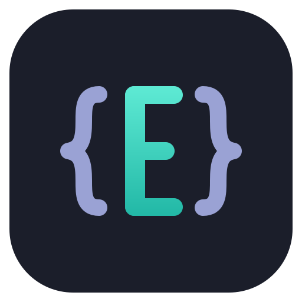
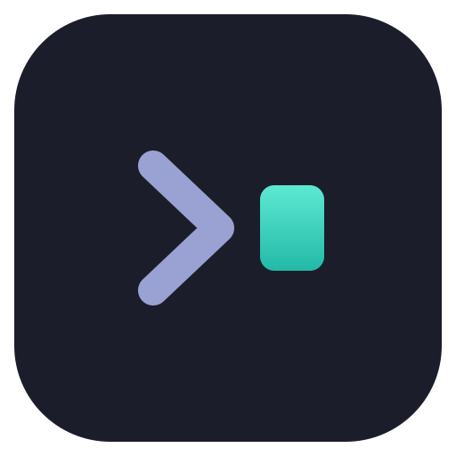
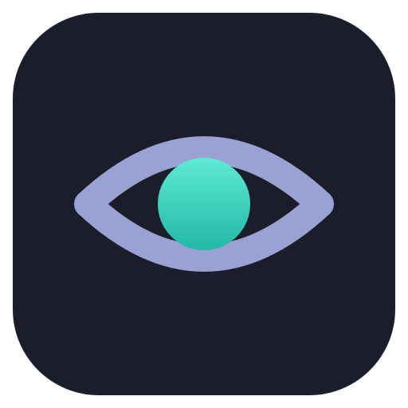

# Pauta

**The adl desktop apps guidelines.** *Pauta* is Spanish for a guideline, and for the ruled lines on writing paper.

<p>
  
  
  
  
  
  
</p>

[](https://github.com/adriandeleon/adl-desktop-apps-guidelines/actions/workflows/pages.yml)
[](LICENSE)


UI, UX and platform rules so the family of JavaFX desktop apps is the same app on Windows, macOS and Linux — [Editora](https://github.com/adriandeleon/Editora),
[Torrenta](https://github.com/adriandeleon/torrenta), [Termina](https://github.com/adriandeleon/Termina),
[Modula](https://github.com/adriandeleon/Modula), [Mirada](https://github.com/adriandeleon/Mirada) and
[nux](https://github.com/adriandeleon/nux). Editora is the reference implementation: every rule names the class
or file to copy from.

🧰 **Starting a new app?** Use [adl-desktop-app-template](https://github.com/adriandeleon/adl-desktop-app-template),
a GitHub template repository: a runnable app with its tests, CI and release workflows, and an example of every
repository document, built to the Pauta edition its README names. Click **Use this template**, then run
`scripts/rename.sh <AppName> <package>`.

The current edition's version and date live in `package.json`; [CHANGELOG.md](CHANGELOG.md) says what each edition
changed, and the [Changelog page](https://pauta-project.dev/latest/changelog/) how editions are numbered.

📖 **Read it at [pauta-project.dev](https://pauta-project.dev/)**
— or download the [PDF](https://pauta-project.dev/downloads/adl-desktop-apps-guidelines.pdf)
or the [single Markdown file](https://pauta-project.dev/downloads/adl-desktop-apps-guidelines.md).
Coding agents start at [`llms.txt`](https://pauta-project.dev/llms.txt): every edition also serves its rules as
[`rules.json`](https://pauta-project.dev/latest/rules.json) and
[`llms-full.txt`](https://pauta-project.dev/latest/llms-full.txt), with how to audit an app against them; the [Coding agents and LLMs](https://pauta-project.dev/latest/coding-agents/)
page explains them.
Every edition stays online at its own address: [`/latest/`](https://pauta-project.dev/latest/) is always the newest,
`/1.4.0/`, `/1.3.2/` and so on are permanent, and the header of every page switches between them.

## What it covers

| Part | Pages |
|---|---|
| Start here | Principles · New app checklist · Coding agents and LLMs |
| Foundations | Platform baseline (JDK 25, JavaFX 27, AtlantaFX, NullAway, Maven Wrapper) · Repository documents · Documentation (user docs on the website, `docs/`, Help → Documentation) · Code quality gates (90% coverage) |
| Experience | Keyboard first & Command Palette · Window shell · Icons and color (Inter, the Caret & Ink palette, state colors, icon families) · Toolbars and tooltips · Tabs and tool panels · Menus (menu bar, right-click menus) · Tray and background (close to tray, start at login, notifications) · Settings (search, Git/GitHub sync) · Diagnostics (Message Log, Debug Log, updates, Report a Problem) · Command line · Internationalization |
| Templates | Command Palette · QuickOpen picker · Welcome page · About window · Confirm dialog · Find bar · Message Log · Settings Sync |
| Shipping | jpackage + JReleaser installers for macOS / Linux / Windows on arm64 and x64, signing, CI |
| The family | Feature matrix of the six apps · Shared features · Gaps per app |

## Working on it

The pages are Markdown in [`src/content/docs/`](src/content/docs/); their order (sidebar and PDF) is
[`pages.json`](pages.json). The site is [Astro Starlight](https://starlight.astro.build/).

```bash
npm ci
npm run dev        # http://localhost:4321/
npm run print      # PDF + single Markdown into public/downloads (needs pandoc and Chrome)
npm run build      # the whole site into dist/: this edition at latest/ and <version>/, earlier editions beside them
npm run preview    # serves dist/ as deployed
npm run check      # fails on a malformed rule; the build runs it first
```

Conventions: in a feature matrix (a table whose header names the apps), a cell starting with `●`, `◐` or `—`
renders as a status dot, the rest of the cell being its note; elsewhere a `—` stays a dash. `MUST`, `SHOULD` and
`MAY` render as a level pill wherever they appear in prose, lists or tables, including `**MUST.**` and `(SHOULD)`.
A rule is a list item that opens with its ID and level, `**KBD-07 · MUST.**`, followed by *Why*, *Check* and
*Reference* lines; [AGENTS.md](AGENTS.md) has the details and each page's prefix.

Guidance collects under *Unreleased* in `CHANGELOG.md` and is published in batches, as editions. Every push to
`master` is checked and built; it is deployed to GitHub Pages only when nothing waits under *Unreleased*, and while
something does, CI still publishes the current edition from its release commit if that edition isn't live yet
(`scripts/release-state.mjs`). The site carries every edition: the current one at `/latest/` and `/<version>/`, the
earlier ones from the `versions` branch, where CI archives each edition it deploys, and CI tags each `v<version>`.
While nothing waits under *Unreleased*, a push that changes only how the site looks (styles, scripts, a typo fixed
with an `Edition: none` trailer) deploys the current edition again and re-archives its folder: the current edition's
pages can change in form, never in their rules, and an older edition's folder never changes on the `versions` branch. The site serves the PDF of the two newest
editions only; an older edition's overview links its PDF on that branch on GitHub. On
every pull request `scripts/check-edition.mjs` checks the changelog and, for a release, its number.

## License

MIT — see [LICENSE](LICENSE) and [NOTICE](NOTICE).
