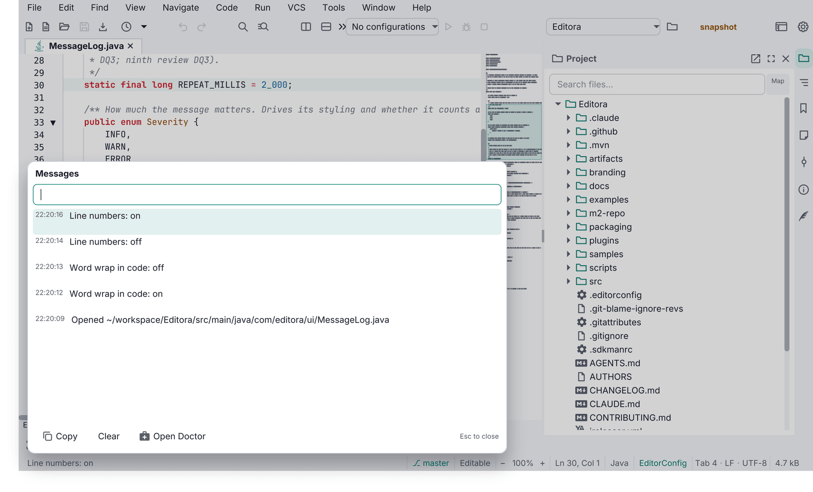
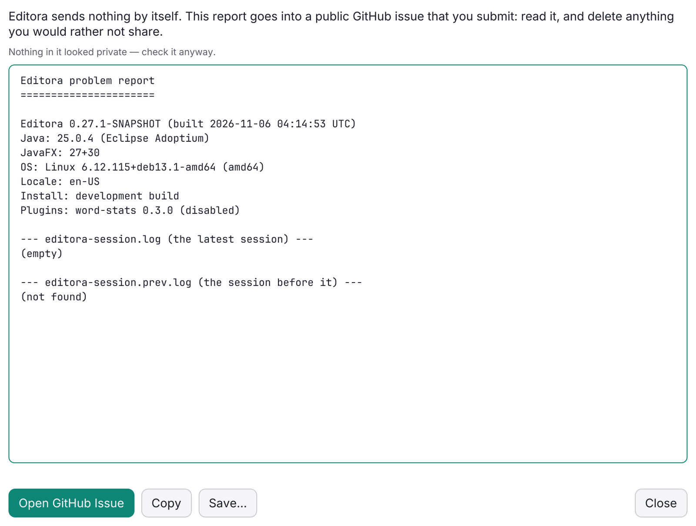
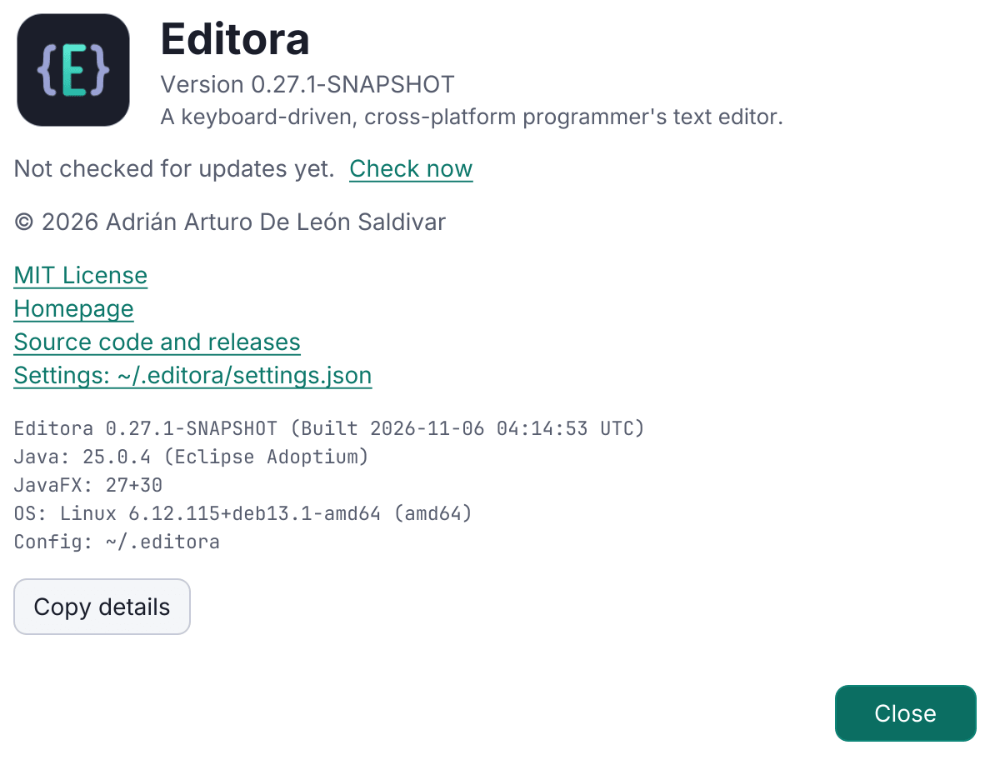
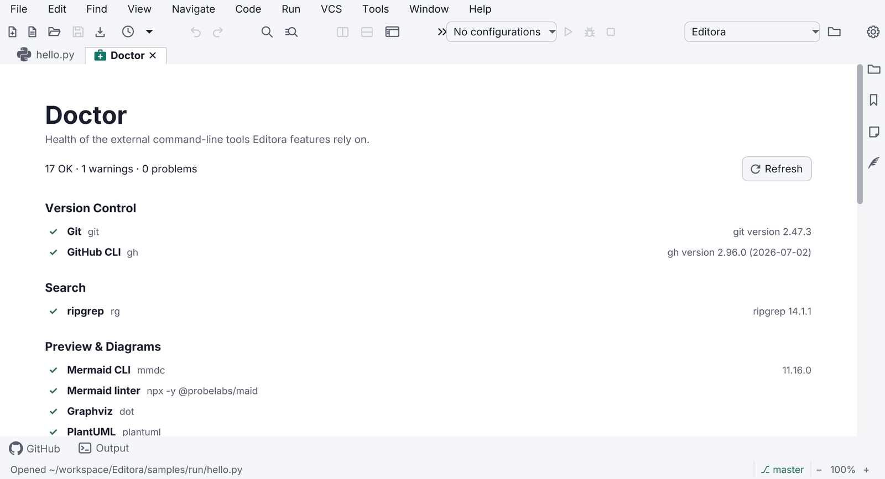

- **DIAG-01 · MUST.** The **Message Log** is a session-only, bounded history of every echo-area message with
  `HH:mm:ss` times, newest first. Esc closes it; Clear empties it. What opens it, a click on the echo area, is
  [WIN-01](../window-shell/#win-01)'s to require; the [Message Log template](../templates/message-log/) has the rest.
  - *Check (code):* every message the echo area shows is added, with its time, to one log held in memory and never
    written to disk; the log drops its oldest entry past a fixed count and lists the rest newest first with
    `HH:mm:ss` times; and its window closes on Esc and has a Clear action that empties it. A test that records
    messages newest first, evicts the oldest past the cap, and clears is the surest evidence.
  - *Reference:* Editora [`ui/MessageLog.java`](https://github.com/adriandeleon/Editora/blob/master/src/main/java/com/editora/ui/MessageLog.java) ([`MessageLogTest`](https://github.com/adriandeleon/Editora/blob/master/src/test/java/com/editora/ui/MessageLogTest.java)), [`ui/MessageLogPopup.java`](https://github.com/adriandeleon/Editora/blob/master/src/main/java/com/editora/ui/MessageLogPopup.java).
- **DIAG-02 · MUST.** The **Debug Log** captures all `java.util.logging` records and uncaught exceptions in memory
  (bounded) **and** mirrors them to a session file in the config folder, keeping the previous session's file so a
  crash is still visible next launch. Editora names the two `<app>-session.log` and `<app>-session.prev.log`.
  - *Check (code):* a handler on the root `java.util.logging` logger and the uncaught exception handler feed one
    bounded buffer in memory and a session file in the config folder, and at start the last session's file is kept
    under a second name before the new one is begun. Tests that bound the buffer and find the session file written
    and the previous one kept are the surest evidence.
  - *Reference:* Editora [`ui/DebugLog.java`](https://github.com/adriandeleon/Editora/blob/master/src/main/java/com/editora/ui/DebugLog.java) ([`DebugLogTest`](https://github.com/adriandeleon/Editora/blob/master/src/test/java/com/editora/ui/DebugLogTest.java), [`DebugLogSessionFileTest`](https://github.com/adriandeleon/Editora/blob/master/src/test/java/com/editora/ui/DebugLogSessionFileTest.java)).
- **DIAG-03 · MUST.** The Debug Log opens in a modeless window with Refresh, Copy, Clear, Export and Report a
  Problem. The window's find bar is [FIND-01](../templates/find-bar/#find-01).
  - *Why:* it is the only way to see logs in a packaged build.
  - *Check (code):* the Debug Log's window is a stage with no modality, so the main window keeps working while it
    is open, and it carries the five actions: Refresh, Copy, Clear, Export and Report a Problem.
  - *Reference:* Editora [`ui/DebugLogWindow.java`](https://github.com/adriandeleon/Editora/blob/master/src/main/java/com/editora/ui/DebugLogWindow.java). Termina's, Mirada's and the app template's windows have the
    five actions too; Torrenta's has no Export ([`ui/DebugLogWindow.java`](https://github.com/adriandeleon/torrenta/blob/master/src/main/java/com/torrenta/ui/DebugLogWindow.java)). Modula and nux have no Debug Log
    ([DIAG-02](#diag-02)).
- **DIAG-04 · MUST.** An **uncaught exception handler** is installed at the start of `main`, before the toolkit
  starts, and routes to the Debug Log and an echo message. Never a stack trace dialog.
  - *Check (code):* `main` calls the install method before any argument handling or `launch`, and the handler
    posts an error to the echo area, and opens no dialog.
  - *Reference:* Editora [`DebugLog.install()`](https://github.com/adriandeleon/Editora/blob/master/src/main/java/com/editora/ui/DebugLog.java) for the install and the log. The echo message is posted by Termina
    ([`ui/WindowManager.java`](https://github.com/adriandeleon/Termina/blob/master/src/main/java/com/termina/ui/WindowManager.java), through `DebugLog.onUncaught`), the app template ([`ui/Startup.java`](https://github.com/adriandeleon/adl-desktop-app-template/blob/master/src/main/java/com/example/app/ui/Startup.java)) and Mirada
    ([`App.java`](https://github.com/adriandeleon/Mirada/blob/main/src/main/java/com/mirada/App.java), `uncaught`). Editora's handler and Torrenta's ([`ui/DebugLog.java`](https://github.com/adriandeleon/torrenta/blob/master/src/main/java/com/torrenta/ui/DebugLog.java)) log the exception
    but do not yet post one.
- **DIAG-05 · MUST.** The **update check** reads GitHub `/releases/latest`. The automatic check runs once per app
  session (not per window), at most once a day, and starts at least three seconds after the first frame
  ([PERF-15](../performance/#perf-15)); a check the user asks for ([DIAG-10](#diag-10)) runs when asked. It never
  downloads or installs anything by itself.
  - *Check (code):* the code that starts the automatic check waits for the first frame and then a delay of three
    seconds or more before it asks GitHub's `/releases/latest` for the app's repository (Editora's
    `AfterFirstPaint`, then a pause of five seconds); it asks once for the whole process, however many windows
    open, and not at all when the last check, whose time the app keeps from one session to the next, was less than
    a day ago, or when the setting is off ([DIAG-10](#diag-10)); and what it does
    with the answer is show it: no code downloads or installs a release. A test that asserts the wait, the one
    check a session and the two skips is the surest evidence.
  - *Reference:* Editora [`update/UpdateCheck.java`](https://github.com/adriandeleon/Editora/blob/master/src/main/java/com/editora/update/UpdateCheck.java), [`ui/UpdateCheckScheduler.java`](https://github.com/adriandeleon/Editora/blob/master/src/main/java/com/editora/ui/UpdateCheckScheduler.java) ([`UpdateCheckSchedulerTest`](https://github.com/adriandeleon/Editora/blob/master/src/test/java/com/editora/ui/UpdateCheckSchedulerTest.java),
    `waitsForTheFirstPaintThenTheDelayThenStampsAndChecks` and `onlyOnceASessionAndNotWhenOffOrNotDue`),
    [`ui/UpdateCoordinator.java`](https://github.com/adriandeleon/Editora/blob/master/src/main/java/com/editora/ui/UpdateCoordinator.java); Editora waits five
    seconds (`UpdateCheckScheduler.DELAY`). Termina ([`App.java`](https://github.com/adriandeleon/Termina/blob/master/src/main/java/com/termina/App.java), three seconds after its first frame), Mirada
    ([`update/UpdateCoordinator.java`](https://github.com/adriandeleon/Mirada/blob/main/src/main/java/com/mirada/update/UpdateCoordinator.java), `scheduleStartupCheck`, five seconds) and the app template
    ([`ui/UpdateCoordinator.java`](https://github.com/adriandeleon/adl-desktop-app-template/blob/master/src/main/java/com/example/app/ui/UpdateCoordinator.java), started from [`ui/Startup.java`](https://github.com/adriandeleon/adl-desktop-app-template/blob/master/src/main/java/com/example/app/ui/Startup.java) after the first paint, five seconds) wait the same way. Three apps
    don't wait yet: Torrenta starts its check as soon as its engine is ready ([`ui/MainWindow.java`](https://github.com/adriandeleon/torrenta/blob/master/src/main/java/com/torrenta/ui/MainWindow.java),
    `maybeCheckForUpdates`), and Modula ([`ModulaApp.java`](https://github.com/adriandeleon/Modula/blob/master/src/main/java/com/modula/ModulaApp.java), `checkForUpdates`) and nux ([`App.java`](https://github.com/adriandeleon/nux/blob/master/src/main/java/com/nux/App.java),
    `maybeCheckForUpdates`) start theirs inside `start()`.
- **DIAG-09 · MUST.** When the update check ([DIAG-05](#diag-05)) finds a newer version, the status bar says so,
  naming the version and linking its release. About's line for the last check is
  [ABOUT-02](../templates/about/#about-02).
  - *Check (code):* when a check finds a newer version, the app shows a notice in the status bar that names that
    version, and the notice, or a link beside it in the bar, opens that release's page (Editora's
    `UpdateCoordinator` shows a status-bar segment whose click opens the release).
  - *Reference:* Editora [`ui/UpdateCoordinator.java`](https://github.com/adriandeleon/Editora/blob/master/src/main/java/com/editora/ui/UpdateCoordinator.java). Mirada ([`ui/StatusBar.java`](https://github.com/adriandeleon/Mirada/blob/main/src/main/java/com/mirada/ui/StatusBar.java)) and the app template
    ([`ui/StatusBar.java`](https://github.com/adriandeleon/adl-desktop-app-template/blob/master/src/main/java/com/example/app/ui/StatusBar.java)) show a link in the bar, and Torrenta a badge there that opens the release
    ([`ui/MainWindow.java`](https://github.com/adriandeleon/torrenta/blob/master/src/main/java/com/torrenta/ui/MainWindow.java), `updateBadge`). Termina and Modula don't link the release yet: their status message
    names the version and nothing in the bar opens it (Termina's `status.updateAvailable`, posted from
    [`ui/WindowManager.java`](https://github.com/adriandeleon/Termina/blob/master/src/main/java/com/termina/ui/WindowManager.java); Modula's [`ui/RadioPane.java`](https://github.com/adriandeleon/Modula/blob/master/src/main/java/com/modula/ui/RadioPane.java), `setAvailableUpdate`). nux doesn't meet it
    either: it has no status bar, and shows a button in its toolbar that opens the release
    ([`App.java`](https://github.com/adriandeleon/nux/blob/master/src/main/java/com/nux/App.java), `refreshUpdateNotice`).
- **DIAG-10 · MUST.** **Check for Updates** runs the update check ([DIAG-05](#diag-05)) by hand, as a command in the
  palette and in the Help menu, where the app has a Help menu (the Help menu of a menu bar, or a Help submenu of the
  app's main menu, which [WIN-14](../window-shell/#win-14) defines), and Settings has an off switch for the automatic
  check.
  - *Check (code):* the command (`help.checkForUpdates` in Editora) is registered and, in an app with a Help menu,
    listed there, and the scheduler skips the automatic check while the setting is off.
  - *Reference:* Editora [`ui/MenuBarModel.java`](https://github.com/adriandeleon/Editora/blob/master/src/main/java/com/editora/ui/MenuBarModel.java) (`help.checkForUpdates`),
    [`ui/SettingsWindow.java`](https://github.com/adriandeleon/Editora/blob/master/src/main/java/com/editora/ui/SettingsWindow.java) (`settings.checkForUpdates`), [`ui/UpdateCheckScheduler.java`](https://github.com/adriandeleon/Editora/blob/master/src/main/java/com/editora/ui/UpdateCheckScheduler.java).
    Mirada lists the command in the Help submenu of its main menu ([`ui/TitleBar.java`](https://github.com/adriandeleon/Mirada/blob/main/src/main/java/com/mirada/ui/TitleBar.java), `help`) and in the Help
    menu of its macOS menu bar. nux, which has no menu bar, registers the command for its palette
    (`app.checkUpdates` in [`App.java`](https://github.com/adriandeleon/nux/blob/master/src/main/java/com/nux/App.java)).
- **DIAG-06 · MUST.** **Report a Problem** is a command, listed in the Help menu where the app has one, that builds a
  report: the app's version, the OS, the runtime, a summary of the settings and the recent Debug Log. Its redaction
  is [DIAG-11](#diag-11), its window [DIAG-12](#diag-12) and the limit on the issue link's length
  [DIAG-13](#diag-13). The same report from the command line, for when the app cannot start, is
  [CLI-05](../command-line/#cli-05).
  - *Check (code):* the command (`help.reportProblem` in Editora) is registered and, in an app with a Help menu,
    listed there, and the text it builds carries the app's version, the OS, the Java and JavaFX versions, a summary
    of the settings and the end of the Debug Log.
  - *Reference:* Termina [`report/ProblemReport.java`](https://github.com/adriandeleon/Termina/blob/master/src/main/java/com/termina/report/ProblemReport.java) ([`ProblemReportTest`](https://github.com/adriandeleon/Termina/blob/master/src/test/java/com/termina/report/ProblemReportTest.java),
    `itCarriesTheEnvironmentTheUsefulSettingsAndTheEndOfTheLog`), the app template's
    [`report/ProblemReport.java`](https://github.com/adriandeleon/adl-desktop-app-template/blob/master/src/main/java/com/example/app/report/ProblemReport.java) and Mirada's [`report/ProblemReport.java`](https://github.com/adriandeleon/Mirada/blob/main/src/main/java/com/mirada/report/ProblemReport.java). Editora's
    ([`report/ProblemReport.java`](https://github.com/adriandeleon/Editora/blob/master/src/main/java/com/editora/report/ProblemReport.java), `help.reportProblem` in [`ui/MenuBarModel.java`](https://github.com/adriandeleon/Editora/blob/master/src/main/java/com/editora/ui/MenuBarModel.java)) and Torrenta's
    ([`report/ProblemReport.java`](https://github.com/adriandeleon/torrenta/blob/master/src/main/java/com/torrenta/report/ProblemReport.java)) carry the system details and the last two session logs, and no settings
    summary yet. Modula and nux have no problem report.
- **DIAG-11 · MUST.** An app's problem report ([DIAG-06](#diag-06)) is **redacted** before it is shown: home paths,
  user names, e-mail addresses, credentials and tokens are replaced.
  - *Check (code):* the text the Report a Problem window shows has been through the redactor, and the redactor
    replaces home paths, user names, e-mail addresses, credentials in URLs and tokens. Redaction tests that cover
    each of the five are the surest evidence.
  - *Reference:* Editora [`report/Redactor.java`](https://github.com/adriandeleon/Editora/blob/master/src/main/java/com/editora/report/Redactor.java) ([`RedactorTest`](https://github.com/adriandeleon/Editora/blob/master/src/test/java/com/editora/report/RedactorTest.java)), applied in
    [`ProblemReport.assemble`](https://github.com/adriandeleon/Editora/blob/master/src/main/java/com/editora/report/ProblemReport.java) before the window gets the text. The other four apps with a report do it too:
    Termina ([`RedactorTest`](https://github.com/adriandeleon/Termina/blob/master/src/test/java/com/termina/report/RedactorTest.java)), Torrenta ([`RedactorTest`](https://github.com/adriandeleon/torrenta/blob/master/src/test/java/com/torrenta/report/RedactorTest.java)), Mirada ([`RedactorTest`](https://github.com/adriandeleon/Mirada/blob/main/src/test/java/com/mirada/report/RedactorTest.java)) and the app
    template ([`ReportTest`](https://github.com/adriandeleon/adl-desktop-app-template/blob/master/src/test/java/com/example/app/report/ReportTest.java), `redactsPrivateDetails`).
- **DIAG-12 · MUST.** The Report a Problem window shows the report in a field the user can edit. Its submit action
  copies the report, as edited, to the clipboard and opens a GitHub issue prefilled from the repository's
  `bug_report.yml` form. Nothing is uploaded: the user submits the issue.
  - *Check (code):* the window's report field is editable; its submit action puts the field's text on the clipboard
    and opens a new-issue link that names `bug_report.yml` as its template and carries the report in the form's
    fields; and the report's code opens that link in the browser and makes no network request of its own.
  - *Reference:* Editora [`ui/ReportProblemWindow.java`](https://github.com/adriandeleon/Editora/blob/master/src/main/java/com/editora/ui/ReportProblemWindow.java) ([`ReportProblemWindowFxTest`](https://github.com/adriandeleon/Editora/blob/master/src/test/java/com/editora/ui/ReportProblemWindowFxTest.java),
    `theEditedReportIsCopiedAndFilledIntoTheIssue`), [`ProblemReport.issueUrl`](https://github.com/adriandeleon/Editora/blob/master/src/main/java/com/editora/report/ProblemReport.java). Termina's
    [`ui/ReportProblemWindow.java`](https://github.com/adriandeleon/Termina/blob/master/src/main/java/com/termina/ui/ReportProblemWindow.java), Torrenta's [`ui/ReportProblemWindow.java`](https://github.com/adriandeleon/torrenta/blob/master/src/main/java/com/torrenta/ui/ReportProblemWindow.java), Mirada's
    [`ui/ReportProblemWindow.java`](https://github.com/adriandeleon/Mirada/blob/main/src/main/java/com/mirada/ui/ReportProblemWindow.java) and the app template's [`ui/ReportProblemWindow.java`](https://github.com/adriandeleon/adl-desktop-app-template/blob/master/src/main/java/com/example/app/ui/ReportProblemWindow.java) do the same. The
    five differ in one thing the rule does not ask. Only Termina sends everything as the user left it: its
    environment block (version, runtime, OS) is a second editable field. The other four fill the form's environment
    field from the block as the app built it, whatever the user edits: Editora and Torrenta show the block at the top of the editable report, Mirada shows it as a label, and
    the app template does not show it.
- **DIAG-13 · MUST.** When the issue link that Report a Problem prefills ([DIAG-12](#diag-12)) would be longer than
  7,500 characters, the report stays out of the link: the form's report field asks the user to paste the report
  from the clipboard, where DIAG-12 has put it.
  - *Check (code):* the code that builds the issue link puts the report in the form's report field while the link
    stays within 7,500 characters, and past that puts the paste hint in that field instead. A test that builds the
    link for a short report and for a long one is the surest evidence.
  - *Reference:* Editora [`ProblemReport.issueUrl`](https://github.com/adriandeleon/Editora/blob/master/src/main/java/com/editora/report/ProblemReport.java) (`MAX_URL_LENGTH`, 7500; [`ProblemReportTest`](https://github.com/adriandeleon/Editora/blob/master/src/test/java/com/editora/report/ProblemReportTest.java),
    `aShortReportGoesIntoTheIssueLinkItself` and `aLongReportLeavesThePasteHintInstead`). Torrenta
    ([`ProblemReportTest`](https://github.com/adriandeleon/torrenta/blob/master/src/test/java/com/torrenta/report/ProblemReportTest.java), `aShortReportGoesInTheLinkAndALongOneLeavesTheHint`), Mirada ([`ProblemReportTest`](https://github.com/adriandeleon/Mirada/blob/main/src/test/java/com/mirada/report/ProblemReportTest.java),
    `aLongReportAsksForAPaste`) and the app template ([`ReportTest`](https://github.com/adriandeleon/adl-desktop-app-template/blob/master/src/test/java/com/example/app/report/ReportTest.java),
    `issueLinkFillsTheFormOrFallsBackToTheClipboard`) do the same at the same limit. Termina has the limit
    (`MAX_LINK_LENGTH`; [`ProblemReportTest`](https://github.com/adriandeleon/Termina/blob/master/src/test/java/com/termina/report/ProblemReportTest.java), `aLongReportFallsBackToTheClipboard`) but not the hint yet: past it,
    its link leaves the form's report field empty, and only its own window says to paste
    ([`report/ProblemReport.java`](https://github.com/adriandeleon/Termina/blob/master/src/main/java/com/termina/report/ProblemReport.java), `link`; `report.paste`).
- **DIAG-07 · SHOULD.** A **Doctor** page checks the environment (external tools, versions, permissions, paths),
  with a status per row and a fix or link for each failure.
  - *Check (by hand):* open the Doctor with a tool missing and find its row failed, with what to install.
  - *Reference:* Editora `doctor/*`, [`ui/DoctorPane.java`](https://github.com/adriandeleon/Editora/blob/master/src/main/java/com/editora/ui/DoctorPane.java).
- **DIAG-08 · SHOULD.** An app with user documents snapshots unsaved work off the FX thread and offers it back after
  a crash.
  - *Check (code):* unsaved documents are written to snapshot files from a background thread while the user works,
    and the first window opened after a crash finds the abandoned session's snapshots and offers them back. A test
    that finds an abandoned session's snapshots and offers them to the first window only is the surest evidence.
  - *Reference:* Editora [`recovery/RecoveryService.java`](https://github.com/adriandeleon/Editora/blob/master/src/main/java/com/editora/recovery/RecoveryService.java) ([`RecoveryServiceTest`](https://github.com/adriandeleon/Editora/blob/master/src/test/java/com/editora/recovery/RecoveryServiceTest.java), [`CrashRecoveryFxTest`](https://github.com/adriandeleon/Editora/blob/master/src/test/java/com/editora/ui/CrashRecoveryFxTest.java)).

Secrets never reach a log, a report or a config file: see [Secrets stay out of files](../settings/#secrets-stay-out-of-files).
