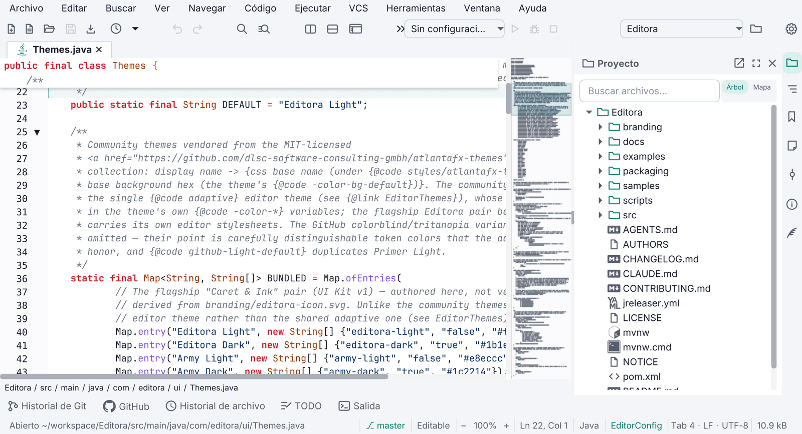
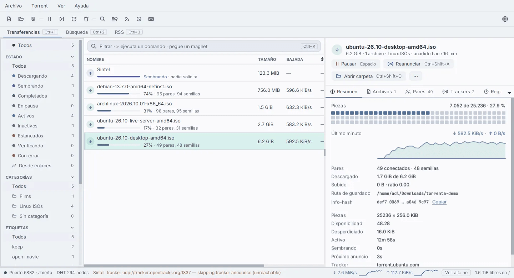

## Languages

Every app ships **at least these six**. They are a floor, not the set: an app SHOULD add languages as people ask
for them, and a new app can start with more.

| Language | Catalog |
|---|---|
| English (base) | `messages.properties` |
| Spanish | `messages_es.properties` |
| Portuguese | `messages_pt.properties` |
| French | `messages_fr.properties` |
| Italian | `messages_it.properties` |
| German | `messages_de.properties` |

Adding a language:

- Add `messages_<code>.properties` with every key, and the language to the Settings language picker. The parity
  test then holds it to the same keys as the others.
- Translate for real; do not ship English values in another language's catalog.
- Check the layout in the new language at 1024 px wide. German is today's longest; rows must wrap, never cut.
- Scripts beyond Latin need more than strings. Chinese, Japanese and Korean need a font fallback, because Inter
  has no CJK glyphs. Arabic and Hebrew need `NodeOrientation.RIGHT_TO_LEFT` on every scene.

## Rules

- Never pass a raw English literal to a control: `tr("some.key")` from one `Messages` class.
- Every language has a real translation of every key. A test fails the build when a key is missing in any
  catalog.
- `MessageFormat` rules: in a value with a placeholder, double literal apostrophes; identifiers such as line
  numbers and ports use `{0,number,#}` so they are not digit-grouped.
- Untranslated on purpose: technical identifiers, `--help` and `--version` text.

