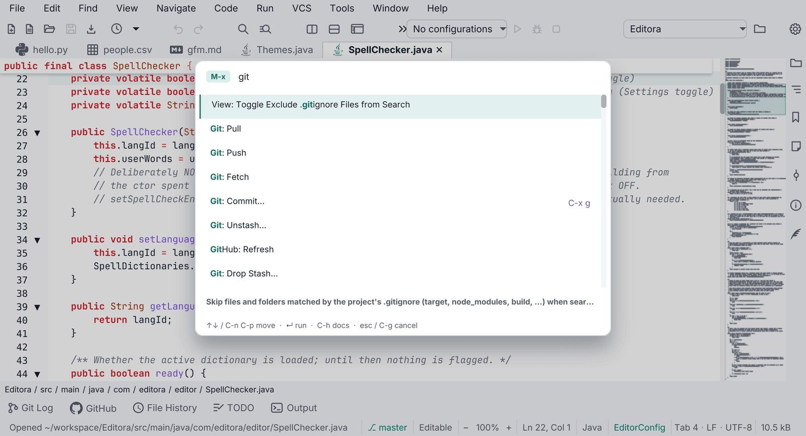
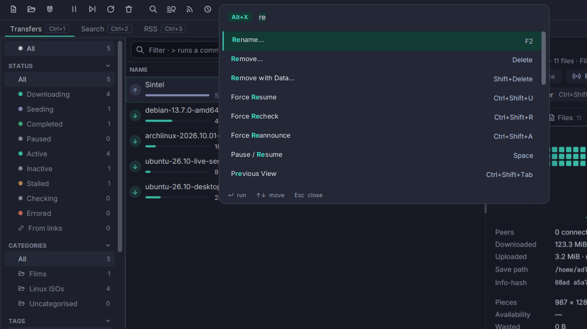
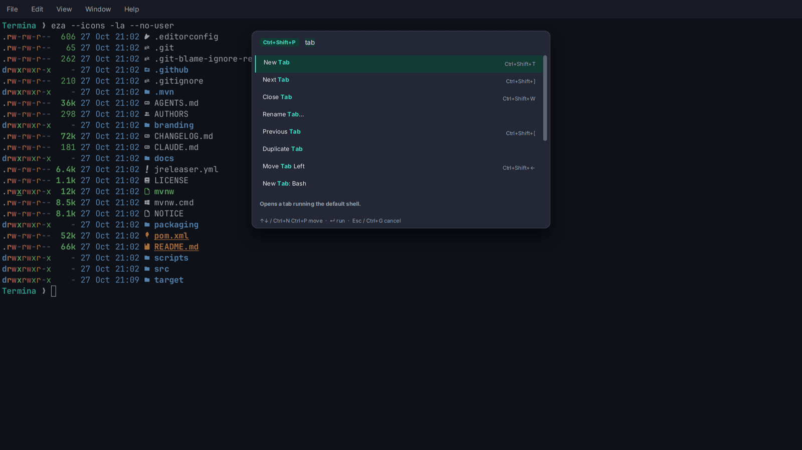
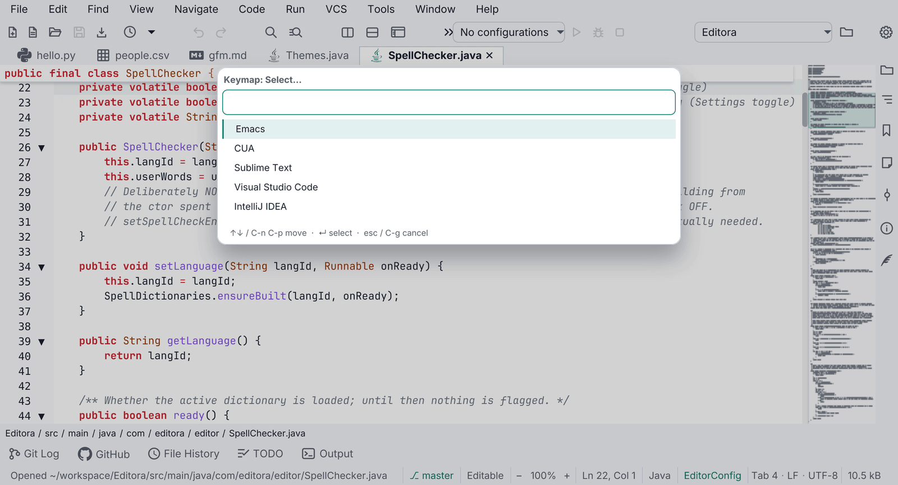
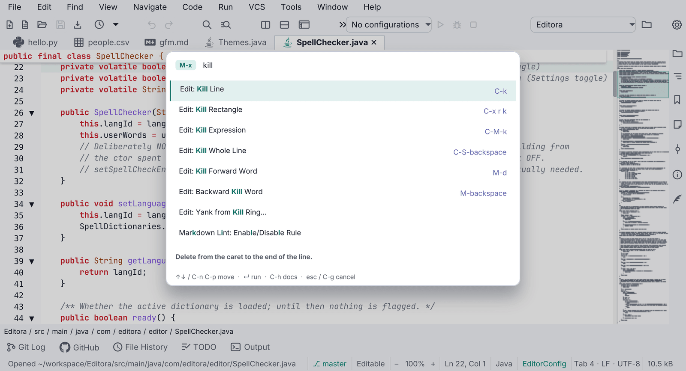
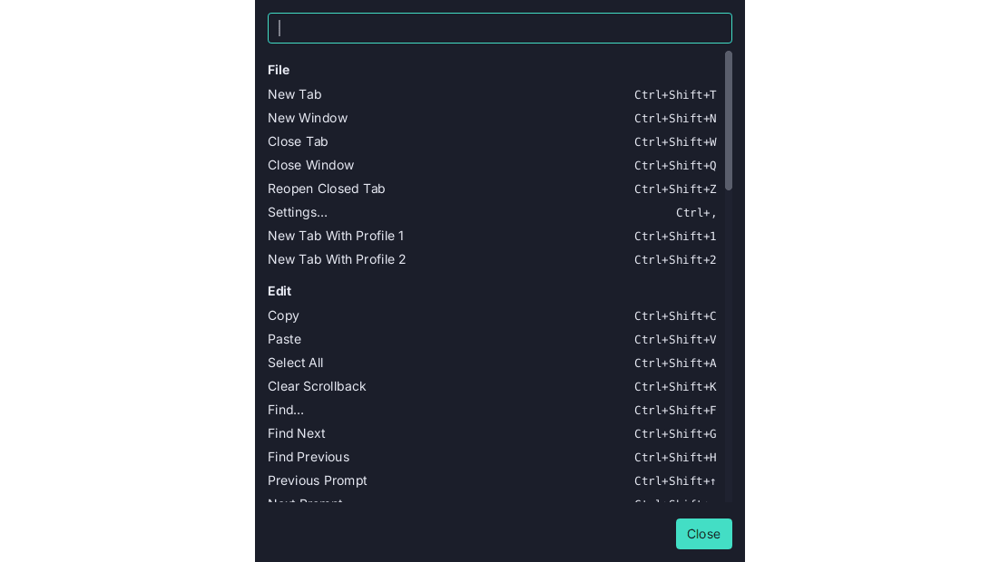

## Commands

- **KBD-01 · MUST.** Every user-facing action is a `Command` (id, title, runnable) registered in one
  `CommandRegistry`.
  - *Check (code):* menu items, toolbar buttons, palette rows and key bindings run a command id through the
    registry; no control's handler does work no command can reach.
  - *Reference:* Editora [`command/Command.java`](https://github.com/adriandeleon/Editora/blob/master/src/main/java/com/editora/command/Command.java), [`command/CommandRegistry.java`](https://github.com/adriandeleon/Editora/blob/master/src/main/java/com/editora/command/CommandRegistry.java).
- **KBD-02 · SHOULD.** Command ids are dotted and grouped by area: `file.open`, `view.toggleStatusBar`,
  `help.reportProblem`.
  - *Check (code):* every registered id matches `<area>.<camelCaseName>`.
  - *Reference:* Editora [`ui/MenuBarModel.java`](https://github.com/adriandeleon/Editora/blob/master/src/main/java/com/editora/ui/MenuBarModel.java).
- **KBD-03 · MUST.** A command's title comes from `command.<id>` and its palette description from
  `command.<id>.desc` in the message catalogs.
  - *Why:* a registered command is then localized and discoverable without extra work.
  - *Check (test):* a catalog parity test fails when a registered command has no `command.<id>` or
    `command.<id>.desc` key.
  - *Reference:* Editora [`i18n/messages.properties`](https://github.com/adriandeleon/Editora/blob/master/src/main/resources/com/editora/i18n/messages.properties), [`MessagesTest`](https://github.com/adriandeleon/Editora/blob/master/src/test/java/com/editora/i18n/MessagesTest.java).
- **KBD-04 · SHOULD.** A command that cannot run in the current context is shown grayed, with a tooltip that says
  why, not hidden.
  - *Check (code):* the palette and menus list a disabled command with a reason, rather than filtering it out.
  - *Reference:* Editora [`ui/Chrome.java`](https://github.com/adriandeleon/Editora/blob/master/src/main/java/com/editora/ui/Chrome.java) (`paletteEnabled`, `disabledReason`).

## Command Palette

- **KBD-05 · MUST.** The Command Palette opens with `M-x` in the Emacs keymap and `Ctrl+Shift+P` (`Cmd+Shift+P` on
  macOS) in the others; the IntelliJ keymap may use IntelliJ's own Find Action chord, `Ctrl+Shift+A`
  (`Cmd+Shift+A`), instead.
  - *Check (code):* each bundled keymap binds that chord to the palette command.
  - *Reference:* Editora [`keymaps/emacs.json`](https://github.com/adriandeleon/Editora/blob/master/src/main/resources/com/editora/keymaps/emacs.json) (`M-x`), [`cua.json`](https://github.com/adriandeleon/Editora/blob/master/src/main/resources/com/editora/keymaps/cua.json) and [`vscode.json`](https://github.com/adriandeleon/Editora/blob/master/src/main/resources/com/editora/keymaps/vscode.json) (`C-S-p`), [`cua.mac.json`](https://github.com/adriandeleon/Editora/blob/master/src/main/resources/com/editora/keymaps/cua.mac.json)
    (`Cmd-S-p`), all to `palette.show`; [`intellij.json`](https://github.com/adriandeleon/Editora/blob/master/src/main/resources/com/editora/keymaps/intellij.json) binds `C-S-a`.
- **KBD-06 · SHOULD.** The palette matches fuzzily over title, id and description; a query that names a command's
  title outranks a fuzzy hit. Each row shows the command's binding in the active keymap. See the
  [Command Palette template](../templates/command-palette/).
  - *Check (test):* a ranking test puts the title match first.
  - *Reference:* Editora [`ui/CommandPalette.java`](https://github.com/adriandeleon/Editora/blob/master/src/main/java/com/editora/ui/CommandPalette.java), [`search/FuzzyMatch.java`](https://github.com/adriandeleon/Editora/blob/master/src/main/java/com/editora/search/FuzzyMatch.java).
- **KBD-07 · MUST.** The palette is an in-scene overlay in the window's root `StackPane`, not a
  `javafx.stage.Popup`.
  - *Why:* on Windows a Popup does not reliably take OS keyboard focus, and the whole app can stop receiving
    keystrokes.
  - *Check (code):* the palette and every picker add their node to the root `StackPane`; none creates a `Popup`.
  - *Reference:* Editora [`ui/CommandPalette.java`](https://github.com/adriandeleon/Editora/blob/master/src/main/java/com/editora/ui/CommandPalette.java).

Every other list choice (recent files, themes, keymaps, a setting's values) uses the same picker:
[QOPEN-01](../templates/quick-open/#qopen-01).

## Keymaps

- **KBD-09 · MUST.** Emacs and CUA keymaps ship as JSON resources, CUA with a `.mac.json` variant where Cmd replaces
  Ctrl.
  - *Check (code):* `emacs.json`, `cua.json` and `cua.mac.json` are in the app's resources.
  - *Command:* `[ -f pom.xml ] || { echo 'not an app root: no pom.xml here'; exit 1; }; ! for f in emacs.json cua.json cua.mac.json; do find src/main/resources -name "$f" | grep -q . || echo "missing $f"; done | grep .`
  - *Reference:* Editora [`src/main/resources/com/editora/keymaps/`](https://github.com/adriandeleon/Editora/tree/master/src/main/resources/com/editora/keymaps).
- **KBD-10 · SHOULD.** IntelliJ, VS Code and Sublime keymaps ship the same way, each with its `.mac.json` variant.
  - *Check (code):* `intellij`, `vscode` and `sublime` `.json` and `.mac.json` files are in the resources.
  - *Command:* `[ -f pom.xml ] || { echo 'not an app root: no pom.xml here'; exit 1; }; ! for k in intellij vscode sublime; do for f in "$k.json" "$k.mac.json"; do find src/main/resources -name "$f" | grep -q . || echo "missing $f"; done; done | grep .`
  - *Reference:* Editora [`src/main/resources/com/editora/keymaps/`](https://github.com/adriandeleon/Editora/tree/master/src/main/resources/com/editora/keymaps).
- **KBD-21 · MUST.** A keymap's `.mac.json` variant binds the same commands as the keymap it varies. A chord may
  differ, to put `Cmd` where the other has `Ctrl`, to follow the macOS keymap of the editor it copies, or where
  macOS keeps the chord for itself (`Cmd+Space`, `Cmd+Tab`). See [Same on every OS](../same-on-every-os/).
  - *Why:* a command with no chord on one OS is a command that user never finds from the keyboard.
  - *Check (test):* a test loads each keymap and its `.mac.json` variant and compares the commands they bind.
  - *Reference:* Editora [`KeymapsTest`](https://github.com/adriandeleon/Editora/blob/master/src/test/java/com/editora/command/KeymapsTest.java) (`guiKeymapsBindSameCommandSetOnBothPlatforms`).
- **KBD-11 · MUST.** Keymaps are applied in layers: base keymap → user overrides → plugin keymaps → the user's own
  bindings again. An app without plugins has the first two.
  - *Why:* the user always has the last word, and a plugin can still use a chord the user freed.
  - *Check (code):* one place applies the layers in that order.
  - *Reference:* Editora [`ui/KeymapLayers.java`](https://github.com/adriandeleon/Editora/blob/master/src/main/java/com/editora/ui/KeymapLayers.java).
- **KBD-12 · SHOULD.** A keymap editor in Settings lists every command with its chord, is searchable, and warns of
  conflicts.
  - *Check (by hand):* open Settings → Keymap, search, and bind a chord that is taken.
  - *Reference:* Editora [`ui/SettingsKeymapsPage.java`](https://github.com/adriandeleon/Editora/blob/master/src/main/java/com/editora/ui/SettingsKeymapsPage.java); conflicts from [`KeybindingEdits.takenDefaults`](https://github.com/adriandeleon/Editora/blob/master/src/main/java/com/editora/command/KeybindingEdits.java).
- **KBD-13 · SHOULD.** No command's chord is written into translated text. Every label shows the binding from the
  active keymap. Fixed keys of a control (Enter, Tab, Esc, arrows) and keys meant for another program may be
  written.
  - *Check (code):* no message catalog value names a command's chord (`Ctrl+`, `Cmd+`, `C-x`, `M-x`); chords are
    rendered by one formatter.
  - *Reference:* Editora [`command/ChordFormat.java`](https://github.com/adriandeleon/Editora/blob/master/src/main/java/com/editora/command/ChordFormat.java), the one place a binding is rendered. Editora's
    `command.edit.universalArgument` title still carries `C-u`.
- **KBD-14 · SHOULD.** A multi-key prefix (`C-x …`) shows a which-key style hint listing the possible next keys.
  - *Check (by hand):* press `C-x` in the Emacs keymap and wait.
  - *Reference:* no app lists the next keys yet. Editora echoes only the pending prefix (`C-x -`) in the status bar
    ([`command/KeyDispatcher.java`](https://github.com/adriandeleon/Editora/blob/master/src/main/java/com/editora/command/KeyDispatcher.java)).

## Focus and accessibility

- **KBD-15 · MUST.** Every interactive control is reachable with Tab and operable with Space or Enter. A button whose
  command the keyboard reaches another way is the exception: toolbar buttons
  ([TBAR-02](../toolbars-and-tooltips/#tbar-02)) and the find bar's buttons
  ([Find bar](../templates/find-bar/)) stay out of the Tab order. See [Accessibility](../accessibility/).
  - *Why:* a control that Tab can't reach is one a keyboard-only or screen-reader user can't use at all.
  - *Check (by hand):* Tab through every window and dialog without the mouse.
  - *Reference:* Editora; [`FocusRingFxTest`](https://github.com/adriandeleon/Editora/blob/master/src/test/java/com/editora/ui/FocusRingFxTest.java) holds that every control family draws the focus ring when Tab
    reaches it.
- **KBD-16 · MUST.** Every control shows the focus ring when the keyboard focuses it. The ring is one layer of
  `:focus-visible` rules in `app.css`, after every rule that sets a border or background on the same controls,
  since rules of equal specificity are decided by order. Its color and contrast are [ICON-12](../icons-and-color/#icon-12).
  - *Why:* a keyboard user who can't see where focus is can't use the window; the ring's color is a MUST, and so is
    drawing it.
  - *Check (test):* an FX test tabs to each control family and asserts the ring.
  - *Reference:* Editora [`app.css`](https://github.com/adriandeleon/Editora/blob/master/src/main/resources/com/editora/styles/app.css) (*Keyboard focus*, one layer for every control), [`FocusRingFxTest`](https://github.com/adriandeleon/Editora/blob/master/src/test/java/com/editora/ui/FocusRingFxTest.java).
- **KBD-18 · SHOULD.** On/off rows use a keyboard-operable switch with the `TOGGLE_BUTTON` role.
  - *Why:* a bare AtlantaFX `ToggleSwitch` is mouse-only.
  - *Check (code):* no `new ToggleSwitch` outside the switch class.
  - *Reference:* Editora [`ui/SettingSwitch.java`](https://github.com/adriandeleon/Editora/blob/master/src/main/java/com/editora/ui/SettingSwitch.java).

Related rules on other pages: every icon-only button gets its name from one helper,
[TBAR-01](../toolbars-and-tooltips/#tbar-01); rows wrap instead of being cut short in every language,
[INTL-04](../i18n/#intl-04); readable text and its contrast are one rule, [ICON-09](../icons-and-color/#icon-09).
