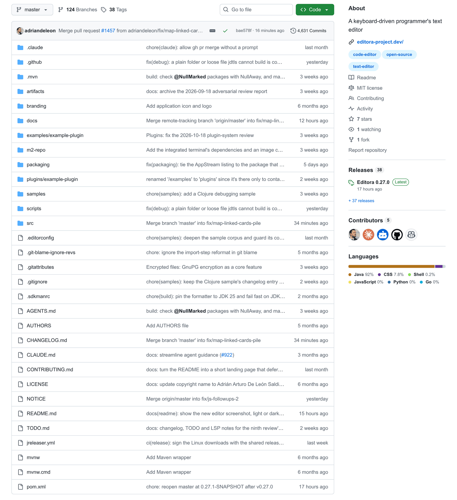
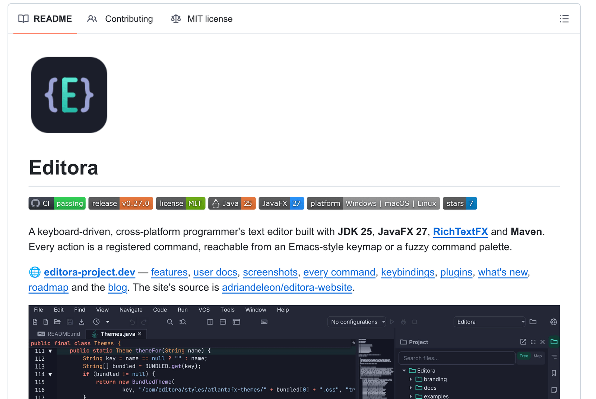

**Start from the template.** [adl-desktop-app-template](https://github.com/adriandeleon/adl-desktop-app-template) carries an example of every file on this page,
filled in for a placeholder app, `ExampleApp`. `scripts/rename.sh <AppName> <package>` renames it to yours.

| File | What it holds | Level |
|---|---|---|
| `README.md` | A landing page, about 200 lines: logo, badges, one-paragraph pitch, hero screenshot, highlights, install, build, command line, config folder, licence. Detail lives on the website. | MUST |
| `CHANGELOG.md` | [Keep a Changelog 1.1](https://keepachangelog.com/en/1.1.0/) + SemVer. An `## [Unreleased]` section with Added / Changed / Fixed / Removed; each entry opens with a bold one-line summary written for users. | MUST |
| `LICENSE` | MIT, "Copyright (c) 2026 Adrián Arturo De León Saldivar". | MUST |
| `NOTICE` | App name, copyright, "licensed under the MIT License", then every bundled third-party component with its licence (Inter is OFL, AtlantaFX is MIT, OpenJFX is GPLv2+CPE…). Ship it inside the installers too. | MUST |
| `AGENTS.md` (+ a one-line `CLAUDE.md` pointing to it) | Operational rules for coding agents: essential commands, worktree-per-task, change checklist. Not a changelog. | MUST |
| `CONTRIBUTING.md` | How to build, test, format, and open a PR. | MUST |
| `docs/` | `architecture.md`, `conventions.md`, `testing.md`, `gotchas.md`, `release.md`, `building-and-packaging.md`, `decisions/` (ADRs). | MUST |
| `TODO.md` | The open list, kept in the same PR as the change. | MAY |
| `.github/ISSUE_TEMPLATE/bug_report.yml` | Issue form whose field ids (`environment`, `report`) the in-app Report a Problem fills. | MUST |
| `branding/` | Source SVG of the icon; generated PNG/ICNS/ICO live in `packaging/`. | MUST |



## README badges (in this order)

```markdown
[](…/actions/workflows/ci.yml)
[](…/releases/latest)
[](LICENSE)


[](…/stargazers)
```



The hero screenshot is a `<picture>` with a dark `srcset` under `prefers-color-scheme: dark`, so GitHub
shows the screenshot that matches the reader's theme. Screenshots are taken at 2× by a headless harness so
they can be retaken after any UI change. The README states that the app is built with the help of AI
coding tools.
