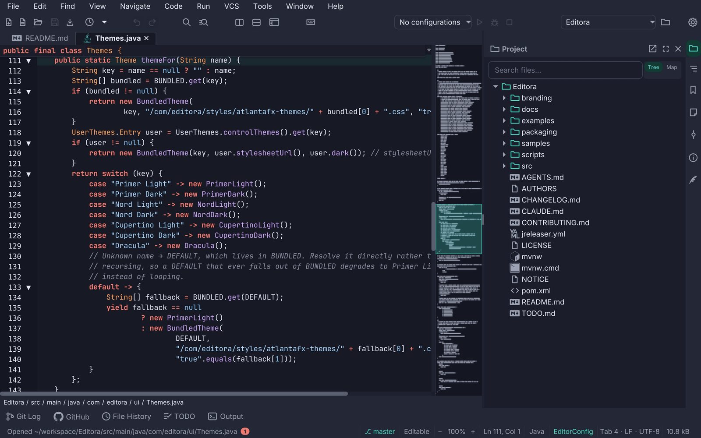
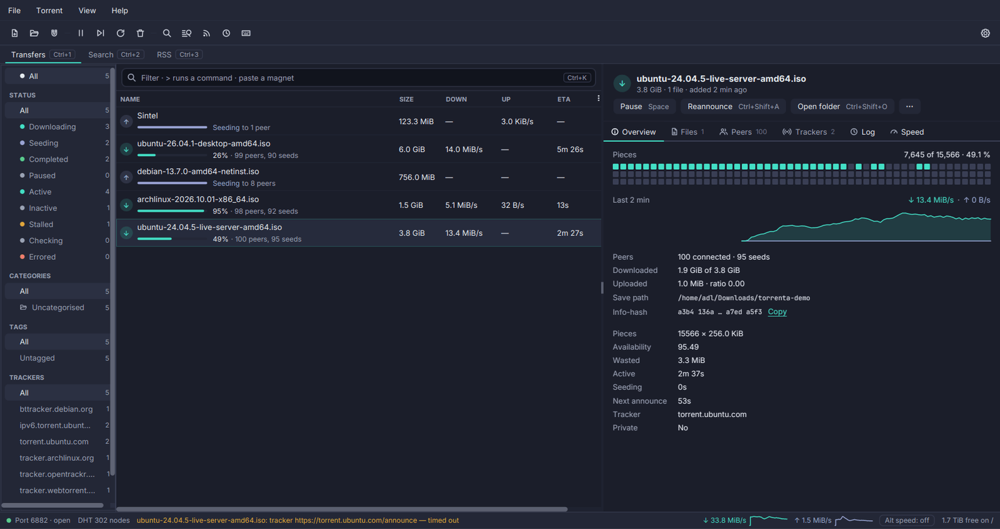

A window shows its documents in a **tab strip** and its tools in **panels** docked beside or under them. Both are
driven by commands, both remember their state, and both draw their chrome as one band with the toolbar, not as boxes
inside boxes. Reference: Editora's [`ui/TabHeaders.java`](https://github.com/adriandeleon/Editora/blob/master/src/main/java/com/editora/ui/TabHeaders.java) (the tab header), [`ui/ClosedTabs.java`](https://github.com/adriandeleon/Editora/blob/master/src/main/java/com/editora/ui/ClosedTabs.java), [`ui/Switcher.java`](https://github.com/adriandeleon/Editora/blob/master/src/main/java/com/editora/ui/Switcher.java),
[`ui/ToolWindowManager.java`](https://github.com/adriandeleon/Editora/blob/master/src/main/java/com/editora/ui/ToolWindowManager.java), [`ui/ToolWindowPanel.java`](https://github.com/adriandeleon/Editora/blob/master/src/main/java/com/editora/ui/ToolWindowPanel.java) and the `.tab-pane`, `.tool-stripe` and `.tool-window`
rules in [`app.css`](https://github.com/adriandeleon/Editora/blob/master/src/main/resources/com/editora/styles/app.css).

<svg class="pinicon" viewBox="0 0 24 24"><path d="M16 9V4h1c.55 0 1-.45 1-1s-.45-1-1-1H7c-.55 0-1 .45-1 1s.45 1 1 1h1v5c0 1.66-1.34 3-3 3v2h5.97v7l1 1 1-1v-7H19v-2c-1.66 0-3-1.34-3-3z"/></svg>pom.xml3
Main.java×1
• notes.md2
LICENSE4
Util.java
README.md5

<svg viewBox="0 0 24 24"><path d="M10 4H4c-1.1 0-2 .9-2 2v12c0 1.1.9 2 2 2h16c1.1 0 2-.9 2-2V8c0-1.1-.9-2-2-2h-8l-2-2z"/></svg><svg viewBox="0 0 24 24"><path d="M17 3H7c-1.1 0-2 .9-2 2v16l7-3 7 3V5c0-1.1-.9-2-2-2z"/></svg><svg viewBox="0 0 24 24"><path d="M3 13h2v-2H3v2zm0 4h2v-2H3v2zm0-8h2V7H3v2zm4 4h14v-2H7v2zm0 4h14v-2H7v2zM7 7v2h14V7H7z"/></svg>6

<svg viewBox="0 0 24 24"><path d="M10 4H4c-1.1 0-2 .9-2 2v12c0 1.1.9 2 2 2h16c1.1 0 2-.9 2-2V8c0-1.1-.9-2-2-2h-8l-2-2z"/></svg>Project▭⤢×7

▾ <b>editora</b>

▾ src

Main.java

Util.java

▸ docs

pom.xml

README.md

8

1

package com.editora;

2

3

public final class Main {

4

    static void main() {

5

        IO.println("ready");

6

    }

7

}

TerminalProblemsRunGit9

<ol class="anatomy">
<li>1<strong>Active tab.</strong> Its fill is the editor's own surface (<code>-editor-surface</code>) with a border on three sides and none at the bottom, so the tab opens into the editor instead of sitting on it. Title bold in <code>-color-fg-default</code>; the file-type glyph tints accent.</li>
<li>2<strong>Unsaved tab.</strong> A <code>•</code> before the name, amber (<code>-state-amber</code>, "not durable yet") and italic. Amber outranks the Git-status color: "you have not saved this" matters more than "this differs from HEAD".</li>
<li>3<strong>Pinned tab.</strong> A pin glyph and a bold title, kept at the front of the strip in pin order. Every bulk close (Others, All, Unmodified, Left, Right) skips it.</li>
<li>4<strong>Read-only tab.</strong> Muted and italic, echoing the status bar's Read-Only segment.</li>
<li>5<strong>Drag to reorder.</strong> The header is the drag handle and a snapshot of the whole tab follows the pointer; the dragged tab dims to 40 % and a 2 px accent line marks the edge it would land on (left half of a tab: before it; right half: after).</li>
<li>6<strong>Tool stripe.</strong> A 30 px rail of icon buttons, one per tool window, 8 px apart, on the subtle ground with no drawn edge. The open window's button is tinted; the one holding keyboard focus is tinted stronger. The first icon lines up with the editor's first line of text, not with the tab strip.</li>
<li>7<strong>Panel header.</strong> The window's glyph and title (14 px bold, muted) with float, maximize and close; the same size and glyph as its stripe button, so the two name the same thing. On the subtle ground, with no rule under it; when the panel holds focus the band tints accent-subtle and the title turns accent.</li>
<li>8<strong>The divider is the edge.</strong> The panel draws no frame: the SplitPane divider between it and the editor is the real, grabbable edge, and a hairline beside it would only double it. Its position is remembered.</li>
<li>9<strong>Bottom stripe.</strong> Its buttons carry a 14 px label beside the glyph, side by side; the open one is accent and bold.</li>
</ol>

## Window title

- **TABS-10 · SHOULD.** The window title names the file, the project and the app, with a `●` prefix for an unsaved
  file.
  - *Check (code):* the code that sets the stage title adds all three and the marker.
  - *Reference:* Editora [`MainController.updateWindowTitle`](https://github.com/adriandeleon/Editora/blob/master/src/main/java/com/editora/ui/MainController.java).

## Tabs

**Applies to:** an app with a tab strip.

- **TABS-01 · MUST.** Every tab operation is a command, so it can be bound to a chord, is in the palette and has a
  menu row: close, close others, close all, close unmodified, close to the left and right, pin, reopen closed, next
  and previous. The tab's [right-click menu](../menus/) lists the ones that act on a tab.
  - *Check (code):* each operation has a registered command id, and `TabContextMenu` lists the per-tab ones.
  - *Reference:* Editora [`ui/WindowCommandRegistrar.java`](https://github.com/adriandeleon/Editora/blob/master/src/main/java/com/editora/ui/WindowCommandRegistrar.java) (`buffer.close`, `buffer.closeOthers`, `buffer.closeAll`,
    `buffer.closeUnmodified`, `buffer.closeLeft`, `buffer.closeRight`, `buffer.togglePin`, `buffer.reopenClosed`,
    `buffer.next`), [`ui/TabContextMenu.java`](https://github.com/adriandeleon/Editora/blob/master/src/main/java/com/editora/ui/TabContextMenu.java). Editora has no previous-tab command yet.
- **TABS-02 · MUST.** The header is the title: the Tab's own text stays empty, and a graphic header carries the
  file-type glyph, the markers and the title in a label of its own (Editora's style class for it is `tab-title`).
  The tooltip is the full path.
  - *Why:* the graphic is what makes the header a drag handle and lets each state set its own color.
  - *Check (code):* every editor tab gets `setText("")` and a graphic with a `.tab-title` label; its tooltip is the
    file's path.
  - *Reference:* Editora [`ui/TabHeaders.java`](https://github.com/adriandeleon/Editora/blob/master/src/main/java/com/editora/ui/TabHeaders.java).
- **TABS-03 · MUST.** The one header carries the states: a `• ` prefix in amber italic for unsaved, a pin and bold for
  pinned, muted italic for read-only.
  - *Check (code):* `app.css` styles `.tab-header.dirty`, `.tab-header.pinned` and `.tab-header.read-only`
    `.tab-title`, and the header sets those classes.
  - *Reference:* Editora [`ui/TabHeaders.java`](https://github.com/adriandeleon/Editora/blob/master/src/main/java/com/editora/ui/TabHeaders.java), [`app.css`](https://github.com/adriandeleon/Editora/blob/master/src/main/resources/com/editora/styles/app.css); the Unsaved, Pinned and Read-only rows of the
    [Spec](#spec) table.
- **TABS-04 · MUST.** Bulk close skips pinned tabs: close others, close all, close unmodified and close to the left
  or right never close a pinned tab.
  - *Check (code):* `closeOtherTabs`, `closeAllTabs`, `closeUnmodifiedTabs` and `eligibleToLeft` /
    `eligibleToRight` all filter on the pinned set.
  - *Reference:* Editora [`ui/MainController.java`](https://github.com/adriandeleon/Editora/blob/master/src/main/java/com/editora/ui/MainController.java).
- **TABS-05 · MUST.** Pinning moves the tab to the end of the pinned group, unpinning to just after it.
  - *Check (code):* `togglePin` calls `moveToPinBoundary`.
  - *Reference:* Editora [`ui/MainController.java`](https://github.com/adriandeleon/Editora/blob/master/src/main/java/com/editora/ui/MainController.java) (`togglePin`), [`ui/EditorArea.java`](https://github.com/adriandeleon/Editora/blob/master/src/main/java/com/editora/ui/EditorArea.java) (`moveToPinBoundary`).
- **TABS-06 · MUST.** Reopen Closed Tab brings back the files whose tabs this window closed, newest first, bounded
  to twenty, a file listed once, with the caret where it was. In a terminal app the *tab* comes back (its shells,
  their directories, the pane arrangement, the names the user gave them, its place in the strip) and not the
  scrollback.
  - *Why:* the process is gone, and pretending otherwise would be worse than saying so.
  - *Check (test):* a unit test over the closed-tab list holds the order, the bound, the single entry per file and
    the caret.
  - *Reference:* Editora [`ui/ClosedTabs.java`](https://github.com/adriandeleon/Editora/blob/master/src/main/java/com/editora/ui/ClosedTabs.java), [`ClosedTabsTest`](https://github.com/adriandeleon/Editora/blob/master/src/test/java/com/editora/ui/ClosedTabsTest.java); `C-S-t` in the CUA keymap. Termina
    [`ui/ClosedTabs.java`](https://github.com/adriandeleon/Termina/blob/master/src/main/java/com/termina/ui/ClosedTabs.java), on `Ctrl+Shift+Z` (`Cmd+Z` on macOS).
- **TABS-07 · SHOULD.** Tabs reorder by dragging, with this feedback: the dragged header dimmed and an
  accent line on the edge where it will land.
  - *Check (by hand):* drag a tab along the strip and watch the landing edge.
  - *Reference:* Editora [`TabHeaders.enableTabDrag`](https://github.com/adriandeleon/Editora/blob/master/src/main/java/com/editora/ui/TabHeaders.java); Termina `installTabDrag` and the pure [`TabReorder.insertIndex`](https://github.com/adriandeleon/Termina/blob/master/src/main/java/com/termina/ui/TabReorder.java).
    In Termina a double-click on a tab renames it, and a pane dragged onto a tab joins it (the whole header
    outlined, `tab-drop-into`).
- **TABS-08 · SHOULD.** A tab shows its file's Git status in the Project tree's colors: modified accent, added
  green, untracked olive, renamed violet, deleted muted, conflict red. A read-only tab still shows it; an unsaved one
  shows amber.
  - *Check (test):* a test gives a changed file the same style class the Project tree uses.
  - *Reference:* Editora [`ui/TabGitStatus.java`](https://github.com/adriandeleon/Editora/blob/master/src/main/java/com/editora/ui/TabGitStatus.java), [`TabGitStatusTest`](https://github.com/adriandeleon/Editora/blob/master/src/test/java/com/editora/ui/TabGitStatusTest.java).
- **TABS-09 · SHOULD.** A switcher lists the open files in tab order: `C-x C-b` (Emacs) opens it, `C-n` / `C-p` or
  the arrows move, Enter or releasing Ctrl activates, `C-g` or Esc cancels, `C-d` or Backspace closes the
  highlighted file. Its width is fixed to the longest path on each open, so it never resizes while you move.
  - *Check (by hand):* open it with several tabs and move through it; the list keeps its width.
  - *Reference:* Editora [`ui/Switcher.java`](https://github.com/adriandeleon/Editora/blob/master/src/main/java/com/editora/ui/Switcher.java), [`SwitcherFxTest`](https://github.com/adriandeleon/Editora/blob/master/src/test/java/com/editora/ui/SwitcherFxTest.java).
- **TABS-12 · SHOULD.** A command hides the tab bar.
  - *Check (code):* a registered command toggles the tab header.
  - *Reference:* Editora `view.toggleTabBar`, `.tab-pane.no-tab-header` in [`app.css`](https://github.com/adriandeleon/Editora/blob/master/src/main/resources/com/editora/styles/app.css).

Termina's `HeaderBar` holds the menu bar and the window title
([`ui/TerminalWindow.java`](https://github.com/adriandeleon/Termina/blob/master/src/main/java/com/termina/ui/TerminalWindow.java), `buildHeaderBar`), and its tab strip is the row under it.

## Tool panels

**Applies to:** an app with tool panels: any panel the user shows and hides beside the content, such as a sidebar, a detail pane or an info panel, whether or not it sits on a stripe.

- **TABS-13 · MUST.** A command toggles each panel (`tool.<id>`: `M-1` … `M-0` in the Emacs keymap for ten of
  them), and where the app has a stripe, its button runs the same command.
  - *Check (code):* every tool window registers a `tool.<id>` command, and its stripe button, where there is one,
    runs it.
  - *Reference:* Editora [`ui/ToolWindowManager.java`](https://github.com/adriandeleon/Editora/blob/master/src/main/java/com/editora/ui/ToolWindowManager.java), [`keymaps/emacs.json`](https://github.com/adriandeleon/Editora/blob/master/src/main/resources/com/editora/keymaps/emacs.json).
- A panel's content is built on first use: [PERF-14](../performance/#perf-14).
- **TABS-15 · SHOULD.** Panel state is restored: which windows are open, on which side, in what order, hidden or shown,
  floating, and every divider position go to the session-state file ([SET-08](../settings/#set-08); Editora's is
  `workspace-state.json`) and come back on the next launch.
  - *Check (code):* the workspace state holds each of those, and the manager reads them back at startup.
  - *Reference:* Editora [`ui/ToolWindowManager.java`](https://github.com/adriandeleon/Editora/blob/master/src/main/java/com/editora/ui/ToolWindowManager.java), [`config/WorkspaceState.java`](https://github.com/adriandeleon/Editora/blob/master/src/main/java/com/editora/config/WorkspaceState.java).
- **TABS-16 · SHOULD.** Panels dock on three sides, left, right and bottom, and a side holds at most two windows
  stacked (Project over Structure, two consoles along the bottom).
  - *Why:* past that a side stops being a dock and becomes a list of slivers.
  - *Check (code):* the sides are an enum of three and the per-side limit is two.
  - *Reference:* Editora [`ToolWindow.Side`](https://github.com/adriandeleon/Editora/blob/master/src/main/java/com/editora/ui/ToolWindow.java), [`ToolWindowManager.MAX_PER_SIDE`](https://github.com/adriandeleon/Editora/blob/master/src/main/java/com/editora/ui/ToolWindowManager.java).
- **TABS-17 · SHOULD.** A panel re-docks by dragging its stripe button to another stripe, with the same
  dim-and-accent-line feedback as a tab; an empty stripe appears as a dashed accent drop zone for the duration of
  the drag.
  - *Check (by hand):* drag a stripe button to the opposite side.
  - *Reference:* Editora [`ui/ToolWindowDock.java`](https://github.com/adriandeleon/Editora/blob/master/src/main/java/com/editora/ui/ToolWindowDock.java), [`ToolWindowVisibilityTest`](https://github.com/adriandeleon/Editora/blob/master/src/test/java/com/editora/ui/ToolWindowVisibilityTest.java) (an empty stripe shows while
    dragging).
- **TABS-18 · SHOULD.** Panels float, maximize, resize and close from the keyboard, and at most one window is
  maximized at a time.
  - *Check (code):* floating, maximizing, resizing and closing a panel are each a registered command, so the
    palette runs them without the mouse; and maximizing a panel first restores the one that was maximized.
  - *Reference:* Editora `view.floatToolWindow` (palette only), `view.maximizeToolWindow` (`C-x f`),
    `view.closeFocusedToolWindow` (`C-x 0`), the resize commands (`C-x S-.`, `C-x S-,`, `C-x S-6`);
    [`ui/ToolWindowManager.java`](https://github.com/adriandeleon/Editora/blob/master/src/main/java/com/editora/ui/ToolWindowManager.java) keeps one `maximized` panel and restores it before it maximizes another.
- **TABS-19 · SHOULD.** Closing the panel that holds keyboard focus returns focus to where it was in the editor.
  - *Check (code):* the manager keeps the last editor focus owner and refocuses it on close.
  - *Reference:* Editora [`ToolWindowManager.focusEditor`](https://github.com/adriandeleon/Editora/blob/master/src/main/java/com/editora/ui/ToolWindowManager.java), a weak reference to the last editor focus owner.
- **TABS-20 · SHOULD.** Hidden is not unavailable: the user's show/hide choice for a stripe button is kept apart
  from a context-driven hide (the Commit window outside a Git repository), so the second never clobbers the first.
  - *Check (test):* a unit test holds that a button shows only when visible and available.
  - *Reference:* Editora [`ui/ToolWindowVisibility.java`](https://github.com/adriandeleon/Editora/blob/master/src/main/java/com/editora/ui/ToolWindowVisibility.java), [`ToolWindowVisibilityTest`](https://github.com/adriandeleon/Editora/blob/master/src/test/java/com/editora/ui/ToolWindowVisibilityTest.java).
- **TABS-21 · SHOULD.** A bottom window that is unusable at the default height asks for more on its first open;
  the user's own size wins afterwards.
  - *Check (test):* a test opens an output window taller while the others keep the side's size.
  - *Reference:* Editora [`ToolWindow.setFirstOpenShare`](https://github.com/adriandeleon/Editora/blob/master/src/main/java/com/editora/ui/ToolWindow.java), [`ToolWindowFirstOpenShareTest`](https://github.com/adriandeleon/Editora/blob/master/src/test/java/com/editora/ui/ToolWindowFirstOpenShareTest.java).
- **TABS-22 · SHOULD.** A stripe button badges a spinner while its window has something under way.
  - *Check (test):* an FX test badges a busy window's stripe button without changing its size.
  - *Reference:* Editora [`ToolWindow.busy`](https://github.com/adriandeleon/Editora/blob/master/src/main/java/com/editora/ui/ToolWindow.java), [`ToolWindowManagerFxTest`](https://github.com/adriandeleon/Editora/blob/master/src/test/java/com/editora/ui/ToolWindowManagerFxTest.java).
- **TABS-23 · SHOULD.** Panels follow the active document where they should: the Git UI follows the active tab's
  repository, the status bar's environment segment the active `.http` file, Local History the file whose tab menu
  opened it.
  - *Check (by hand):* switch between tabs from two repositories with the Git window open.
  - *Reference:* Editora [`ui/GitPathScope.java`](https://github.com/adriandeleon/Editora/blob/master/src/main/java/com/editora/ui/GitPathScope.java).

The other apps dock their panels the same way without a stripe. Torrenta's filter **sidebar** sits down the left or
the right of the list or nowhere, kept as two settings keys so hiding it keeps its side (`SidebarPlace`); its inner
edge drags to resize within readable bounds and a double-click resets it (`SidebarWidth`); the **detail pane** docks
under the list in two columns or beside it in one, from the View menu (`DetailPane`). Mirada's info panel opens on
the right and its thumbnail strip along the bottom or down the left side, each closed until its command asks for it
(`ThumbnailStrip.place`). Termina splits a tab into **panes** instead: a pane is picked up with a drag while
`Ctrl+Alt+Shift` (`Cmd+Option+Shift` on macOS) is held, since every smaller chord is spoken for (`PaneDrag`), and a
maximized pane wears a "Pane 2 of 3" badge so the others are known to still be there.

## Spec

| Property | Value | Reference |
|---|---|---|
| Tab strip | `-color-bg-subtle`, padding 3 10 0 10, tabs bottom-aligned so the active one touches the editor; no bottom rule | `.tab-pane > .tab-header-area` |
| Tab | Transparent, square corners, padding 2 11 3 11; hover `-color-bg-inset` | `.headers-region > .tab` |
| Active tab | Two background layers: `-color-border-default` outside, `-editor-surface` inset 1 1 0 1; title bold `-color-fg-default`; glyph `-color-accent-fg` | `.tab:selected` |
| Title | Inter 14 px, `-color-fg-muted`, in a graphic label; the full path as tooltip | `.tab .tab-title`, `TabHeaders.tooltip` |
| Unsaved | `• ` prefix, `-state-amber`, italic | `.tab-header.dirty .tab-title` |
| Pinned | `Icons.pin()` in the header, bold; first in the strip | `.tab-header.pinned`, `togglePin` |
| Read-only | `-color-fg-muted`, italic | `.tab-header.read-only` |
| Drag | Dragged header at 0.4 opacity; 2 px `-color-accent-emphasis` on the landing edge | `.tab-dragging`, `.tab-drop-before`, `.tab-drop-after` |
| Closed tabs | Twenty, newest first, one entry per file, with the caret | `ClosedTabs.DEFAULT_CAPACITY` |
| Switcher | 26 px rows, 12 visible, width fixed per open | `Switcher.CELL_HEIGHT`, `MAX_VISIBLE` |
| Tool stripe | 30 px wide, `-color-bg-subtle`, 8 px spacing, no edge; buttons min 24, padding 9 5, radius 6 | `.tool-stripe`, `.tool-stripe-button` |
| Stripe states | Open: `-color-accent-subtle` fill, accent glyph. Focused window: `-state-accent-hover` | `:open`, `:tw-active` |
| Bottom stripe | Label 14 px beside the glyph, padding 3 8; open = accent, bold | `.tool-stripe-horizontal .tool-stripe-button` |
| Panel | `-color-bg-subtle` ground, radius 0 0 8 8, no border | `.tool-window` |
| Panel header | Padding 6 6 6 12, radius 7 7 0 0, no rule under it; title 14 px bold muted with the window's glyph; active: `-color-accent-subtle` band, accent title | `.tool-window-header`, `.tool-window:active` |
| Panel content | `-color-bg-default`, padding 8; its tree or list draws no frame of its own | `.tool-window-content` |
| Per side | Two windows at most, stacked in an inner SplitPane | `MAX_PER_SIDE` |
| Persisted | Open state, sides, order, visibility, floating windows, divider positions | `WorkspaceState` in `workspace-state.json` |
