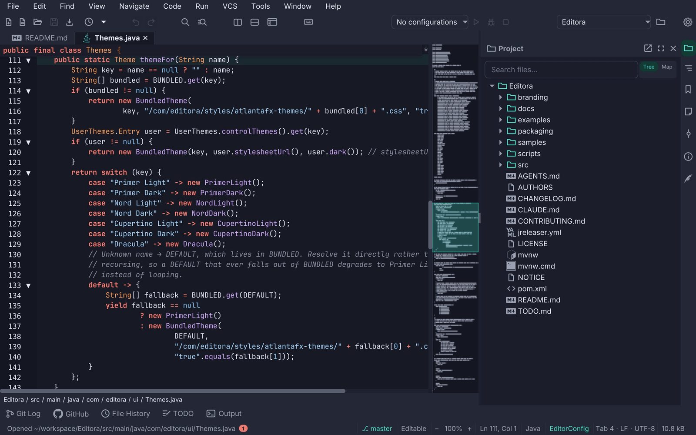

A toolbar is the fast path to commands that are also in the [menus](../menus/) and the
[Command Palette](../templates/command-palette/): nothing lives only on it. Every button is a command, so its icon,
title and chord come from the registry and the active keymap. Reference: Editora's [`ui/Icons.java`](https://github.com/adriandeleon/Editora/blob/master/src/main/java/com/editora/ui/Icons.java) (`button`,
`toolbarButton`, `name`), [`ui/ToolbarCoordinator.java`](https://github.com/adriandeleon/Editora/blob/master/src/main/java/com/editora/ui/ToolbarCoordinator.java) (the customizable bar), [`ui/WindowChromeCoordinator.java`](https://github.com/adriandeleon/Editora/blob/master/src/main/java/com/editora/ui/WindowChromeCoordinator.java)
(`collapseToolbarSeparators`), [`ui/ToolWindowManager.java`](https://github.com/adriandeleon/Editora/blob/master/src/main/java/com/editora/ui/ToolWindowManager.java) (the tool window stripes) and the `.tool-bar`,
`.toolbar-button`, `.tool-stripe-button` and `.tooltip` rules in [`app.css`](https://github.com/adriandeleon/Editora/blob/master/src/main/resources/com/editora/styles/app.css).

<svg width="0" height="0" style="position:absolute" aria-hidden="true"><defs>
<symbol id="tb-new" viewBox="0 0 24 24"><path d="M6 2c-1.1 0-1.99.9-1.99 2L4 20c0 1.1.89 2 1.99 2H18c1.1 0 2-.9 2-2V8l-6-6H6zm7 7V3.5L18.5 9H13z"/></symbol>
<symbol id="tb-open" viewBox="0 0 24 24"><path d="M20 6h-8l-2-2H4c-1.1 0-1.99.9-1.99 2L2 18c0 1.1.9 2 2 2h16c1.1 0 2-.9 2-2V8c0-1.1-.9-2-2-2zm0 12H4V8h16v10z"/></symbol>
<symbol id="tb-save" viewBox="0 0 24 24"><path d="M17 3H5c-1.11 0-2 .9-2 2v14c0 1.1.89 2 2 2h14c1.1 0 2-.9 2-2V7l-4-4zm-5 16c-1.66 0-3-1.34-3-3s1.34-3 3-3 3 1.34 3 3-1.34 3-3 3zm3-10H5V5h10v4z"/></symbol>
<symbol id="tb-undo" viewBox="0 0 24 24"><path d="M12.5 8c-2.65 0-5.05.99-6.9 2.6L2 7v9h9l-3.62-3.62c1.39-1.16 3.16-1.88 5.12-1.88 3.54 0 6.55 2.31 7.6 5.5l2.37-.78C21.08 11.03 17.15 8 12.5 8z"/></symbol>
<symbol id="tb-redo" viewBox="0 0 24 24"><path d="M18.4 10.6C16.55 8.99 14.15 8 11.5 8c-4.65 0-8.58 3.03-9.96 7.22L3.9 16c1.05-3.19 4.05-5.5 7.6-5.5 1.95 0 3.73.72 5.12 1.88L13 16h9V7l-3.6 3.6z"/></symbol>
<symbol id="tb-find" viewBox="0 0 24 24"><path d="M15.5 14h-.79l-.28-.27C15.41 12.59 16 11.11 16 9.5 16 5.91 13.09 3 9.5 3S3 5.91 3 9.5 5.91 16 9.5 16c1.61 0 3.09-.59 4.23-1.57l.27.28v.79l5 4.99L20.49 19l-4.99-5zm-6 0C7.01 14 5 11.99 5 9.5S7.01 5 9.5 5 14 7.01 14 9.5 11.99 14 9.5 14z"/></symbol>
<symbol id="tb-palette" viewBox="0 0 24 24"><path d="M20 4H4c-1.1 0-2 .9-2 2v12c0 1.1.9 2 2 2h16c1.1 0 2-.9 2-2V6c0-1.1-.9-2-2-2zm0 14H4V8h16v10zm-2-1h-6v-2h6v2zM7.5 17l-1.41-1.41L8.67 13l-2.59-2.59L7.5 9l4 4-4 4z"/></symbol>
<symbol id="tb-settings" viewBox="0 0 24 24"><path d="M3 17v2h6v-2H3zM3 5v2h10V5H3zm10 16v-2h8v-2h-8v-2h-2v6h2zM7 9v2H3v2h4v2h2V9H7zm14 4v-2H11v2h10zm-6-4h2V7h4V5h-4V3h-2v6z"/></symbol>
</defs></svg>

## Anatomy

<svg><use href="#tb-new"/></svg>
<svg><use href="#tb-open"/></svg>
<svg><use href="#tb-save"/></svg>1
2
<svg><use href="#tb-undo"/></svg>
<svg><use href="#tb-redo"/></svg>

<svg><use href="#tb-find"/></svg>4
<svg><use href="#tb-palette"/></svg>
Project: Editora ▾<svg><use href="#tb-settings"/></svg>6

Main.javapom.xml5

Save (C-x C-s)3

<ol class="anatomy">
<li>1<strong>Icon button</strong>, 28 px: padding 3 × 5, radius 4, no border, the glyph in <code>-color-fg-muted</code> and <code>-color-fg-default</code> under the pointer. It has a name even though it shows none: the same string is its tooltip and its accessible text.</li>
<li>2<strong>Group gap.</strong> A vertical <code>Separator</code> node whose line is transparent: its padding is what separates the groups. No drawn rule.</li>
<li>3<strong>Tooltip.</strong> The command's title and its chord in the active keymap, "Save (C-x C-s)". A popup window with the menus' radius 8.</li>
<li>4<strong>Open toggle.</strong> A button whose overlay is showing (Find, the palette, a split) wears <code>:open</code>: an accent-subtle fill and the glyph in the accent color. Simple mode's own button does the same while the mode is on.</li>
<li>5<strong>One band.</strong> The menu bar, the toolbar and the tab strip sit on <code>-color-bg-subtle</code> with no hairline between them; spacing does the grouping.</li>
<li>6<strong>Pinned tail.</strong> The run configuration controls, the project picker, the Simple mode toggle and Settings live in their own container beside the <code>ToolBar</code>, so a narrow window overflows the icons (which are all in the menus too) and never the tail.</li>
</ol>

## Spec

| Property | Value | Reference |
|---|---|---|
| Button | 28 px high: padding 3 × 5, radius 4, style classes `button-icon flat toolbar-button`; every control on the bar is pinned to 28 px, combos and menu buttons included | `.toolbar-button`, `.tool-bar .combo-box-base` |
| Bar | Padding 5 1 2 6 (asymmetric: the tab strip below adds its own inset); 18 px font for the bar's own labels, controls inside it at 14 px; `-color-bg-subtle`, no rule above or below | `.tool-bar`, `.menu-bar, .tool-bar` |
| Icon | The command's glyph, 17 px drawn (Torrenta) or a kit glyph at the toolbar scale (Editora); `-color-fg-muted`, `-color-fg-default` on hover, `-color-accent-fg` while `:open` | `Icons`, `.toolbar-icon`, `.icon-line`, `.button:open` |
| Group gap | A vertical `Separator` with its line transparent; its 0.75 em padding is the gap | `.tool-bar .separator:vertical > .line` |
| Tail | Its own container (`.toolbar-tail`), same insets and font as the bar, never overflowed | `ToolbarOverflowFxTest` |
| Tooltip | `<title> (<chord>)`, the chord from `KeymapManager.displayChord`; only the title when unbound; radius 8 like the menus | `ToolbarCoordinator.buildExtraButton`, `ToolWindowManager.tooltipFor`, `.tooltip` |
| Stripe button | A toolbar button on the tool window rail: min 24 px, padding 9 × 5, radius 6, 8 px apart on a 30 px rail; the same muted, hover and `:open` colors; the bottom stripe adds a 14 px label | `.tool-stripe-button`, `ToolWindowManager.register` |
| Customize mode | The bar tinted `-color-accent-subtle`, a move cursor, the dragged button at 0.4 opacity, a 2 px accent insertion line on the drop target's edge | `.tool-bar.toolbar-customizing`, `.toolbar-drop-before` |

## Rules

- **TBAR-01 · MUST.** Every icon-only button has a name: one helper sets its tooltip and its accessible text from
  the same string.
  - *Why:* a hand-rolled button gets the tooltip and forgets the name, which is how Editora once had seven copies
    of the helper drifting apart, and how a screen reader comes to announce "button".
  - *Check (code):* every icon-only `Button` is built by `Icons.button` or `Icons.toolbarButton`, or passed to
    `Icons.name`; none calls `setTooltip` without `setAccessibleText`.
  - *Reference:* Editora [`ui/Icons.java`](https://github.com/adriandeleon/Editora/blob/master/src/main/java/com/editora/ui/Icons.java) (`button`, `toolbarButton`, `name`); Torrenta's copy of all three; Mirada's
    [`ui/Icons.java`](https://github.com/adriandeleon/Mirada/blob/main/src/main/java/com/mirada/ui/Icons.java) (`button`, `name`), which sets the tooltip and the accessible text from the command's title;
    Termina's [`ui/IconNames.java`](https://github.com/adriandeleon/Termina/blob/master/src/main/java/com/termina/ui/IconNames.java) (`name`), which binds both to one string. nux sets both by hand on its "?" button
    for the same reason. Editora doesn't yet on its main toolbar:
    [`WindowToolbar.setupButton`](https://github.com/adriandeleon/Editora/blob/master/src/main/java/com/editora/ui/WindowToolbar.java) and [`ToolbarCoordinator.buildExtraButton`](https://github.com/adriandeleon/Editora/blob/master/src/main/java/com/editora/ui/ToolbarCoordinator.java) set the tooltip only.
- **TBAR-03 · MUST.** The tooltip names the command and its chord, read from the active keymap and never typed into
  a string: "Save (C-x C-s)". An unbound command shows its title alone.
  - *Check (code):* the tooltip is built from the command's title and the keymap's display chord for its id, and is
    rebuilt when the keymap changes.
  - *Reference:* Editora [`WindowToolbar.setupButton`](https://github.com/adriandeleon/Editora/blob/master/src/main/java/com/editora/ui/WindowToolbar.java) (`refreshToolbarTooltips`), [`ToolbarCoordinator.buildExtraButton`](https://github.com/adriandeleon/Editora/blob/master/src/main/java/com/editora/ui/ToolbarCoordinator.java)
    and [`ToolWindowManager.tooltipFor`](https://github.com/adriandeleon/Editora/blob/master/src/main/java/com/editora/ui/ToolWindowManager.java); Torrenta's `toolbar.withChord`. Mirada's [`Icons.tooltip`](https://github.com/adriandeleon/Mirada/blob/main/src/main/java/com/mirada/ui/Icons.java) builds the same
    "label (key)" form with the chord from the keymap in use ([`Command.chord`](https://github.com/adriandeleon/Mirada/blob/main/src/main/java/com/mirada/ui/Command.java)), and [`TitleBar.relabel`](https://github.com/adriandeleon/Mirada/blob/main/src/main/java/com/mirada/ui/TitleBar.java) names the
    header buttons again when the keys change; Termina's [`IconNames.withChord`](https://github.com/adriandeleon/Termina/blob/master/src/main/java/com/termina/ui/IconNames.java) takes the chord from its keymap too.
- **TBAR-06 · SHOULD.** One chrome band: the menu bar, the toolbar and the tab strip share `-color-bg-subtle` and
  draw no hairline between them; the breadcrumb, the bottom stripe and the status bar do the same at the bottom.
  - *Why:* three rules within forty pixels read as clutter, not structure.
  - *Check (by hand):* look at the top and the bottom of a window in a light and a dark theme for a line between
    the bands.
  - *Reference:* Editora [`app.css`](https://github.com/adriandeleon/Editora/blob/master/src/main/resources/com/editora/styles/app.css) (`.menu-bar, .tool-bar`).

## The toolbar

**Applies to:** an app with a toolbar.

- **TBAR-02 · MUST.** Toolbar buttons stay out of the Tab order: the command, the palette and the menus reach the
  action, and Tab is for the content. The [keyboard page](../keyboard/#focus-and-accessibility) has the general
  focus rules.
  - *Check (code):* every button on a toolbar is built by `Icons.toolbarButton` or calls
    `setFocusTraversable(false)`.
  - *Reference:* Editora [`Icons.toolbarButton`](https://github.com/adriandeleon/Editora/blob/master/src/main/java/com/editora/ui/Icons.java), used by the tool window toolbars (Git, Diff, Markdown lint); Termina's
    search bar buttons; Mirada's header buttons. Editora doesn't yet on its main toolbar: the buttons built by
    [`WindowToolbar.setupButton`](https://github.com/adriandeleon/Editora/blob/master/src/main/java/com/editora/ui/WindowToolbar.java) and [`ToolbarCoordinator.buildExtraButton`](https://github.com/adriandeleon/Editora/blob/master/src/main/java/com/editora/ui/ToolbarCoordinator.java), and the stripe buttons, take focus.
- **TBAR-04 · SHOULD.** Groups are separated by spacing, not rules: keep the `Separator` nodes (their padding is the
  gap) and make the line transparent.
  - *Check (code):* the stylesheet sets `.tool-bar .separator:vertical > .line` to a transparent border.
  - *Reference:* Editora [`app.css`](https://github.com/adriandeleon/Editora/blob/master/src/main/resources/com/editora/styles/app.css). Torrenta's separators still draw a line.
- **TBAR-05 · SHOULD.** Hiding a button group (Simple mode, a build tool that is not detected) hides the leading,
  trailing and doubled separators it leaves, so no gap stands on its own, and shows them all again when nothing is
  hidden.
  - *Check (code):* every change to a toolbar item's visibility ends in one pass over the bar's separators.
  - *Reference:* Editora [`WindowChromeCoordinator.collapseToolbarSeparators`](https://github.com/adriandeleon/Editora/blob/master/src/main/java/com/editora/ui/WindowChromeCoordinator.java).
- **TBAR-07 · SHOULD.** A toggle looks on while it is on: a button that opens an overlay (Find, the palette, a split)
  and the Simple mode button carry the `:open` pseudo-class while their state holds, so the way back out does not
  look like the way in.
  - *Check (code):* each such button sets a pseudo-class from its state, and the stylesheet gives that state a fill.
  - *Reference:* Editora [`MainController.OPEN`](https://github.com/adriandeleon/Editora/blob/master/src/main/java/com/editora/ui/MainController.java), [`WindowChromeCoordinator`](https://github.com/adriandeleon/Editora/blob/master/src/main/java/com/editora/ui/WindowChromeCoordinator.java) (Simple mode), `.button:open` in
    [`app.css`](https://github.com/adriandeleon/Editora/blob/master/src/main/resources/com/editora/styles/app.css). Torrenta uses `:on` for Simple mode and `:active` for the alternative speed limit.
- **TBAR-08 · MUST.** The toolbar never holds the only way to an action: every icon in the customizable cluster is
  also in the menus and the palette.
  - *Why:* that is what makes it safe to hide icons in a narrow window and to let the user remove them.
  - *Check (code):* every toolbar catalog item runs a registered command that a menu also lists.
  - *Reference:* Editora [`toolbar/ToolbarCatalog.java`](https://github.com/adriandeleon/Editora/blob/master/src/main/java/com/editora/toolbar/ToolbarCatalog.java): each item carries the `commandId` it runs; the only items
    without one are declared special widgets, such as the Recent menu button ([`ToolbarCatalogTest`](https://github.com/adriandeleon/Editora/blob/master/src/test/java/com/editora/toolbar/ToolbarCatalogTest.java)).
- **TBAR-09 · MAY.** The toolbar is customizable: the user reorders, removes and restores its buttons, and the
  layout is saved in Settings and shared by every window.
  - *Check (test):* FX tests drive customize mode, reorder and removal.
  - *Reference:* Editora [`ui/ToolbarCoordinator.java`](https://github.com/adriandeleon/Editora/blob/master/src/main/java/com/editora/ui/ToolbarCoordinator.java), [`ToolbarCustomizeModeFxTest`](https://github.com/adriandeleon/Editora/blob/master/src/test/java/com/editora/ui/ToolbarCustomizeModeFxTest.java), [`ToolbarCustomizationFxTest`](https://github.com/adriandeleon/Editora/blob/master/src/test/java/com/editora/ui/ToolbarCustomizationFxTest.java).
    The cluster is a list of catalog ids in Settings (`toolbarLayout`), sanitized on read. The bar's right-click
    menu offers *Customize Toolbar…* (or *Done*), *Configure…* (the Settings page) and *Restore Default*. In
    customize mode the bar tints, buttons drag to reorder with an accent insertion line and drag off the bar to
    remove; Escape leaves the mode.
- The toolbar's right-click menu follows the rules for every right-click menu:
  [MENU-06](../menus/#menu-06) and [MENU-07](../menus/#menu-07).

## Tool window stripes

**Applies to:** an app with tool window stripes.

- **TBAR-12 · SHOULD.** Tool window stripes are toolbars: a stripe button is built like a toolbar button, with the
  chord in its tooltip, accessible text bound to the window's title, and a right-click menu with *Open in Split* and
  *Hide*.
  - *Check (code):* the stripe button's tooltip comes from the same title-and-chord format, and its
    `accessibleTextProperty` is bound to the tool window's title.
  - *Reference:* Editora [`ToolWindowManager.register`](https://github.com/adriandeleon/Editora/blob/master/src/main/java/com/editora/ui/ToolWindowManager.java), `tooltipFor`.
- **TBAR-13 · SHOULD.** The right stripe's first icon lines up with the editor's first line of text, not with the
  tab strip.
  - *Check (test):* an FX test compares the first stripe button's top with the editor's first line.
  - *Reference:* Editora [`ToolWindowStripeAlignmentFxTest`](https://github.com/adriandeleon/Editora/blob/master/src/test/java/com/editora/ui/ToolWindowStripeAlignmentFxTest.java).

## In the apps

- **Editora**: the customizable cluster, the pinned tail, the stripes.
- **Torrenta**: the same [`Icons.toolbarButton`](https://github.com/adriandeleon/torrenta/blob/master/src/main/java/com/torrenta/ui/Icons.java) and [`Icons.name`](https://github.com/adriandeleon/torrenta/blob/master/src/main/java/com/torrenta/ui/Icons.java), 32 px buttons, Simple mode as `:on`; its separators
  still draw a line.
- **Mirada**: a `HeaderBar` title bar with flat icon buttons around the file name, stroked symbolic icons in the text
  color, tooltips of the form "label (key)" with the key read from the keymap; [`Icons.button`](https://github.com/adriandeleon/Mirada/blob/main/src/main/java/com/mirada/ui/Icons.java) and [`Icons.name`](https://github.com/adriandeleon/Mirada/blob/main/src/main/java/com/mirada/ui/Icons.java) set
  each button's tooltip and accessible text together, and the buttons are out of the Tab order.
- **Termina**: no main toolbar (the tab strip is the row under the menu bar); the search bar's buttons are 24 × 22
  flat icons, their tooltips and accessible text set from one string by [`ui/IconNames.java`](https://github.com/adriandeleon/Termina/blob/master/src/main/java/com/termina/ui/IconNames.java), out of the Tab order.

