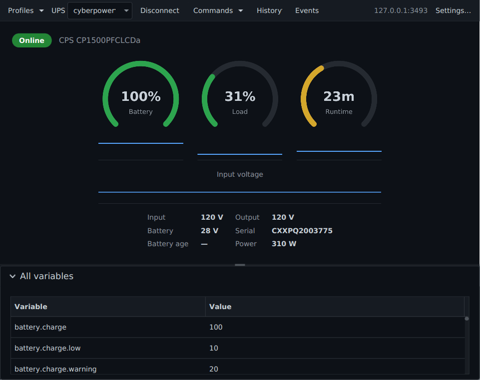

An app whose work goes on without its window (Torrenta's transfers, Modula's radio, nux's monitoring) lives behind a
tray icon. For such an app everything here is a MUST; for the others (Editora, Termina, Mirada) a tray is MAY, and none
has one. Reference: Torrenta's `tray/` package (`Trays`, `TorrentaTray`, `SniTray`, `AwtTray`, `TrayIconRenderer`,
`SniMenuModel`), `os/Autostart` with `os/AutostartSpec`, and `automation/Notifiers`. Modula's and nux's `tray/` packages
are the same code with their own menus; nux's `TrayController` holds the close policy.

## The icon and its menu

<svg viewBox="0 0 24 24"><circle cx="12" cy="12" r="2.2"/><path d="M7.8 16.2a6 6 0 0 1 0-8.4M16.2 7.8a6 6 0 0 1 0 8.4M5 19a10 10 0 0 1 0-14M19 5a10 10 0 0 1 0 14"/></svg>112:48

Listening · 101.5 MHz2

Stop3

Record

Show Modula4

Quit5

<ol class="anatomy">
<li>1<strong>The icon</strong> is the app's own mark, recoloured by state, not a badge and never the number it stands for ("101.5" at 22 px is unreadable and lies by rounding). Torrenta's arrow is teal while something downloads, muted when nothing does, red on an error; Modula's broadcast glyph amber while listening, ink when stopped, coral on a fault; nux shows the charge number coloured by severity, grey when disconnected.</li>
<li>2<strong>Status line</strong>, disabled, first. It is also the tooltip, because GNOME's AppIndicator extension renders a StatusNotifierItem's menu but not its tooltip, so the menu is the one place the live figures are sure to appear.</li>
<li>3<strong>The main actions</strong> the window would offer, so the common jobs need no window: Listen becomes Stop, Record is greyed (not hidden) until the receiver runs; Torrenta's menu has none; nux offers Connect, Switch UPS and the instant commands, which still go through the app's confirmation.</li>
<li>4<strong>Show <em>App</em></strong> brings the window back, as a left click on the icon does.</li>
<li>5<strong>Quit</strong>, after a separator. The only way to end the program apart from File → Quit and the system's Quit.</li>
</ol>

Tray menus are text only: AWT's `PopupMenu` and dbusmenu show no item icons, so the [menu rules](../menus/) about
icons and chords do not apply here. The order does.

### Spec

| Property | Value | Reference |
|---|---|---|
| Linux backend | A StatusNotifierItem on the session bus, found through `org.kde.StatusNotifierWatcher`: KDE natively, GNOME with the AppIndicator extension, X11 and Wayland alike. No AWT fallback: the XEmbed tray GNOME dropped in 3.26 and Wayland never had | `SniTray`, `StatusNotifierWatcher`, `Trays.create` |
| Windows and macOS | AWT `SystemTray`, every mutation on the EDT, a multi-resolution image so a HiDPI tray picks a crisp variant | `AwtTray` |
| Created | Off the FX thread, after the first frame (D-Bus and AWT can block); the outcome is a tray or the one-line reason there is none | `Trays.Attempt`, `MainWindow.installTray` |
| Icon | Pure Java2D from the branding SVG's geometry, at each size the backend asks for, so the panel entry and the dock entry are one mark | `TrayIconRenderer`, `TrayDisplay` |
| Attention | A state that needs a person sets the SNI status `NeedsAttention`; otherwise `Active` | `SniTray.update` |
| Left click | Shows the window: SNI `Activate` and `SecondaryActivate`, a single primary click on the AWT icon | `SniTray.Item`, `AwtTray` |
| Right click | The menu; the host pulls it from the item's `Menu` property | `SniMenu`, `SniMenuModel` |
| Updates | Only when the value-equal snapshot changed: a repaint crosses a process boundary on Linux. Torrenta polls once a second, Modula nine times | `TrayDisplay`, `MainWindow.pushTray` |
| Package | Free of JavaFX: it takes callbacks, and the window marshals them onto the FX thread | `TorrentaTray` |

## Behaviour

- **MUST. Fully usable without a tray.** No icon is a normal outcome (stock GNOME has no StatusNotifier host), not an
  error. The reason is said where the person will look, because the bug they actually hit is silence: the box says
  close to tray, and closing quits. Torrenta's status bar says "No tray icon (…); closing the window quits Torrenta";
  Modula's says closing the window will quit it (`RadioPane.reportNoTray`).
- **MUST. Closing the window hides it only while an icon is actually up and the setting says so.** Both are read at
  close time, not at startup: the checkbox can change while the window is open, and hiding a window that leaves no icon
  behind is how a program becomes unreachable. Otherwise a close quits. `Platform.setImplicitExit(false)` is set only
  once a tray exists, and turning the tray off brings a hidden window back (`MainWindow.setOnCloseRequest`, Modula's
  `installCloseBehaviour`, nux's `TrayController.closeHidesWindow` and `updateImplicitExit`).
- **MUST. Quit is explicit** and one path: the tray's Quit, File → Quit and the system's Quit all run the same method,
  which closes open dialogs first (quitting from inside a nested event loop aborted the JVM) and saves the window
  geometry (`MainWindow.quit`).
- **`--minimized` comes up behind the icon.** The window is never shown until the tray attempt has answered; if no icon
  comes, the window is shown after all, so a start at login can never leave a program with no way back. With the tray
  setting off, Torrenta starts minimised instead and nux ignores the flag (`MainWindow.show`, nux's `App`).
- **Start at login writes the OS's own entry, and nothing else.** An XDG autostart entry in `~/.config/autostart`
  (quoted `Exec`, `StartupWMClass` matching the installed launcher, `X-KDE-autostart-after=panel` so a tray host is up
  first), a LaunchAgent in `~/Library/LaunchAgents`, the `HKCU\…\Run` value on Windows (read together with
  `StartupApproved`, where Task Manager keeps the person's "off"). The entry is the one truth: turned off in GNOME
  Tweaks, KDE's Autostart page or Task Manager, the box shows unticked. The installers never do it, since they run for
  every account. Only an installed package has anything to start (`jpackage.app-path`); a run from source says so. The
  one setting beside it is *start behind the tray icon*, written into the entry as `--minimized`. Every call may block
  on the file system or `reg.exe`: never on the FX thread. The exact bytes are a pure, tested spec (`Autostart`,
  `AutostartSpec`; nux's design).
- **Desktop notifications go through one `Notifier`**: `notify-send` on Linux (nux and Termina fall back to `gdbus`
  against the freedesktop service), `osascript` with `display notification` on macOS, a PowerShell toast on Windows
  (Torrenta ships `toast.ps1`; nux raises it through the tray icon, which the `Notifier` keeps as the last resort on
  every platform). Each is a short program run with the title and message as arguments, never as part of a script, so
  text from a torrent name or a remote shell cannot run anything. Off the FX thread, bounded to a few seconds; a
  failure is logged and never breaks the app (`Notifiers`, `ProcessNotifier`, nux's `service/Notifier`, Termina's
  `DesktopNotifier`).
- **Notify for what happened while the window was away**, one switch per event, few on by default: Torrenta notifies
  on added, finished, seeding done, error and updated, with only *finished* on at first, and a Test button in Settings
  shows one now; nux notifies on power events with a rule per UPS; Termina and Editora relay a program's own OSC 9 and
  OSC 777 notifications. The in-app status already shows the state, so a notification is never the only place it is
  said.
- **A dock badge (MAY).** Torrenta puts the download rate on the macOS dock icon through AWT's `Taskbar` and a count
  on a Linux launcher that honours Unity's `LauncherEntry` signal (KDE, Dash to Dock); nothing on Windows, whose
  taskbar badges only AWT's own windows. Cleared when nothing downloads; its own switch (`os/Badges`, `BadgeState`).
- **A second launch brings the hidden window forward.** The [single-instance hand-off](../command-line/) shows a
  window hidden to the tray before it opens what it was given (`MainWindow.showFromTray`).
- **AWT stays headless unless the tray needs it.** Linux never needs it; Windows and macOS lift the guard only when the
  tray setting is on, decided in `main` (`Trays.usesAwt`, `os.AwtUse`). A tray turned on later says "restart to show
  the tray icon" rather than "unsupported".

## Settings copy

| Key | English |
|---|---|
| `ui.tray` | A tray (menu-bar) icon with the rates and a menu; on by default |
| `ui.closeToTray` | Closing the window keeps Torrenta in the tray. *The torrents go on; the tray icon's Show Torrenta brings the window back, its Quit ends the program, as does Quit in the File menu. Without a tray, closing quits.* On by default; nux greys it while the tray is off |
| (the OS entry) | Start Torrenta when you log in. *Adds Torrenta to your login items: an entry in ~/.config/autostart on Linux, a LaunchAgent on macOS, the Run key on Windows. Turned off in the system's own settings, it shows unticked here. Only for an installed Torrenta, not a run from source.* |
| `os.autostartInTray` | Start behind the tray icon. *At login Torrenta comes up behind its tray icon instead of as a window, and minimised where there is no tray. `torrenta --minimized` does the same by hand.* |
| `notify.<event>` | One switch per event; `notify.finished` on by default |
| `status.noTray` | No tray icon ({reason}); closing the window quits {app} |

## In the apps

